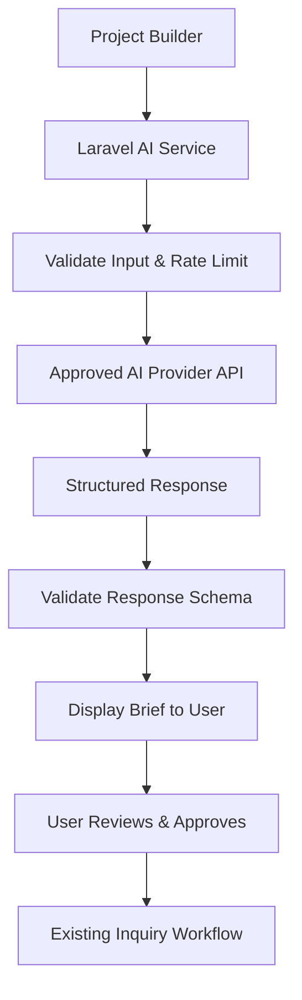
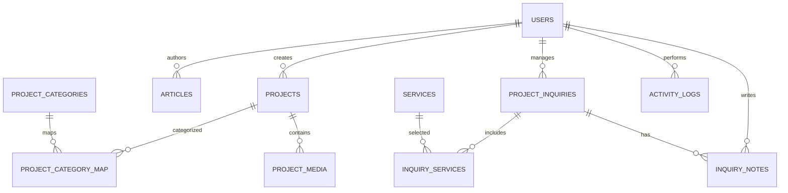
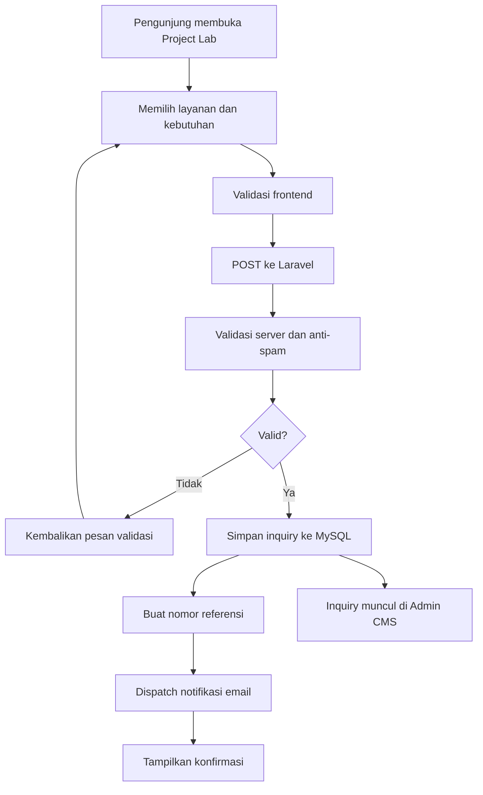

==================== ITEM 42 (len 102) ====================

https://ogimg.chatgpt.com/conversation/6adf435a-496c-83ec-aea8-ecb5a1c5707b/response_multicolor_v1.png

==================== ITEM 199 (len 4446) ====================

## 12. Roadmap implementasi

Estimasi berikut merupakan perencanaan awal untuk satu developer berpengalaman atau tim kecil, dengan materi brand dan konten tersedia secara bertahap.

<box border radius="xl" padding={3} gap={3}>
  {#each [{phase:"01",name:"Foundation & Design System",duration:"Minggu 1",tasks:"Setup Laravel, database, struktur proyek, design tokens, komponen UI, dan wireframe."},{phase:"02",name:"Public Website",duration:"Minggu 2–3",tasks:"Homepage, About, Services, Works, detail proyek, Insights, Contact, dan Legal."},{phase:"03",name:"CMS & Lead Management",duration:"Minggu 4–5",tasks:"Autentikasi admin, CRUD konten, media, Project Builder, inquiry pipeline, dan email."},{phase:"04",name:"Immersive Experience",duration:"Minggu 6",tasks:"Three.js hero, animasi, interaksi, fallback, optimasi media, dan responsive polish."},{phase:"05",name:"QA & Production Launch",duration:"Minggu 7",tasks:"Security review, browser testing, SEO, performa, backup, staging, dan deployment."},{phase:"06",name:"AI Creative Assistant",duration:"Tahap kedua",tasks:"Integrasi provider AI, brief generator, evaluasi output, privasi, dan pengendalian biaya."}] as p}
    <row align="start" gap={3}>
      <box background="#171A2C" radius="lg" size="44px" align="center" justify="center">
        <title color="#65F5FF" size="md">{p.phase}</title>
      </box>
      <box flex="1" gap={1}>
        <row align="center" justify="between" gap={2} wrap="wrap">
          <title size="md">{p.name}</title>
          <badge>{p.duration}</badge>
        </row>
        <text color="secondary" size="sm">{p.tasks}</text>
      </box>
    </row>
  {/each}
</box>

Target versi pertama adalah **7 minggu**, dengan asumsi ruang lingkup terkendali, keputusan desain cepat, dan tidak ada hambatan hosting atau integrasi. Jadwal aktual perlu disesuaikan dengan jumlah personel, kompleksitas 3D, dan kesiapan konten.

## 13. Definition of Done

Website BRAIN WAVES dianggap selesai apabila:

- Semua halaman publik dan fitur CMS yang disepakati telah dibangun.
- Seluruh alur Project Builder berfungsi sampai data diterima admin.
- Desain Neon Futuristic diterapkan secara konsisten.
- Immersive 3D bekerja dengan fallback yang dapat digunakan.
- Database, migrasi, validasi, role, dan authorization telah diuji.
- Website memenuhi target keamanan, SEO, aksesibilitas, dan performa yang ditetapkan.
- Prosedur deployment, backup, restore, serta pemeliharaan terdokumentasi.
- AI Creative Assistant tetap berada di luar cakupan rilis pertama.

## 14. Keputusan yang sudah final dan hal yang perlu disiapkan

<box border radius="xl" padding={3} gap={3}>
  <row align="start" gap={2}>
    <icon name="check-circle-2" color="#22A06B" size="xl"/>
    <box flex="1" gap={1}>
      **Sudah ditetapkan**

      <text color="secondary" size="sm">Brand direction, cakupan Full Agency, Immersive 3D, Laravel + MySQL, modul admin, desain database konseptual, dan AI Phase 2.</text>
    </box>
  </row>
  <divider color="subtle"/>
  <row align="start" gap={2}>
    <icon name="clipboard-list" color="#65F5FF" size="xl"/>
    <box flex="1" gap={1}>
      **Diperlukan sebelum produksi**

      <text color="secondary" size="sm">Logo final, domain, email bisnis, konten layanan, portofolio asli, foto tim, kredensial hosting, dan keputusan mengenai peran admin.</text>
    </box>
  </row>
  <divider color="subtle"/>
  <row align="start" gap={2}>
    <icon name="layers-3" color="#9B6BFF" size="xl"/>
    <box flex="1" gap={1}>
      **Dapat dikembangkan kemudian**

      <text color="secondary" size="sm">Portal klien, pelacakan progres proyek, quotation generator, invoice, CRM lanjutan, dan AI Creative Assistant.</text>
    </box>
  </row>
</box>

### Rekomendasi langkah berikutnya

Tahap paling tepat setelah PRD ini adalah membuat **rancangan UI/UX high-fidelity untuk homepage dan halaman inti**, dilanjutkan dengan struktur database final, migration Laravel, dan implementasi komponen visual.

Urutan pengerjaan yang saya rekomendasikan:

1. Finalisasi design system dan layout homepage.
2. Bangun sistem layout serta komponen reusable.
3. Implementasikan halaman publik dan animasi 3D.
4. Implementasikan CMS dan database.
5. Integrasikan Project Builder, pengujian, dan deployment.

Dengan urutan tersebut, BRAIN WAVES memiliki identitas visual yang kuat sejak awal tanpa mengorbankan kualitas backend, keamanan, maupun kemudahan pengembangan jangka panjang.

==================== ITEM 303 (len 248) ====================

https://images.openai.com/static-rsc-4/iEdEyiSXIBmD1cHLa2Rt1-5VB3d6bJF7IRa6UG725pesqECJ9sKm_sHhiirv98yQBvvzK_mq8SZ89uetRJzeDExgCRYPrT7nkdsrnKPLaHNfpm5nL9VUK2xFPQZrjUHDtCTaST7mVKj_3by49rJnwaMQDjIeLevz5EjIqbCMj8ECLbeUu0LCCbdDGi6cEdbJ?purpose=fullsize

==================== ITEM 305 (len 225) ====================

https://images.openai.com/static-rsc-4/FogANT12YBqSmuNHpvZrLg5BF19DdQ3az8WCNHxFeQJpHx3rPGBhepW_AdDQmDmZVP6IViL726iPtIIVruxWmEwTrmEGsU-W9rnGwruJ9Iqoc6L5eySytHLc6zO-ySSA98MI34mfd0jG64vUUDAlwgekMX_c-KKIII5S-c3eHhQ?purpose=inline

==================== ITEM 306 (len 248) ====================

https://images.openai.com/static-rsc-4/Ye-nQOoLVsEoc0YpNBTYiyzWRJPzVu1QAmhCZY-mRBql56yqLFJvQTnEpEg-DkeYgliJMAuc92YSCHk_aIp2BUrrOyXUCdkbWrKNVkQkaeGnKINzPsNcvy8YZMCoowlYEH2s1LgiypQnDZSAjTB9CnErOqY12vXfWJH26f3PfD6E1FXTJAiQ4q0pkE2pcLnU?purpose=fullsize

==================== ITEM 308 (len 225) ====================

https://images.openai.com/static-rsc-4/9jQIxeau02j078r4gtCXCeAuhNqHvtDE2yiZ5ojFtukNz1arpRu9gdxWR414_c1fmg10h4LQU4EFDDjkEIRjYjuQ1b9q3X5sgs3hcGNaQDlD8yAu2rFG-ljQF-SNX7y7Ubp7iA0dJDjg6HJ13VU0ldTczdGt87hLHu9reDWcc70?purpose=inline

==================== ITEM 309 (len 248) ====================

https://images.openai.com/static-rsc-4/rF2xAeFqXKCZbOniv07d6AlO1jl8shOKQyta3uQ8aUMdweymVXEvcUnjW6EqxdQcX2k5bXSdCnwMrs677XjVrwGGWWnLDsC4p3FjklEWjp6uHTeYLdTEg0NsX0UQk9e89JNwjNuRqBF3gYWoP7C04h03d7BIJcKxwPZI3AjvPlzd3iPucS5JEN2-Osg6fI0T?purpose=fullsize

==================== ITEM 311 (len 225) ====================

https://images.openai.com/static-rsc-4/kBvXNXWPtnZLLKqYZKWJWAi7Hnu8u39E5hWaj1j319Ta10fILey4QsFbO461lWJwWdMTHebgdbUacTLOG9sboE_Cdi6kC7C3pD26a_o9m-s0kjjwdQnw4Z7nf9YkYlu-UJh80xf_B1TbjXttL2JcFAhd-LY7XyuFsYOFe9WwxTo?purpose=inline

==================== ITEM 312 (len 248) ====================

https://images.openai.com/static-rsc-4/s-wercE7M0Cbcrr8g33B3-eKfBB-Jhzj-xJQX660UcaclI8PM1KIZ0qFHLzmPjIB5XzkHqTOLWX3z4fjQpemY4TUpX3n_yyBcjcBtJuQWt5Q0PDR4-JXh5gKFB9kxRtIsimy3qAeHPYvta6pwMlJaA14VfjckG9hdicYlpSqyeshaCASWRfXxpQoDDZXIxkG?purpose=fullsize

==================== ITEM 314 (len 225) ====================

https://images.openai.com/static-rsc-4/so9c26G4LQTqLBn7tAgg2DagfkfXX9U0WpE8Vfr_GGg8i3jl64KLmeMmYAHCH4j8Mp02LXk_-kmDVWXge0R7vvL0tUu8pWp3A1yqRlPbkgf6SlVftFQAsLdYLM-XwUwtFPMGizXxT2Tpxu8qm37zaNp_yRVDyXunSbQYqpaZJZg?purpose=inline

==================== ITEM 315 (len 248) ====================

https://images.openai.com/static-rsc-4/hnFfYfK2_KehzfA-DuqjUTytCZObNG4B_FNCJfECQa0mrg5FLebdJ5Drqr1DIcjjPCiNELFkVeeLGtZvKB_Vqdr6atXOX9rDzooVn4H3AYQlKWTFbPnGtN-4t89ujrZV7W_zmg4EF5yajFp0o8CJ4R2O1sqyKeoLm24WlDM__qhNKJugVJbAXVXfPpPa3PnK?purpose=fullsize

==================== ITEM 317 (len 225) ====================

https://images.openai.com/static-rsc-4/ejthEC7VlXSV7gcpNA0FPkfH1YuAnkfgQr-old7nxnjZElRQz8n1PpP2dpam1XsFKQGcOCRJ8QBFoS3HbExQQ-k5pYkZmj5LgtOZS1gbj6ZxQZFc3lIIf3l0828gdF2UavuSxMbelEYDaVdwbUQK4rhdmWldBNK6uJJT-NTLgSA?purpose=inline

==================== ITEM 318 (len 248) ====================

https://images.openai.com/static-rsc-4/dcTJt1YJ0ssRs-Cnoscb8A66hLh_-VKwk4IOszJjP0SCRKVuPZRiC21Cebl4KOMrzyLbocs8SJhamjTYUYTKdDZZoLlKciU0JSUke_Bu5sXA_IK3LghipXTMJuxCBvIeQPLDnsMTjzKVxAnShOoFlWC8iLvyTbVXdbANzw9So5uG10RIcAIv56lxd6H0uRi1?purpose=fullsize

==================== ITEM 320 (len 225) ====================

https://images.openai.com/static-rsc-4/g_6iZWn1kjpcC9xoa_ZA9TPxpc6MFnlXKNZjzY71J73tL-RBUVee2pW4FsWbjEAL103i_mgnrpsY8XHzIchEMj9wf12K4qGm-ooYfIeLkXX8rF9HroBlcXKQlh-RZDzKikb8ByUMjzp9R-O3BJWbv_VfHBJFK4lc-4DUoxUol9Y?purpose=inline

==================== ITEM 321 (len 248) ====================

https://images.openai.com/static-rsc-4/CtWBs-YAVm9SfMLCba8bJ9RL4v20qbLCBGIPijdwD0iGRsMT6DbiIDwbxUPse-3_9UO4V0qKpKH9hwEYnIywqs-Su17N-nClp5MccHfNuyFny6VuqkK4YNGl7ysVuq_rMlO0vfxDe6iQTjuh2k1pHPrcrMfos96WsQFNGquwEQHI5I7Tg-kzAvYjzYQF2Fnr?purpose=fullsize

==================== ITEM 357 (len 248) ====================

https://images.openai.com/static-rsc-4/6srTAceGzlzXRruRQQyJU-h8agBFpovXvPuWB-YpdMrPMkcUO3lYxCWvcNduGETQwSJvCchTwmwhuh3OBVfAP0l2J7ThyOOl6pz5E7fRMeSALgt1jc2HPaY3woNmi3XQorkccM4YUxPxeeinAMyP_RP_s-AhWutzOwAqw-hY3Jd3qme_ajrHklnSJm-wAH-a?purpose=fullsize

==================== ITEM 359 (len 225) ====================

https://images.openai.com/static-rsc-4/m2Hk3VNEgDaH3QvZJ7zkBJQuOcQtn7qACXnitPFSlWDOFDD8LQY4hmO2zYkVYXN7Itgh9ZXu4Id4KImkAlQqfgimE7J1Xe9N-f_EiU2OY73wFrqfZtT0ie22MNIZLnaFN1mzT6J348lXaFc98o4RszbAyk-eRy_YzEnBRmcqIeo?purpose=inline

==================== ITEM 360 (len 248) ====================

https://images.openai.com/static-rsc-4/YQ3lhWxaiDqufnUiSlGsGDvjbMt-qIwV03rXXR2NRc6qRhPDfjAe9teWs_rS3TpYioNmBxYMLv2qcJRhhl8U1ySht_iC232NvVmpSBeaKbOGfy7JKTFsxZjMCBw4pyZ7FLMEUtUiS1GVX2B-vV2rd4_cVUIFHuNxzqxH1SPC2ZgAogEcl4rXJktIfpEX9uEH?purpose=fullsize

==================== ITEM 362 (len 225) ====================

https://images.openai.com/static-rsc-4/v4fJObjpR14lraGcamOS1PmxNo5MCRL2kMpnQx03iS5jKo6A_v6p0XbKx6lYi3tb1iSQwc2rdGRcO6KgokVK6T6cqQm6rTUPteBnF--56dYVk1lhoKyRajM4odvW3E2bFcKg2ld1zqlPTHhipsIpbryONH496HutjzT6cKY_LF0?purpose=inline

==================== ITEM 363 (len 248) ====================

https://images.openai.com/static-rsc-4/5v0JvJPrwlhlZlF80zfeh8UaHebeOuM4P9wA7bOnhgwP6Jr_smsdpOFKhKIPZKU0tzJtEGl_xN0nyXd3Ls1y9f8YX06iXnnlWoaNeKPZ_kN4EwpZqN4-gwdm4S0S3NAq7st_m3jbY1evstOk1FjpF4DzpxsC5lCuCPEUwHdy2S3y_Mh_dTAcOCJiYC54-OkA?purpose=fullsize

==================== ITEM 365 (len 225) ====================

https://images.openai.com/static-rsc-4/RzrV8_pn0JjIvxzT-pR7onn4lgcNM5AnkrAJHt6-2lieOWe_YX8I8gRx0eF5XLEHyBL9HMeXH5b6HJmFXBKBJb9Hi5SyPr94UkPNm_Y9uP48c-SE_l4nfxn-5rfSDYYpoTlHMlb7iHr9602LvBg-p3KC0Ul7Z_IG-3hRfFz08Lc?purpose=inline

==================== ITEM 366 (len 248) ====================

https://images.openai.com/static-rsc-4/nRC1tQAcwOE8E8SsDS7DIuImIQF0Wh3Pd_uclwRQsswc1tO0SHEDG3k8fSHR7R8WZG7HKIjKSd6yo_QE2tjQv5IvnXgmxxli9j8gcWkqp_1qfEyId1-HI1wWjqHmh8iubJBQG4HOKjIXq9ouef2jRFLob_0AcUdPN1BQOnqsoTzE_PA0HQckMqrmjNhljB1c?purpose=fullsize

==================== ITEM 368 (len 225) ====================

https://images.openai.com/static-rsc-4/MYa90R_2rbzv8OxHyWwnvkLV6EmBxcrTFbeh9E92jBkh_QA0EYMf-NzF0CSe2mnmucq-8LbvNWOSYIprt6uI95nQnhg-4bCVxiY-JYotduV0kI7sxRzzlM-JaR46Nq4KBQ1NPwHBgfTgRsd_jesmm3gPO7QZ40KNQgM6ZT3a93k?purpose=inline

==================== ITEM 369 (len 248) ====================

https://images.openai.com/static-rsc-4/Cxkhe_E3O0jaH2I-t__snLSsVZUupE9Ltax0j5DK6KkIvfVOMUwqy3wxhdf0Hr0foM6oFjuJVYFEbxHNUUtPdBRNPi9BtG3nUMc0dFemlJhNPkx8dPBVtclGmOztlDYMyUUfnXKxju2N0gt-nBrFej6BlrpLm90kUrH63eC5WYeCbxRn26S1cM_15SIM_gII?purpose=fullsize

==================== ITEM 370 (len 109) ====================

https://www.icandesign.co.in/post/breaking-the-mold-how-to-make-your-website-stand-out-in-a-sea-of-similarity

==================== ITEM 371 (len 225) ====================

https://images.openai.com/static-rsc-4/exjQO8g94yzmm6ihfZAHx1XcHrCFRkhOjmVCvXdnoKBxf6EEqebcemvF4ksq57CkBGpaKRf60g62wTJ3cKxaEnUOHvXosgKr1vvle68NPH3AIbT32-afbBZK6pSkrVokPbARDHQgQRSkEou1GwkewqzMhsIsub67QzVxOwYYfJs?purpose=inline

==================== ITEM 372 (len 248) ====================

https://images.openai.com/static-rsc-4/tf7EqSlGejX_PCEfuibtXicViPzZe9cCZ0Y4ONYDXFeZt7jMFCrfH-00E6GFaMNDYx8fP1bFjoBl6ELKLTEPWzr_GLklpQd3soBa8PXeOCv5LUA6W76DH9tghABgeckSKOdy__A5gWuzWHruDcHiAc_ctEpHvVQbb_fEtTQuZgEHap946T-IvZ_MBu5LLFmN?purpose=fullsize

==================== ITEM 374 (len 225) ====================

https://images.openai.com/static-rsc-4/R5TVI85NESegguGpL8StANOJsS0K5fvX-14EeRBTF_xw05xYl4dUpczGXL_dhoXcRM6_Kwxfq9eZ82pTwZEzWssxNbI3Srkx4XIVDDmYcA8N74Qdbw_25xUzPsE4R3Hz94f_IjTggS9ZnPMT1PHo2mWQI8nNxL0IwgALqf9tfi4?purpose=inline

==================== ITEM 375 (len 248) ====================

https://images.openai.com/static-rsc-4/TpYrfVXMYs4YuRoO5vLutA-NMTT07lHvfVeqB3B4v4nZ4QKavE0HN5U1TLcGvSCHLBc4SKALvfsTmo5qPlBj66z0456pmO6lFZlk_idm1A_R66R2fs21cyL0WSDgWagKCTfE7Uh9JLT8NRtU-_f1ZJyUWBE74zyolRJsCMF8QxyEBAZKu5N1SftvmiKJiEeP?purpose=fullsize

==================== ITEM 397 (len 136) ====================

Jelaskan acceptance criteria lengkap dan terukur yang dapat digunakan sebagai acuan dalam pembangunan dan pengujian website BRAIN WAVES.

==================== ITEM 415 (len 140) ====================

Buat rincian spesifikasi teknis backend Laravel dan skema database MySQL untuk website BRAIN WAVES sesuai konfigurasi yang sudah ditetapkan.

==================== ITEM 420 (len 155) ====================

Lanjutkan dengan rincian lengkap design system, termasuk tipografi, warna, layout, dan motion system sesuai gaya Neon Futuristic untuk website BRAIN WAVES.

==================== ITEM 426 (len 225) ====================

https://images.openai.com/static-rsc-4/F2dPP55tMKHux--vGym5mYHqBB8Y2mzGdJzAziTxA2MVDg1t14ILLH8hM915i3jFvesiAVcFcbXNUES610hYsyYhseNS9kiDwKQuS3C-cFcA8qwFpTA_f3o8GlWzkYMMYAsoVDj7JmzS1Pb5JyToxwncJb2IJ26WgbSDZ6XPIZ8?purpose=inline

==================== ITEM 428 (len 248) ====================

https://images.openai.com/static-rsc-4/fEyEbMreyeymza8GEpP4wYXWJpeSGXpaNpkz_aSxRWofyJCNORLou0ixhFF-CcxqCss8WA5ds4zoVuYldLF0tw5DHI7D1kT7TWeYnhn-TRzZyJfZysconYYvtc8h9v_8u8APlUHUbCi95c7tCxwX7bAhVs76-FGjMo0uRMz000P8NUuAEqGH0SBSNfPL7HQV?purpose=fullsize

==================== ITEM 429 (len 225) ====================

https://images.openai.com/static-rsc-4/67lp6PlyW5-sx2HXAzE421VAq11OG_k2ohiNRTc_FxI-XiIEr10mj3CUR1ZpUDUZUk59MvoDt3MLr8J19g1zXawfdFPzf8Xe6yLfXhdwRzwnO0IhOYGLhtdhyj_TuprAtouRdTpBuupNb7nXpuwBPNAy9WDH_6Ts13Gw4kPIQT8?purpose=inline

==================== ITEM 431 (len 248) ====================

https://images.openai.com/static-rsc-4/gfuSDlqwwoWjgAKHu2bjBhvY9byzsmD0xzoqoht0MFIzN5_UtkAq6Shi1IsoK3LCedZtS79VfqJM9jM60PwFRlMCBhrflWogKVkEVafBGOW3m7Mzdsb_EHOVf3f85GxWz7TzeESe-yzhpOVGR0PfKIUZ82M8yE6lPRXn6oBLT5gGFHyJ3NFqJKxLCjUKM8Zu?purpose=fullsize

==================== ITEM 432 (len 225) ====================

https://images.openai.com/static-rsc-4/rMe0oebLHd5Gskjty5IOFsx3QZsQzlXY1ls50rVrrDxaSno31mXw5rhLqxFb5EJkaeF09Tl_ZbHFkBPMI_WOBTgaUZv0EzLLh-zeFsxZTzMdh2eSQiY35yIdZqcD6piSyZawky2jztpVU4GVhV6IylcM-beR_Ny2d6JkWlejyZU?purpose=inline

==================== ITEM 434 (len 248) ====================

https://images.openai.com/static-rsc-4/GlFm3_11I2HnfxGc90InGDNimCO2kjQhSNI8PgClOQi05p3XTvshH9RGcFnZzeNE1u_9Qp0N4L57k8Iy_dYY88O3hNvcc6igmqOO-W1x1egdzMM15oD8c_4m5gO4qP5BOU2qIrFeUtXkBOP1dMkfMPKnQmzZjVNHv7TXJ7Hs07UwGYdPqGO7oasQqXD0tq8v?purpose=fullsize

==================== ITEM 435 (len 225) ====================

https://images.openai.com/static-rsc-4/c_os6AiFOKrDobfQLnj-fFImhziCdvz2iw_iii7eJSlrFWTAC5krLSJVIFDWQigKCPqim3cLSBoGIttcu2qJJuT-jdKYbLdd9wCP1yQBGYzoR23yQq8xIsEsqexKvUfMbzGA8_JtfyLmyLjRlh207ienv9LFEVOyTnodYT1bvNM?purpose=inline

==================== ITEM 437 (len 248) ====================

https://images.openai.com/static-rsc-4/OmIw-E1oqbmAc-1HplRoOZILCXghkm6oJrKOMUnVIPU4acDTzyCc7DSd74x7yRZdGtOv42dTJpO5qLV8N84X-3gYLBQM8II9r83D2JkhK1yXq31mFJY1FMnvZjzh8C_dBbAfQfRUnsQL8uxNLiHDfqLFy02elcfgEC4sH29f4wia8l4ySlDSjUB30l7rrxnz?purpose=fullsize

==================== ITEM 438 (len 225) ====================

https://images.openai.com/static-rsc-4/WwDB6Oix38ZVdCTUmfIHLR6vCykg_u9zQo0K-jbdnU2sE36U2Pba7iyv2iSZNTkvuvVM7KpGn2PBM4h7SNyyMyu_DdUxg8uwfyBlpSGOBaDGl3IMPa5FHrzJb-QKPiCpiNkC4GOZdPqAwI-68IqC4N7qoPfAgbmRc4DbxLMc2dw?purpose=inline

==================== ITEM 440 (len 248) ====================

https://images.openai.com/static-rsc-4/cHt4ArY9vdi_c_59J4HgUKoupuzzFIetOy2eeCLiAh3alzEGbRNeb3MQWLGVVwT5L0FZdY6nmfh9DaPJxhWVJL2D1Mhwtma4_BTZ_Mbp5gxyLIVogzq6oSCZK9Ib-EKJFXXzoRwD_EZOxUdzqPHX-H0M7PKUgbhLB6Fvs1LylsM5t3nNbjyMwf8bdqaBEYNZ?purpose=fullsize

==================== ITEM 441 (len 225) ====================

https://images.openai.com/static-rsc-4/eCOWleoVZaz8oZSyXoo_waM_wzf20h1M3LSDl5WekR9w_nw3tgUtYyNSO-dlbXHk8ydfFUmATf9eQFp6M1IXwAosC0YchwwMXOPWBX_cSrs-B-O61WyXCdCE3ib5EqCTgaLQYBzqKfQcyqYAuBHSMyhbBEMyX5eAfTLxyiAISTU?purpose=inline

==================== ITEM 442 (len 112) ====================

https://www.linkedin.com/posts/codrops_phantomland-bends-pixels-and-perception-activity-7345363103800295424-f2ZP

==================== ITEM 443 (len 248) ====================

https://images.openai.com/static-rsc-4/M54JO0UPAZP-TVf-aeWAelBOf-cPuc_DcWvnyFfLYaiJaAdgnBfGk_Gw6I8vKm7Y7-hAd_6ejH4D4nu0O3wopMAcj_qykstm_FKKNQCtN8GPKdI4v0Kx_a5DLlyJKxzB80_4F7VPnNUljujvL9yQAu68aLtIdbQyNE3UfFyDHCsWR4vTsfcNGq70WiB3tmti?purpose=fullsize

==================== ITEM 444 (len 225) ====================

https://images.openai.com/static-rsc-4/hq7trCTjHAgEX5uAZYoSpcAj63j9h-yrerTyGRln-Jv1DkN7wgES8amrQnWVUbKqaeQxAMPJuVEGOFd0-4m5t9A7j_jIShhwkcYzQbR0ttXMNcNvL8MdCz1NHpB9m6cS567c4aKSR3VSsrlKeIHjDRTUJl5PXfvokme8vQ-5xto?purpose=inline

==================== ITEM 446 (len 248) ====================

https://images.openai.com/static-rsc-4/okEGDuWr4lHtPEPrSNrdv6YRDgPxhURxORPD6LwH-1X9f8kj7HIljE66yklUazJY1LyWQsHI4P6_kbszWD2449TYeDAGlc0PIt6NaN14LghsIEkZgd_sf0xCPEylIfEPpLR0I05t1zA4j5eWe3YTISSZOUKXvyiBbjnChBNSDPYEnw5aDqYvP0gvAuG5jE22?purpose=fullsize

==================== ITEM 447 (len 225) ====================

https://images.openai.com/static-rsc-4/96ifmfDAYL-5_4VBQeZyw9RLoX6IAhyHxk_vM0v7KtwxKObnwrDnH-XkuZp0IU3iIM6mBog3WLcoToo2c8fNEdTKuZ_W_ZT-tnsI2HZozZ1bJhrON76XLohkiebY8GHZxX9q5FIAkckdlqjZSUkhmAVMq3V77jHqqsm4OlQsQys?purpose=inline

==================== ITEM 449 (len 248) ====================

https://images.openai.com/static-rsc-4/CDOORISlMQslU5Z7R0FZGosPNePQtHnGdXm5g0QjP_Ry5tHGUegcAi-gfr4kZqqgACyw8nohK393SUSxtzeNGD0MvTaErOUsF9Nrmr1dSx-iWjOMaVD9kt2CIh0HXn5Q6ySruuRLWYYGmrPTF3ACyN2H96emJxTuigg0nXG6zDC0gZwN_ChjK8h5fc7Q-rYt?purpose=fullsize

==================== ITEM 450 (len 225) ====================

https://images.openai.com/static-rsc-4/rHK8og5TLok9un2lvYxQGJDBj90RhFbZZO_lCtz2Swqj88FT2y_trWllWaM5kZRx_mh8toQLJQzrhFcDLHYYuvI-NQYMVDYB_EXlbgMewTcd00apWwesU1BDwnLUScpNngwtsvk67KaSFci4thf14sT09KZ_UBu8jEkBji5v7EM?purpose=inline

==================== ITEM 451 (len 225) ====================

https://images.openai.com/static-rsc-4/8Qg69u8yePeOIulnrMxRczjC1nzGeAUJ8cjqmhDrhYZ1WfXfAHCFqtrieLhfdMcIgc_aS5mqNDyVggFNnpAiQNDcMmjJyY-Xx1NoqhRVyevl2uru8y1hCZTWQF4ltire80ZurIK9enecGqJ4uyakml_V90kkg2zPXqvr68kNqZg?purpose=inline

==================== ITEM 453 (len 248) ====================

https://images.openai.com/static-rsc-4/r4Epn_hNNAh-GUZbc-6DGBVFD0VQiUuE2Rv14qHsG3oNSIccBpt6F1lETD9YfUiY9jr39yaTGas2XcOO_W_YiKJFKYgXAE-sy_2X8v2XmPFDBcLWm9Azk9yYLB6qEk4IdmMV9F7zZF-sIKymF2LVCI9roBr4ON3lcLueSx4OLtBaG0S9U4XtJXz1T00wpfmN?purpose=fullsize

==================== ITEM 454 (len 225) ====================

https://images.openai.com/static-rsc-4/czTWu4CXdcNVmHYZa0q2c0aF_SG9M47z8FHN6Prgj_gLc04aRYKITuum3b3vb6mxd323XtevKy2tx4hn_zCTq0v5CItkAyZpD9h-WTJKO7HUphovzF4-_itg5-ZgjMZnGN25AbQC9tgge-m6RVQ4rWko7fOoB2mE7Z0rjgGKlI0?purpose=inline

==================== ITEM 456 (len 248) ====================

https://images.openai.com/static-rsc-4/6USQJcqqBjFpVJnSB6FJWezX9ePX3YlyCExVQSdqy_6BxPMhREShp0N1gFNxhO2ZJ2tkcJQcCU-2Tb3fELgSZFuwwipEboT-dxpdYo-Uws6YoCD_k0FBJQ7wQr0nJ9FlNuaB0qK4SiECTcV_nsvs3nvz2Em3hFFY_D1VHtOezLXmO9QqqGGnpx3dAQLZWoeI?purpose=fullsize

==================== ITEM 457 (len 225) ====================

https://images.openai.com/static-rsc-4/vUtDX_6LuaWqi-cISlAfXmdTEXOkUFaREGHHfzFJG0A4fsCBDKgu2w8qE5xv6RJ6og8zWAimV6eBy5WrOX1lllRYZPZq2e4qiY7rhJwcX_x5vXGr6om-qZE0LYy8v_8mcrYEuj0IC9K9VcIMUZe7l_igIJ_1MxqyKh1tlhC94MI?purpose=inline

==================== ITEM 459 (len 248) ====================

https://images.openai.com/static-rsc-4/49Cq51OgUaM7-CW_q9Q5t2sYoQ695J76RKwNBCsD6AlP1eM-83MxJuTT4q7ePGf6eaP9YbnQugJS_b4f4gZGxzGXuIUrIUsOmWRk0Nu3QoCJKr-POj-HZ6rCb8sM5cJ6ieBRUhyz_ppUeiGoINpdR-5WHDbflcGNMtCH2SFwRIWSOwtkmbTLcpVI8T2wRZv4?purpose=fullsize

==================== ITEM 460 (len 225) ====================

https://images.openai.com/static-rsc-4/sz9j_d16NU46Gpu5rSFFUdw4g8PQIZGfdSHcYWnweSLr0a7Zfuk950udYDoNghXY7v4ngqcSLvkw2157Pn_vTxFT-FJhOvrcAI5CWR4PQBQQSRaRxMPxqNm-OA6Z9ALxYkYGpKsHIGprSD6jnS5tUoINm3s5e4IgAjnokP9t84w?purpose=inline

==================== ITEM 462 (len 248) ====================

https://images.openai.com/static-rsc-4/bHSmOQHHdZ6ZQMM7Ubfdlv3RavJ-cap9CJjGMnOVUsUqV9nVw54pxccOuqT9BYvTOggLaiqm5Nu_S2xuJiWdVhvo4etZ4Qstyr0Eiyd97wThGyyqWF0mQLYgfbtgJ45_OW0Anzl-XYT9RO62HHdmsbYawmLw4F5398KcBZ20UNHEFWLsY4AoyCybsv_VYXbm?purpose=fullsize

==================== ITEM 463 (len 225) ====================

https://images.openai.com/static-rsc-4/k9ULr9Q21q5ewebDnh9y9LsAdtwySPydJ6XNAMqU4elctYvPuwPJKkf1sAAasbyBgFdtxw-_k2zjkr7uABPYByn21LIx-yA7k4x7vF2MUtaaDib0lu8CpG_hFIFxEF59_a6Koz3o0BP6mFmbRknJIN75jzYJ6DnZ2ehn0f1ZVxM?purpose=inline

==================== ITEM 465 (len 248) ====================

https://images.openai.com/static-rsc-4/FwQJQ5p1bp2rgwKtF9cTfyodmi-zOOsqBHpdKkDciVweSpMl5FwqnArbQqZCh5_byDlFl2VpdLtafiC7YGGi_GZtXn8egJvxG3XN5R1tdmZkYnIbAWR99dJL2wFV5ou2fyZxk12inCK7utUU7cUe2zruE1oa3sFlywQD5UwWtXeb-UGVe7NKMC8PsBzWf6vz?purpose=fullsize

==================== ITEM 466 (len 225) ====================

https://images.openai.com/static-rsc-4/38-arxxvb2FAkydFkjYZIlViychfAwbQ5UuV66Vh-Fa0ztZMjYObm_anc5bEnCYq0L_SeLWjMILZgzOPBc6y0wOPaVPOdR8CZnnuxnaBouNWtcGnEWgeqecs4OHwv4eJgNJPgPP29dC3AKnkhkAhLuuCKQiaPQ5vJXPVQkTTf68?purpose=inline

==================== ITEM 470 (len 356) ====================



==================== ITEM 476 (len 342) ====================


flowchart TD
    A["Project Builder"] --> B["Laravel AI Service"]
    B --> C["Validate Input & Rate Limit"]
    C --> D["Approved AI Provider API"]
    D --> E["Structured Response"]
    E --> F["Validate Response Schema"]
    F --> G["Display Brief to User"]
    G --> H["User Reviews & Approves"]
    H --> I["Existing Inquiry Workflow"]


==================== ITEM 482 (len 1552) ====================

```php

<?php

use Illuminate\Database\Migrations\Migration;
use Illuminate\Database\Schema\Blueprint;
use Illuminate\Support\Facades\Schema;

return new class extends Migration {
    public function up(): void
    {
        Schema::create('project_inquiries', function (Blueprint $table) {
            $table->id();
            $table->string('reference', 32)->unique();
            $table->string('name', 120);
            $table->string('email', 254)->index();
            $table->string('company', 160)->nullable();
            $table->string('budget_range', 50)->nullable();
            $table->string('timeline', 50)->nullable();
            $table->text('brief');
            $table->string('status', 30)->default('new')->index();
            $table->foreignId('assigned_to')
                ->nullable()
                ->constrained('users')
                ->nullOnDelete();
            $table->timestamp('contacted_at')->nullable();
            $table->timestamps();
        });

        Schema::create('inquiry_services', function (Blueprint $table) {
            $table->foreignId('inquiry_id')
                ->constrained('project_inquiries')
                ->cascadeOnDelete();

            $table->foreignId('service_id')
                ->constrained('services')
                ->restrictOnDelete();

            $table->primary(['inquiry_id', 'service_id']);
        });
    }

    public function down(): void
    {
        Schema::dropIfExists('inquiry_services');
        Schema::dropIfExists('project_inquiries');
    }
};
```

==================== ITEM 487 (len 1542) ====================


<?php

use Illuminate\Database\Migrations\Migration;
use Illuminate\Database\Schema\Blueprint;
use Illuminate\Support\Facades\Schema;

return new class extends Migration {
    public function up(): void
    {
        Schema::create('project_inquiries', function (Blueprint $table) {
            $table->id();
            $table->string('reference', 32)->unique();
            $table->string('name', 120);
            $table->string('email', 254)->index();
            $table->string('company', 160)->nullable();
            $table->string('budget_range', 50)->nullable();
            $table->string('timeline', 50)->nullable();
            $table->text('brief');
            $table->string('status', 30)->default('new')->index();
            $table->foreignId('assigned_to')
                ->nullable()
                ->constrained('users')
                ->nullOnDelete();
            $table->timestamp('contacted_at')->nullable();
            $table->timestamps();
        });

        Schema::create('inquiry_services', function (Blueprint $table) {
            $table->foreignId('inquiry_id')
                ->constrained('project_inquiries')
                ->cascadeOnDelete();

            $table->foreignId('service_id')
                ->constrained('services')
                ->restrictOnDelete();

            $table->primary(['inquiry_id', 'service_id']);
        });
    }

    public function down(): void
    {
        Schema::dropIfExists('inquiry_services');
        Schema::dropIfExists('project_inquiries');
    }
};


==================== ITEM 490 (len 536) ====================



==================== ITEM 495 (len 522) ====================


erDiagram
    USERS ||--o{ PROJECTS : creates
    USERS ||--o{ ARTICLES : authors
    USERS ||--o{ PROJECT_INQUIRIES : manages
    PROJECT_CATEGORIES ||--o{ PROJECT_CATEGORY_MAP : maps
    PROJECTS ||--o{ PROJECT_CATEGORY_MAP : categorized
    PROJECTS ||--o{ PROJECT_MEDIA : contains
    SERVICES ||--o{ INQUIRY_SERVICES : selected
    PROJECT_INQUIRIES ||--o{ INQUIRY_SERVICES : includes
    PROJECT_INQUIRIES ||--o{ INQUIRY_NOTES : has
    USERS ||--o{ ACTIVITY_LOGS : performs
    USERS ||--o{ INQUIRY_NOTES : writes


==================== ITEM 497 (len 1410) ====================

```php

<?php

use Illuminate\Support\Facades\Route;
use App\Http\Controllers\HomeController;
use App\Http\Controllers\ProjectController;
use App\Http\Controllers\ServiceController;
use App\Http\Controllers\InsightController;
use App\Http\Controllers\ProjectInquiryController;

Route::get('/', HomeController::class)->name('home');

Route::get('/about', fn () =>
    view('pages.about')
)->name('about');

Route::get('/services', [ServiceController::class, 'index'])
    ->name('services.index');

Route::get('/services/{service:slug}', [ServiceController::class, 'show'])
    ->name('services.show');

Route::get('/works', [ProjectController::class, 'index'])
    ->name('projects.index');

Route::get('/works/{project:slug}', [ProjectController::class, 'show'])
    ->name('projects.show');

Route::get('/insights', [InsightController::class, 'index'])
    ->name('insights.index');

Route::get('/insights/{article:slug}', [InsightController::class, 'show'])
    ->name('insights.show');

Route::get('/start-project', fn () =>
    view('pages.project-builder')
)->name('project-builder');

Route::post('/project-inquiries', [ProjectInquiryController::class, 'store'])
    ->middleware('throttle:5,1')
    ->name('project-inquiries.store');

// Daftarkan seluruh route admin di grup terproteksi.
// Terapkan autentikasi, verifikasi akun bila diperlukan,
// serta middleware role/permission di sisi server.
```

==================== ITEM 502 (len 1400) ====================


<?php

use Illuminate\Support\Facades\Route;
use App\Http\Controllers\HomeController;
use App\Http\Controllers\ProjectController;
use App\Http\Controllers\ServiceController;
use App\Http\Controllers\InsightController;
use App\Http\Controllers\ProjectInquiryController;

Route::get('/', HomeController::class)->name('home');

Route::get('/about', fn () =>
    view('pages.about')
)->name('about');

Route::get('/services', [ServiceController::class, 'index'])
    ->name('services.index');

Route::get('/services/{service:slug}', [ServiceController::class, 'show'])
    ->name('services.show');

Route::get('/works', [ProjectController::class, 'index'])
    ->name('projects.index');

Route::get('/works/{project:slug}', [ProjectController::class, 'show'])
    ->name('projects.show');

Route::get('/insights', [InsightController::class, 'index'])
    ->name('insights.index');

Route::get('/insights/{article:slug}', [InsightController::class, 'show'])
    ->name('insights.show');

Route::get('/start-project', fn () =>
    view('pages.project-builder')
)->name('project-builder');

Route::post('/project-inquiries', [ProjectInquiryController::class, 'store'])
    ->middleware('throttle:5,1')
    ->name('project-inquiries.store');

// Daftarkan seluruh route admin di grup terproteksi.
// Terapkan autentikasi, verifikasi akun bila diperlukan,
// serta middleware role/permission di sisi server.


==================== ITEM 504 (len 505) ====================



==================== ITEM 509 (len 491) ====================


flowchart TD
    A["Pengunjung membuka Project Lab"] --> B["Memilih layanan dan kebutuhan"]
    B --> C["Validasi frontend"]
    C --> D["POST ke Laravel"]
    D --> E["Validasi server dan anti-spam"]
    E --> F{"Valid?"}
    F -- "Tidak" --> G["Kembalikan pesan validasi"]
    G --> B
    F -- "Ya" --> H["Simpan inquiry ke MySQL"]
    H --> I["Buat nomor referensi"]
    I --> J["Dispatch notifikasi email"]
    J --> K["Tampilkan konfirmasi"]
    H --> L["Inquiry muncul di Admin CMS"]


==================== ITEM 511 (len 881) ====================

```text

brain-waves/
├── app/
│   ├── Http/
│   │   ├── Controllers/
│   │   │   ├── HomeController.php
│   │   │   ├── ProjectController.php
│   │   │   ├── ServiceController.php
│   │   │   ├── InsightController.php
│   │   │   └── ProjectInquiryController.php
│   │   ├── Requests/
│   │   └── Middleware/
│   ├── Livewire/
│   │   └── Admin/
│   ├── Models/
│   ├── Policies/
│   ├── Services/
│   ├── Jobs/
│   └── Mail/
├── database/
│   ├── migrations/
│   ├── factories/
│   └── seeders/
├── resources/
│   ├── css/
│   ├── js/
│   │   ├── app.js
│   │   └── three/
│   └── views/
│       ├── layouts/
│       ├── components/
│       ├── pages/
│       ├── projects/
│       ├── services/
│       ├── insights/
│       └── livewire/admin/
├── routes/
│   ├── web.php
│   └── console.php
├── tests/
│   ├── Feature/
│   └── Unit/
├── public/
│   └── build/
└── storage/
```

==================== ITEM 516 (len 870) ====================


brain-waves/
├── app/
│   ├── Http/
│   │   ├── Controllers/
│   │   │   ├── HomeController.php
│   │   │   ├── ProjectController.php
│   │   │   ├── ServiceController.php
│   │   │   ├── InsightController.php
│   │   │   └── ProjectInquiryController.php
│   │   ├── Requests/
│   │   └── Middleware/
│   ├── Livewire/
│   │   └── Admin/
│   ├── Models/
│   ├── Policies/
│   ├── Services/
│   ├── Jobs/
│   └── Mail/
├── database/
│   ├── migrations/
│   ├── factories/
│   └── seeders/
├── resources/
│   ├── css/
│   ├── js/
│   │   ├── app.js
│   │   └── three/
│   └── views/
│       ├── layouts/
│       ├── components/
│       ├── pages/
│       ├── projects/
│       ├── services/
│       ├── insights/
│       └── livewire/admin/
├── routes/
│   ├── web.php
│   └── console.php
├── tests/
│   ├── Feature/
│   └── Unit/
├── public/
│   └── build/
└── storage/


==================== ITEM 519 (len 48707) ====================

function __dilSafe(evaluate,failureValue){try{return evaluate()}catch{return failureValue}}

DIL.render(__dil.jsx(()=>{const __dilConstants=DIL.useConstants();const __dilModelDataBindings=DIL.useAppData((appData)=>appData.opGenui?.modelDataBindings??{});const criteria = __dilSafe(()=>([
{group:"Public website",items:[
"Homepage menampilkan hero, layanan, proyek unggulan, CTA, dan footer.",
"Semua navigasi dan URL detail bekerja tanpa tautan rusak.",
"Halaman Services, Works, Insights, About, Contact, dan Legal dapat diakses.",
"Halaman publik hanya menampilkan konten yang berstatus published.",
"Layout berfungsi pada perangkat mobile, tablet, dan desktop."
]},
{group:"UI/UX & motion",items:[
"Efek 3D dapat dimuat tanpa memblokir teks dan navigasi utama.",
"Interaksi keyboard dan focus state tersedia untuk elemen interaktif.",
"prefers-reduced-motion dihormati dan terdapat fallback untuk 3D.",
"Form, modal, dropdown, dan menu mobile memiliki state loading, error, dan sukses yang relevan."
]},
{group:"Project Builder",items:[
"Pengguna dapat memilih beberapa layanan dan mengisi brief.",
"Validasi field wajib dan format email bekerja di frontend serta backend.",
"Data inquiry tersimpan di MySQL dan memiliki reference unik.",
"Data yang tersimpan muncul di admin dan dapat ditelusuri.",
"Kegagalan email tidak menghapus inquiry yang sudah tersimpan.",
"Spam dan permintaan berulang dibatasi."
]},
{group:"Admin CMS",items:[
"Pengguna yang tidak terautentikasi tidak dapat mengakses halaman admin.",
"Pengguna tanpa izin tidak dapat melakukan operasi terlarang melalui URL atau API.",
"Admin berwenang dapat membuat, mengedit, memublikasikan, dan mengarsipkan konten.",
"Upload media memvalidasi tipe file, ukuran, dan akses penyimpanan.",
"Perubahan status inquiry dan operasi sensitif dicatat di audit log."
]},
{group:"SEO & security",items:[
"Slug unik dan metadata halaman dapat dikelola dengan benar.",
"Sitemap tidak memasukkan draft atau halaman privat.",
"CSRF, validasi input, output escaping, dan rate limiting telah diuji.",
"Error produksi tidak membocorkan stack trace atau secret.",
"Backup berhasil dibuat dan prosedur restore telah diuji."
]},
{group:"Release readiness",items:[
"Automated tests untuk model, route, authorization, dan inquiry lulus.",
"Browser tests untuk alur kritis lulus.",
"Target Core Web Vitals dan aksesibilitas telah diuji.",
"Environment, deployment, rollback, dan konfigurasi email terdokumentasi.",
"AI Creative Assistant tidak dibutuhkan agar versi pertama berfungsi."
]}
]),undefined)
const [checked,setChecked] = DIL.useState([],{key:"checked"})
return __dil.jsx(__dil.Fragment,null,__dil.jsx("title",{"size":"xl"},__dilConstants["0"]),__dil.jsx("text",{"color":"secondary","size":"sm"},__dilConstants["1"]),__dil.jsx("text",null,__dilConstants["2"]),__dil.jsx("box",{"background":"#080910","theme":"dark","radius":"2xl","padding":4,"gap":3},__dil.jsx("row",{"align":"center","gap":3},__dil.jsx("box",{"background":"#15192C","radius":"xl","size":"64px","align":"center","justify":"center"},__dil.jsx("icon",{"name":"brain-circuit","color":"#65F5FF","size":"3xl"})),__dil.jsx("box",{"flex":"1","gap":1},__dil.jsx("title",{"size":"2xl","color":"#F5F5F7"},__dilConstants["3"]),__dil.jsx("text",{"color":"#65F5FF","size":"sm"},__dilConstants["4"]))),__dil.jsx("divider",{"color":"#35374A"}),__dil.jsx("title",{"size":"2xl","color":"#FFFFFF"},__dilConstants["5"]),__dil.jsx("title",{"size":"lg","color":"#9B6BFF"},__dilConstants["6"]),__dil.jsx("text",{"color":"#C7C9D9"},__dilConstants["7"]),__dil.jsx("row",{"gap":2,"wrap":"wrap"},__dil.jsx("badge",{"color":"info"},__dilConstants["8"]),__dil.jsx("badge",null,__dilConstants["9"]),__dil.jsx("badge",null,__dilConstants["10"]),__dil.jsx("badge",null,__dilConstants["11"]))),__dil.jsx("title",{"size":"lg"},__dilConstants["12"]),__dil.jsx("box",{"border":true,"radius":"xl","padding":3,"gap":3},__dilSafe(()=>(([{icon:"palette",title:"Visual identity",value:"Neon Futuristic",desc:"Void Black, Neon Cyan, Electric Violet, dan tipografi ekspresif."},{icon:"layers-3",title:"Product scope",value:"Full Agency",desc:"Website publik, portofolio, layanan, insights, Project Builder, CMS, dan dashboard admin."},{icon:"orbit",title:"Motion experience",value:"Immersive 3D",desc:"Hero 3D interaktif, partikel neural, parallax, transisi, dan micro-interactions."},{icon:"database",title:"Technology stack",value:"Laravel + MySQL",desc:"Backend terintegrasi, autentikasi admin, database relasional, dan API internal."},{icon:"sparkles",title:"AI Creative Assistant",value:"Phase 2",desc:"Tidak menjadi dependensi peluncuran versi pertama; integrasi dilakukan setelah fondasi website stabil."}]).map((c)=>__dilSafe(()=>(__dil.jsx("row",{"align":"start","gap":3},__dil.jsx("box",{"background":"#171A2C","radius":"lg","size":"44px","align":"center","justify":"center"},__dilSafe(()=>(__dil.jsx("icon",{"name":c.icon,"color":"#65F5FF","size":"xl"})),null)),__dil.jsx("box",{"flex":"1","gap":1},__dilSafe(()=>(__dil.jsx("text",{"color":"secondary","size":"xs"},c.title)),null),__dilSafe(()=>(__dil.jsx("title",{"size":"md"},c.value)),null),__dilSafe(()=>(__dil.jsx("text",{"size":"sm"},c.desc)),null)))),null))),[])),__dil.jsx("title",{"size":"md"},__dilConstants["13"]),__dil.jsx("list",{"marker":"number"},__dil.jsx("list-item",null,__dil.jsx("text",null,__dilConstants["14"])),__dil.jsx("list-item",null,__dil.jsx("text",null,__dilConstants["15"])),__dil.jsx("list-item",null,__dil.jsx("text",null,__dilConstants["16"])),__dil.jsx("list-item",null,__dil.jsx("text",null,__dilConstants["17"])),__dil.jsx("list-item",null,__dil.jsx("text",null,__dilConstants["18"]))),__dil.jsx("title",{"size":"md"},__dilConstants["19"]),__dil.jsx("list",{"marker":"bullet"},__dil.jsx("list-item",null,__dil.jsx("text",null,__dil.jsx("bold",null,__dilConstants["20"]),__dilConstants["21"])),__dil.jsx("list-item",null,__dil.jsx("text",null,__dil.jsx("bold",null,__dilConstants["22"]),__dilConstants["23"])),__dil.jsx("list-item",null,__dil.jsx("text",null,__dil.jsx("bold",null,__dilConstants["24"]),__dilConstants["25"])),__dil.jsx("list-item",null,__dil.jsx("text",null,__dil.jsx("bold",null,__dilConstants["26"]),__dilConstants["27"]))),__dil.jsx("title",{"size":"lg"},__dilConstants["28"]),__dil.jsx("box",{"border":true,"radius":"xl","padding":3,"gap":2,"align":"center"},__dil.jsx("box",{"background":"#171A2C","border":__dilConstants["29"],"radius":"lg","padding":3,"width":"100%","align":"center"},__dil.jsx("title",{"size":"md"},__dilConstants["30"]),__dil.jsx("text",{"size":"xs","color":"secondary"},__dilConstants["31"])),__dil.jsx("icon",{"name":"arrow-down","color":"#65F5FF","size":"lg"}),__dil.jsx("grid",{"columns":2,"gap":2},__dilSafe(()=>(([{name:"Home",path:"/"},{name:"Our Universe",path:"/about"},{name:"Services",path:"/services"},{name:"Selected Works",path:"/works"},{name:"Project Lab",path:"/start-project"},{name:"Insights",path:"/insights"},{name:"Contact",path:"/contact"},{name:"Legal",path:"/privacy, /terms"}]).map((p)=>__dilSafe(()=>(__dil.jsx("grid-item",null,__dil.jsx("box",{"background":"#11121E","border":true,"radius":"md","padding":2,"gap":1},__dilSafe(()=>(__dil.jsx("text",{"weight":"medium","size":"sm"},p.name)),null),__dilSafe(()=>(__dil.jsx("text",{"color":"secondary","size":"xs"},p.path)),null)))),null))),[])),__dil.jsx("divider",{"color":"subtle"}),__dil.jsx("box",{"background":"#171A2C","radius":"lg","padding":3,"width":"100%","align":"center","gap":1},__dil.jsx("title",{"size":"md"},__dilConstants["32"]),__dil.jsx("text",{"size":"sm","color":"secondary"},__dilConstants["33"])),__dil.jsx("grid",{"columns":2,"gap":2},__dilSafe(()=>((["Dashboard","Projects & Media","Services & Categories","Insights & SEO","Inquiries & Pipeline","Testimonials","Users & Roles","Site Settings & Logs"]).map((p)=>__dilSafe(()=>(__dil.jsx("grid-item",null,__dil.jsx("box",{"border":true,"radius":"md","padding":2},__dilSafe(()=>(__dil.jsx("text",{"size":"sm"},p)),null)))),null))),[]))),__dil.jsx("text",null,__dilConstants["34"],__dil.jsx("code",null,__dilConstants["35"]),__dilConstants["36"],__dil.jsx("code",null,__dilConstants["37"]),__dilConstants["38"]),__dil.jsx("title",{"size":"lg"},__dilConstants["39"]),__dil.jsx("title",{"size":"md"},__dilConstants["40"]),__dilSafe(()=>(__dil.jsx(AsyncImageGroup,{"query":__dilConstants["41"],"layout":"bento","aspectRatio":"5:4","size":"lg","__resolutionId":__dilConstants["42"]})),null),__dil.jsx("box",{"gap":2},__dilSafe(()=>(([{n:"01",name:"Navigation",desc:"Logo neural, menu Work / Services / Studio / Insights, CTA Start a Project, serta menu mobile."},{n:"02",name:"Hero Experience",desc:"Headline besar, subheadline, CTA utama, CTA sekunder, objek 3D interaktif, dan indikator scroll."},{n:"03",name:"Capabilities Marquee",desc:"Ticker bergerak berisi BRAND STRATEGY · DIGITAL PRODUCTS · CREATIVE TECHNOLOGY."},{n:"04",name:"Featured Works",desc:"Tiga sampai enam proyek unggulan, thumbnail besar, kategori, judul, dan hover motion."},{n:"05",name:"Services Overview",desc:"Layanan ditampilkan dalam kartu modular dengan deskripsi singkat dan tautan ke detail."},{n:"06",name:"Creative Manifesto",desc:"Narasi filosofi BRAIN WAVES dengan visual gelombang dan tipografi editorial."},{n:"07",name:"Our Process",desc:"Discover → Strategize → Create → Launch → Evolve."},{n:"08",name:"Testimonials & CTA",desc:"Testimoni yang telah disetujui klien, ajakan konsultasi, dan footer."}]).map((s)=>__dilSafe(()=>(__dil.jsx("row",{"align":"start","gap":3},__dil.jsx("box",{"size":"36px","radius":"md","background":"#171A2C","align":"center","justify":"center"},__dilSafe(()=>(__dil.jsx("text",{"color":"#65F5FF","weight":"medium"},s.n)),null)),__dil.jsx("box",{"flex":"1","gap":1},__dil.jsx("text",null,__dilSafe(()=>(__dil.jsx("bold",null,s.name)),null)),__dilSafe(()=>(__dil.jsx("text",{"color":"secondary","size":"sm"},s.desc)),null)))),null))),[])),__dil.jsx("text",null,__dil.jsx("bold",null,__dilConstants["43"]),__dilConstants["44"]),__dil.jsx("title",{"size":"md"},__dilConstants["45"]),__dil.jsx("list",{"marker":"bullet"},__dil.jsx("list-item",null,__dil.jsx("text",null,__dilConstants["46"])),__dil.jsx("list-item",null,__dil.jsx("text",null,__dilConstants["47"])),__dil.jsx("list-item",null,__dil.jsx("text",null,__dilConstants["48"])),__dil.jsx("list-item",null,__dil.jsx("text",null,__dilConstants["49"])),__dil.jsx("list-item",null,__dil.jsx("text",null,__dilConstants["50"])),__dil.jsx("list-item",null,__dil.jsx("text",null,__dilConstants["51"]))),__dil.jsx("title",{"size":"md"},__dilConstants["52"]),__dil.jsx("box",{"gap":2},__dilSafe(()=>(([{name:"Brand Strategy & Identity",icon:"fingerprint",desc:"Riset brand, positioning, strategi komunikasi, logo, visual identity, dan brand guidelines."},{name:"Digital Product Design",icon:"panels-top-left",desc:"User research, information architecture, user flow, wireframe, UI/UX, dan prototyping."},{name:"Web & Application Development",icon:"code-2",desc:"Website bisnis, landing page, portal, dashboard, CMS, dan aplikasi web."},{name:"Creative Campaigns",icon:"megaphone",desc:"Konsep kampanye digital, visual storytelling, materi promosi, dan konten kreatif."},{name:"Motion & 3D Experiences",icon:"orbit",desc:"Motion graphics, visual 3D, interactive storytelling, dan pengalaman imersif."},{name:"AI & Creative Innovation",icon:"brain-circuit",desc:"Eksperimen AI, workflow kreatif, dan integrasi AI berdasarkan kebutuhan proyek."}]).map((s)=>__dilSafe(()=>(__dil.jsx("row",{"align":"start","gap":3},__dil.jsx("box",{"background":"#15182A","radius":"lg","size":"48px","align":"center","justify":"center"},__dilSafe(()=>(__dil.jsx("icon",{"name":s.icon,"color":"#65F5FF","size":"xl"})),null)),__dil.jsx("box",{"flex":"1","gap":1},__dil.jsx("text",null,__dilSafe(()=>(__dil.jsx("bold",null,s.name)),null)),__dilSafe(()=>(__dil.jsx("text",{"color":"secondary","size":"sm"},s.desc)),null)))),null))),[])),__dil.jsx("text",null,__dilConstants["53"]),__dil.jsx("title",{"size":"md"},__dilConstants["54"]),__dilSafe(()=>(__dil.jsx(AsyncImageGroup,{"query":__dilConstants["55"],"layout":"bento","aspectRatio":"5:4","size":"lg","__resolutionId":__dilConstants["56"]})),null),__dil.jsx("text",null,__dilConstants["57"]),__dil.jsx("list",{"marker":"bullet"},__dil.jsx("list-item",null,__dil.jsx("text",null,__dilConstants["58"])),__dil.jsx("list-item",null,__dil.jsx("text",null,__dilConstants["59"])),__dil.jsx("list-item",null,__dil.jsx("text",null,__dilConstants["60"])),__dil.jsx("list-item",null,__dil.jsx("text",null,__dilConstants["61"])),__dil.jsx("list-item",null,__dil.jsx("text",null,__dilConstants["62"])),__dil.jsx("list-item",null,__dil.jsx("text",null,__dilConstants["63"])),__dil.jsx("list-item",null,__dil.jsx("text",null,__dilConstants["64"]))),__dil.jsx("text",null,__dil.jsx("bold",null,__dilConstants["65"]),__dilConstants["66"]),__dil.jsx("title",{"size":"md"},__dilConstants["67"]),__dil.jsx("text",null,__dilConstants["68"]),__dil.jsx("box",{"border":true,"radius":"xl","padding":3,"gap":3},__dilSafe(()=>(([{n:"01",title:"Choose your mission",desc:"Pilih satu atau beberapa layanan yang dibutuhkan."},{n:"02",title:"Define your vision",desc:"Jelaskan tujuan, target pengguna, tantangan, dan kebutuhan."},{n:"03",title:"Set your parameters",desc:"Pilih rentang anggaran dan target penyelesaian."},{n:"04",title:"Tell us about yourself",desc:"Isi nama, email, perusahaan opsional, dan cara dihubungi."},{n:"05",title:"Review & submit",desc:"Tinjau ringkasan, setujui pemberitahuan privasi, dan kirim."}]).map((s)=>__dilSafe(()=>(__dil.jsx("row",{"align":"start","gap":3},__dil.jsx("box",{"background":"#171A2C","radius":"md","size":"40px","align":"center","justify":"center"},__dilSafe(()=>(__dil.jsx("title",{"color":"#65F5FF","size":"md"},s.n)),null)),__dil.jsx("box",{"flex":"1","gap":1},__dilSafe(()=>(__dil.jsx("title",{"size":"md"},s.title)),null),__dilSafe(()=>(__dil.jsx("text",{"color":"secondary","size":"sm"},s.desc)),null)))),null))),[])),__dil.jsx("text",null,__dilConstants["69"]),__dil.jsx("list",{"marker":"bullet"},__dil.jsx("list-item",null,__dil.jsx("text",null,__dilConstants["70"])),__dil.jsx("list-item",null,__dil.jsx("text",null,__dilConstants["71"])),__dil.jsx("list-item",null,__dil.jsx("text",null,__dilConstants["72"])),__dil.jsx("list-item",null,__dil.jsx("text",null,__dilConstants["73"])),__dil.jsx("list-item",null,__dil.jsx("text",null,__dilConstants["74"])),__dil.jsx("list-item",null,__dil.jsx("text",null,__dilConstants["75"]))),__dil.jsx("title",{"size":"md"},__dilConstants["76"]),__dil.jsx("list",{"marker":"bullet"},__dil.jsx("list-item",null,__dil.jsx("text",null,__dilConstants["77"])),__dil.jsx("list-item",null,__dil.jsx("text",null,__dilConstants["78"])),__dil.jsx("list-item",null,__dil.jsx("text",null,__dilConstants["79"])),__dil.jsx("list-item",null,__dil.jsx("text",null,__dilConstants["80"])),__dil.jsx("list-item",null,__dil.jsx("text",null,__dilConstants["81"]))),__dil.jsx("title",{"size":"md"},__dilConstants["82"]),__dil.jsx("text",null,__dilConstants["83"]),__dil.jsx("title",{"size":"md"},__dilConstants["84"]),__dil.jsx("text",null,__dilConstants["85"]),__dil.jsx("title",{"size":"md"},__dilConstants["86"]),__dil.jsx("box",{"border":true,"radius":"xl","padding":3,"gap":3},__dil.jsx("row",{"align":"center","gap":2},__dil.jsx("icon",{"name":"layout-dashboard","size":"xl","color":"#65F5FF"}),__dil.jsx("box",{"flex":"1","gap":1},__dil.jsx("title",{"size":"lg"},__dilConstants["87"]),__dil.jsx("text",{"color":"secondary","size":"sm"},__dilConstants["88"])),__dil.jsx("badge",null,__dilConstants["89"])),__dil.jsx("grid",{"columns":2,"gap":2},__dil.jsx("grid-item",null,__dil.jsx("box",{"background":"#11121E","radius":"lg","padding":3,"gap":1},__dil.jsx("icon",{"name":"briefcase-business","color":"#65F5FF","size":"lg"}),__dil.jsx("text",{"color":"secondary","size":"xs"},__dilConstants["90"]),__dil.jsx("title",{"size":"lg"},__dilConstants["91"]))),__dil.jsx("grid-item",null,__dil.jsx("box",{"background":"#11121E","radius":"lg","padding":3,"gap":1},__dil.jsx("icon",{"name":"inbox","color":"#9B6BFF","size":"lg"}),__dil.jsx("text",{"color":"secondary","size":"xs"},__dilConstants["92"]),__dil.jsx("title",{"size":"lg"},__dilConstants["93"]))),__dil.jsx("grid-item",null,__dil.jsx("box",{"background":"#11121E","radius":"lg","padding":3,"gap":1},__dil.jsx("icon",{"name":"file-text","color":"#65F5FF","size":"lg"}),__dil.jsx("text",{"color":"secondary","size":"xs"},__dilConstants["94"]),__dil.jsx("title",{"size":"lg"},__dilConstants["95"]))),__dil.jsx("grid-item",null,__dil.jsx("box",{"background":"#11121E","radius":"lg","padding":3,"gap":1},__dil.jsx("icon",{"name":"settings-2","color":"#9B6BFF","size":"lg"}),__dil.jsx("text",{"color":"secondary","size":"xs"},__dilConstants["96"]),__dil.jsx("title",{"size":"lg"},__dilConstants["97"]))))),__dil.jsx("text",null,__dilConstants["98"]),__dil.jsx("title",{"size":"lg"},__dilConstants["99"]),__dil.jsx("title",{"size":"md"},__dilConstants["100"]),__dil.jsx("box",{"border":true,"radius":"xl","padding":3,"gap":3},__dilSafe(()=>(([{name:"Void Black",hex:"#080910",usage:"Latar utama"},{name:"Surface Dark",hex:"#11121E",usage:"Kartu dan panel"},{name:"Elevated Surface",hex:"#191B2B",usage:"Modal dan menu"},{name:"Neon Cyan",hex:"#65F5FF",usage:"CTA dan aksen utama"},{name:"Electric Violet",hex:"#9B6BFF",usage:"Aksen sekunder"},{name:"Stellar White",hex:"#F5F5F7",usage:"Teks utama"}]).map((c)=>__dilSafe(()=>(__dil.jsx("row",{"align":"center","gap":3},__dilSafe(()=>(__dil.jsx("box",{"background":c.hex,"border":__dilConstants["101"],"radius":"md","size":"42px"})),null),__dil.jsx("box",{"flex":"1","gap":1},__dilSafe(()=>(__dil.jsx("text",{"weight":"medium"},c.name)),null),__dil.jsx("text",{"color":"secondary","size":"xs"},__dilSafe(()=>(c.hex),null),__dilConstants["102"],__dilSafe(()=>(c.usage),null))))),null))),[])),__dil.jsx("text",null,__dilConstants["103"]),__dil.jsx("list",{"marker":"bullet"},__dil.jsx("list-item",null,__dil.jsx("text",null,__dil.jsx("code",null,__dilConstants["104"]))),__dil.jsx("list-item",null,__dil.jsx("text",null,__dil.jsx("code",null,__dilConstants["105"]))),__dil.jsx("list-item",null,__dil.jsx("text",null,__dil.jsx("code",null,__dilConstants["106"]))),__dil.jsx("list-item",null,__dil.jsx("text",null,__dil.jsx("code",null,__dilConstants["107"]))),__dil.jsx("list-item",null,__dil.jsx("text",null,__dil.jsx("code",null,__dilConstants["108"])))),__dil.jsx("text",null,__dilConstants["109"]),__dil.jsx("title",{"size":"md"},__dilConstants["110"]),__dil.jsx("table",null,__dil.jsx("table-row",null,__dil.jsx("table-cell",{"header":true},__dil.jsx("text",null,__dilConstants["111"])),__dil.jsx("table-cell",{"header":true},__dil.jsx("text",null,__dilConstants["112"]))),__dil.jsx("table-row",null,__dil.jsx("table-cell",null,__dil.jsx("text",null,__dilConstants["113"])),__dil.jsx("table-cell",null,__dil.jsx("text",null,__dilConstants["114"]))),__dil.jsx("table-row",null,__dil.jsx("table-cell",null,__dil.jsx("text",null,__dilConstants["115"])),__dil.jsx("table-cell",null,__dil.jsx("text",null,__dilConstants["116"]))),__dil.jsx("table-row",null,__dil.jsx("table-cell",null,__dil.jsx("text",null,__dilConstants["117"])),__dil.jsx("table-cell",null,__dil.jsx("text",null,__dilConstants["118"]))),__dil.jsx("table-row",null,__dil.jsx("table-cell",null,__dil.jsx("text",null,__dilConstants["119"])),__dil.jsx("table-cell",null,__dil.jsx("text",null,__dilConstants["120"]))),__dil.jsx("table-row",null,__dil.jsx("table-cell",null,__dil.jsx("text",null,__dilConstants["121"])),__dil.jsx("table-cell",null,__dil.jsx("text",null,__dilConstants["122"]))),__dil.jsx("table-row",null,__dil.jsx("table-cell",null,__dil.jsx("text",null,__dilConstants["123"])),__dil.jsx("table-cell",null,__dil.jsx("text",null,__dilConstants["124"]))),__dil.jsx("table-row",null,__dil.jsx("table-cell",null,__dil.jsx("text",null,__dilConstants["125"])),__dil.jsx("table-cell",null,__dil.jsx("text",null,__dilConstants["126"]))),__dil.jsx("table-row",null,__dil.jsx("table-cell",null,__dil.jsx("text",null,__dilConstants["127"])),__dil.jsx("table-cell",null,__dil.jsx("text",null,__dilConstants["128"])))),__dil.jsx("text",null,__dilConstants["129"],__dil.jsx("code",null,__dilConstants["130"]),__dilConstants["131"]),__dil.jsx("title",{"size":"md"},__dilConstants["132"]),__dil.jsx("list",{"marker":"bullet"},__dil.jsx("list-item",null,__dil.jsx("text",null,__dilConstants["133"])),__dil.jsx("list-item",null,__dil.jsx("text",null,__dilConstants["134"])),__dil.jsx("list-item",null,__dil.jsx("text",null,__dilConstants["135"])),__dil.jsx("list-item",null,__dil.jsx("text",null,__dilConstants["136"])),__dil.jsx("list-item",null,__dil.jsx("text",null,__dilConstants["137"])),__dil.jsx("list-item",null,__dil.jsx("text",null,__dilConstants["138"])),__dil.jsx("list-item",null,__dil.jsx("text",null,__dilConstants["139"]))),__dil.jsx("title",{"size":"md"},__dilConstants["140"]),__dil.jsx("table",null,__dil.jsx("table-row",null,__dil.jsx("table-cell",{"header":true},__dil.jsx("text",null,__dilConstants["141"])),__dil.jsx("table-cell",{"header":true,"align":"end"},__dil.jsx("text",null,__dilConstants["142"]))),__dil.jsx("table-row",null,__dil.jsx("table-cell",null,__dil.jsx("text",null,__dilConstants["143"])),__dil.jsx("table-cell",{"align":"end"},__dil.jsx("text",null,__dilConstants["144"]))),__dil.jsx("table-row",null,__dil.jsx("table-cell",null,__dil.jsx("text",null,__dilConstants["145"])),__dil.jsx("table-cell",{"align":"end"},__dil.jsx("text",null,__dilConstants["146"]))),__dil.jsx("table-row",null,__dil.jsx("table-cell",null,__dil.jsx("text",null,__dilConstants["147"])),__dil.jsx("table-cell",{"align":"end"},__dil.jsx("text",null,__dilConstants["148"]))),__dil.jsx("table-row",null,__dil.jsx("table-cell",null,__dil.jsx("text",null,__dilConstants["149"])),__dil.jsx("table-cell",{"align":"end"},__dil.jsx("text",null,__dilConstants["150"]))),__dil.jsx("table-row",null,__dil.jsx("table-cell",null,__dil.jsx("text",null,__dilConstants["151"])),__dil.jsx("table-cell",{"align":"end"},__dil.jsx("text",null,__dilConstants["152"])))),__dil.jsx("text",null,__dilConstants["153"],__dil.jsx("code",null,__dilConstants["154"]),__dilConstants["155"]),__dil.jsx("title",{"size":"lg"},__dilConstants["156"]),__dil.jsx("title",{"size":"md"},__dilConstants["157"]),__dil.jsx("table",null,__dil.jsx("table-row",null,__dil.jsx("table-cell",{"header":true},__dil.jsx("text",null,__dilConstants["158"])),__dil.jsx("table-cell",{"header":true},__dil.jsx("text",null,__dilConstants["159"]))),__dil.jsx("table-row",null,__dil.jsx("table-cell",null,__dil.jsx("text",null,__dilConstants["160"])),__dil.jsx("table-cell",null,__dil.jsx("text",null,__dilConstants["161"]))),__dil.jsx("table-row",null,__dil.jsx("table-cell",null,__dil.jsx("text",null,__dilConstants["162"])),__dil.jsx("table-cell",null,__dil.jsx("text",null,__dilConstants["163"]))),__dil.jsx("table-row",null,__dil.jsx("table-cell",null,__dil.jsx("text",null,__dilConstants["164"])),__dil.jsx("table-cell",null,__dil.jsx("text",null,__dilConstants["165"]))),__dil.jsx("table-row",null,__dil.jsx("table-cell",null,__dil.jsx("text",null,__dilConstants["166"])),__dil.jsx("table-cell",null,__dil.jsx("text",null,__dilConstants["167"]))),__dil.jsx("table-row",null,__dil.jsx("table-cell",null,__dil.jsx("text",null,__dilConstants["168"])),__dil.jsx("table-cell",null,__dil.jsx("text",null,__dilConstants["169"]))),__dil.jsx("table-row",null,__dil.jsx("table-cell",null,__dil.jsx("text",null,__dilConstants["170"])),__dil.jsx("table-cell",null,__dil.jsx("text",null,__dilConstants["171"]))),__dil.jsx("table-row",null,__dil.jsx("table-cell",null,__dil.jsx("text",null,__dilConstants["172"])),__dil.jsx("table-cell",null,__dil.jsx("text",null,__dilConstants["173"]))),__dil.jsx("table-row",null,__dil.jsx("table-cell",null,__dil.jsx("text",null,__dilConstants["174"])),__dil.jsx("table-cell",null,__dil.jsx("text",null,__dilConstants["175"]))),__dil.jsx("table-row",null,__dil.jsx("table-cell",null,__dil.jsx("text",null,__dilConstants["176"])),__dil.jsx("table-cell",null,__dil.jsx("text",null,__dilConstants["177"]))),__dil.jsx("table-row",null,__dil.jsx("table-cell",null,__dil.jsx("text",null,__dilConstants["178"])),__dil.jsx("table-cell",null,__dil.jsx("text",null,__dilConstants["179"]))),__dil.jsx("table-row",null,__dil.jsx("table-cell",null,__dil.jsx("text",null,__dilConstants["180"])),__dil.jsx("table-cell",null,__dil.jsx("text",null,__dilConstants["181"])))),__dil.jsx("text",null,__dilConstants["182"],__dil.jsx("code",null,__dilConstants["183"]),__dilConstants["184"]),__dil.jsx("title",{"size":"md"},__dilConstants["185"]),__dil.jsx("list",{"marker":"number"},__dil.jsx("list-item",null,__dil.jsx("text",null,__dilConstants["186"])),__dil.jsx("list-item",null,__dil.jsx("text",null,__dilConstants["187"])),__dil.jsx("list-item",null,__dil.jsx("text",null,__dilConstants["188"])),__dil.jsx("list-item",null,__dil.jsx("text",null,__dilConstants["189"])),__dil.jsx("list-item",null,__dil.jsx("text",null,__dilConstants["190"])),__dil.jsx("list-item",null,__dil.jsx("text",null,__dilConstants["191"])),__dil.jsx("list-item",null,__dil.jsx("text",null,__dilConstants["192"]))),__dil.jsx("title",{"size":"md"},__dilConstants["193"]),(__dilConstants["195"]==null?__dil.jsx("__chatgptClientDefinedWidget",{"key":"cdw:0","invocationId":__dilConstants["194"]}):__dilConstants["195"].type==="math"?__dil.jsx("math",{"key":"cdw:0","value":__dilConstants["195"].value}):__dilConstants["195"].type==="text"?__dil.jsx("text",{"key":"cdw:0"},__dilConstants["195"].value):null),__dil.jsx("text",null,__dilConstants["196"]),__dil.jsx("title",{"size":"md"},__dilConstants["197"]),(__dilConstants["199"]==null?__dil.jsx("__chatgptClientDefinedWidget",{"key":"cdw:1","invocationId":__dilConstants["198"]}):__dilConstants["199"].type==="math"?__dil.jsx("math",{"key":"cdw:1","value":__dilConstants["199"].value}):__dilConstants["199"].type==="text"?__dil.jsx("text",{"key":"cdw:1"},__dilConstants["199"].value):null),__dil.jsx("text",null,__dilConstants["200"]),__dil.jsx("title",{"size":"md"},__dilConstants["201"]),(__dilConstants["203"]==null?__dil.jsx("__chatgptClientDefinedWidget",{"key":"cdw:2","invocationId":__dilConstants["202"]}):__dilConstants["203"].type==="math"?__dil.jsx("math",{"key":"cdw:2","value":__dilConstants["203"].value}):__dilConstants["203"].type==="text"?__dil.jsx("text",{"key":"cdw:2"},__dilConstants["203"].value):null),__dil.jsx("text",null,__dilConstants["204"]),__dil.jsx("title",{"size":"lg"},__dilConstants["205"]),__dil.jsx("title",{"size":"md"},__dilConstants["206"]),__dil.jsx("box",{"border":true,"radius":"xl","padding":3,"gap":3},__dilSafe(()=>(([{name:"Content Management",items:"Projects, services, categories, articles, testimonials, media"},{name:"Lead Management",items:"Project inquiries, inquiry services, pipeline status, notes, follow-up"},{name:"Identity & Access",items:"Admin users, roles, permissions, password recovery"},{name:"Site Configuration",items:"Brand identity, contact details, social links, SEO defaults"},{name:"System Operations",items:"Activity logs, notifications, queue jobs, error reporting"}]).map((m)=>__dilSafe(()=>(__dil.jsx(__dil.Fragment,null,__dil.jsx("box",{"gap":1},__dilSafe(()=>(__dil.jsx("title",{"size":"md"},m.name)),null),__dilSafe(()=>(__dil.jsx("text",{"color":"secondary","size":"sm"},m.items)),null)),__dil.jsx("divider",{"color":"subtle"}))),null))),[])),__dil.jsx("title",{"size":"md"},__dilConstants["207"]),__dil.jsx("text",null,__dilConstants["208"]),__dil.jsx("list",{"marker":"bullet"},__dil.jsx("list-item",null,__dil.jsx("text",null,__dil.jsx("code",null,__dilConstants["209"]),__dilConstants["210"])),__dil.jsx("list-item",null,__dil.jsx("text",null,__dil.jsx("code",null,__dilConstants["211"]),__dilConstants["212"])),__dil.jsx("list-item",null,__dil.jsx("text",null,__dil.jsx("code",null,__dilConstants["213"]),__dilConstants["214"])),__dil.jsx("list-item",null,__dil.jsx("text",null,__dil.jsx("code",null,__dilConstants["215"]),__dilConstants["216"])),__dil.jsx("list-item",null,__dil.jsx("text",null,__dil.jsx("code",null,__dilConstants["217"]),__dilConstants["218"]))),__dil.jsx("text",null,__dilConstants["219"]),__dil.jsx("title",{"size":"md"},__dilConstants["220"]),__dil.jsx("list",{"marker":"bullet"},__dil.jsx("list-item",null,__dil.jsx("text",null,__dilConstants["221"])),__dil.jsx("list-item",null,__dil.jsx("text",null,__dilConstants["222"])),__dil.jsx("list-item",null,__dil.jsx("text",null,__dilConstants["223"])),__dil.jsx("list-item",null,__dil.jsx("text",null,__dilConstants["224"])),__dil.jsx("list-item",null,__dil.jsx("text",null,__dilConstants["225"])),__dil.jsx("list-item",null,__dil.jsx("text",null,__dilConstants["226"]))),__dil.jsx("title",{"size":"md"},__dilConstants["227"]),__dil.jsx("list",{"marker":"bullet"},__dil.jsx("list-item",null,__dil.jsx("text",null,__dilConstants["228"])),__dil.jsx("list-item",null,__dil.jsx("text",null,__dilConstants["229"])),__dil.jsx("list-item",null,__dil.jsx("text",null,__dilConstants["230"])),__dil.jsx("list-item",null,__dil.jsx("text",null,__dilConstants["231"])),__dil.jsx("list-item",null,__dil.jsx("text",null,__dilConstants["232"]))),__dil.jsx("title",{"size":"lg"},__dilConstants["233"]),__dil.jsx("title",{"size":"md"},__dilConstants["234"]),(__dilConstants["236"]==null?__dil.jsx("__chatgptClientDefinedWidget",{"key":"cdw:3","invocationId":__dilConstants["235"]}):__dilConstants["236"].type==="math"?__dil.jsx("math",{"key":"cdw:3","value":__dilConstants["236"].value}):__dilConstants["236"].type==="text"?__dil.jsx("text",{"key":"cdw:3"},__dilConstants["236"].value):null),__dil.jsx("title",{"size":"md"},__dilConstants["237"]),__dil.jsx("table",null,__dil.jsx("table-row",null,__dil.jsx("table-cell",{"header":true},__dil.jsx("text",null,__dilConstants["238"])),__dil.jsx("table-cell",{"header":true},__dil.jsx("text",null,__dilConstants["239"])),__dil.jsx("table-cell",{"header":true},__dil.jsx("text",null,__dilConstants["240"]))),__dil.jsx("table-row",null,__dil.jsx("table-cell",null,__dil.jsx("text",null,__dil.jsx("code",null,__dilConstants["241"]))),__dil.jsx("table-cell",null,__dil.jsx("text",null,__dilConstants["242"])),__dil.jsx("table-cell",null,__dil.jsx("text",null,__dilConstants["243"]))),__dil.jsx("table-row",null,__dil.jsx("table-cell",null,__dil.jsx("text",null,__dil.jsx("code",null,__dilConstants["244"]))),__dil.jsx("table-cell",null,__dil.jsx("text",null,__dilConstants["245"])),__dil.jsx("table-cell",null,__dil.jsx("text",null,__dilConstants["246"]))),__dil.jsx("table-row",null,__dil.jsx("table-cell",null,__dil.jsx("text",null,__dil.jsx("code",null,__dilConstants["247"]))),__dil.jsx("table-cell",null,__dil.jsx("text",null,__dilConstants["248"])),__dil.jsx("table-cell",null,__dil.jsx("text",null,__dilConstants["249"]))),__dil.jsx("table-row",null,__dil.jsx("table-cell",null,__dil.jsx("text",null,__dil.jsx("code",null,__dilConstants["250"]))),__dil.jsx("table-cell",null,__dil.jsx("text",null,__dilConstants["251"])),__dil.jsx("table-cell",null,__dil.jsx("text",null,__dilConstants["252"]))),__dil.jsx("table-row",null,__dil.jsx("table-cell",null,__dil.jsx("text",null,__dil.jsx("code",null,__dilConstants["253"]))),__dil.jsx("table-cell",null,__dil.jsx("text",null,__dilConstants["254"])),__dil.jsx("table-cell",null,__dil.jsx("text",null,__dilConstants["255"]))),__dil.jsx("table-row",null,__dil.jsx("table-cell",null,__dil.jsx("text",null,__dil.jsx("code",null,__dilConstants["256"]))),__dil.jsx("table-cell",null,__dil.jsx("text",null,__dilConstants["257"])),__dil.jsx("table-cell",null,__dil.jsx("text",null,__dilConstants["258"]))),__dil.jsx("table-row",null,__dil.jsx("table-cell",null,__dil.jsx("text",null,__dil.jsx("code",null,__dilConstants["259"]))),__dil.jsx("table-cell",null,__dil.jsx("text",null,__dilConstants["260"])),__dil.jsx("table-cell",null,__dil.jsx("text",null,__dilConstants["261"]))),__dil.jsx("table-row",null,__dil.jsx("table-cell",null,__dil.jsx("text",null,__dil.jsx("code",null,__dilConstants["262"]))),__dil.jsx("table-cell",null,__dil.jsx("text",null,__dilConstants["263"])),__dil.jsx("table-cell",null,__dil.jsx("text",null,__dilConstants["264"]))),__dil.jsx("table-row",null,__dil.jsx("table-cell",null,__dil.jsx("text",null,__dil.jsx("code",null,__dilConstants["265"]))),__dil.jsx("table-cell",null,__dil.jsx("text",null,__dilConstants["266"])),__dil.jsx("table-cell",null,__dil.jsx("text",null,__dilConstants["267"]))),__dil.jsx("table-row",null,__dil.jsx("table-cell",null,__dil.jsx("text",null,__dil.jsx("code",null,__dilConstants["268"]))),__dil.jsx("table-cell",null,__dil.jsx("text",null,__dilConstants["269"])),__dil.jsx("table-cell",null,__dil.jsx("text",null,__dilConstants["270"]))),__dil.jsx("table-row",null,__dil.jsx("table-cell",null,__dil.jsx("text",null,__dil.jsx("code",null,__dilConstants["271"]))),__dil.jsx("table-cell",null,__dil.jsx("text",null,__dilConstants["272"])),__dil.jsx("table-cell",null,__dil.jsx("text",null,__dilConstants["273"]))),__dil.jsx("table-row",null,__dil.jsx("table-cell",null,__dil.jsx("text",null,__dil.jsx("code",null,__dilConstants["274"]))),__dil.jsx("table-cell",null,__dil.jsx("text",null,__dilConstants["275"])),__dil.jsx("table-cell",null,__dil.jsx("text",null,__dilConstants["276"]))),__dil.jsx("table-row",null,__dil.jsx("table-cell",null,__dil.jsx("text",null,__dil.jsx("code",null,__dilConstants["277"]))),__dil.jsx("table-cell",null,__dil.jsx("text",null,__dilConstants["278"])),__dil.jsx("table-cell",null,__dil.jsx("text",null,__dilConstants["279"])))),__dil.jsx("title",{"size":"md"},__dilConstants["280"]),__dil.jsx("text",null,__dilConstants["281"]),__dil.jsx("list",{"marker":"bullet"},__dil.jsx("list-item",null,__dil.jsx("text",null,__dilConstants["282"],__dil.jsx("code",null,__dilConstants["283"]),__dilConstants["284"])),__dil.jsx("list-item",null,__dil.jsx("text",null,__dilConstants["285"])),__dil.jsx("list-item",null,__dil.jsx("text",null,__dilConstants["286"],__dil.jsx("code",null,__dilConstants["287"]),__dilConstants["288"])),__dil.jsx("list-item",null,__dil.jsx("text",null,__dilConstants["289"],__dil.jsx("code",null,__dilConstants["290"]),__dilConstants["291"],__dil.jsx("code",null,__dilConstants["292"]),__dilConstants["293"])),__dil.jsx("list-item",null,__dil.jsx("text",null,__dilConstants["294"],__dil.jsx("code",null,__dilConstants["295"]),__dilConstants["296"])),__dil.jsx("list-item",null,__dil.jsx("text",null,__dilConstants["297"],__dil.jsx("code",null,__dilConstants["298"]),__dilConstants["299"])),__dil.jsx("list-item",null,__dil.jsx("text",null,__dilConstants["300"],__dil.jsx("code",null,__dilConstants["301"]),__dilConstants["302"],__dil.jsx("code",null,__dilConstants["303"]),__dilConstants["304"],__dil.jsx("code",null,__dilConstants["305"]),__dilConstants["306"],__dil.jsx("code",null,__dilConstants["307"]),__dilConstants["308"],__dil.jsx("code",null,__dilConstants["309"]),__dilConstants["310"])),__dil.jsx("list-item",null,__dil.jsx("text",null,__dilConstants["311"],__dil.jsx("code",null,__dilConstants["312"]),__dilConstants["313"],__dil.jsx("code",null,__dilConstants["314"]),__dilConstants["315"],__dil.jsx("code",null,__dilConstants["316"]),__dilConstants["317"]))),__dil.jsx("title",{"size":"md"},__dilConstants["318"]),(__dilConstants["320"]==null?__dil.jsx("__chatgptClientDefinedWidget",{"key":"cdw:4","invocationId":__dilConstants["319"]}):__dilConstants["320"].type==="math"?__dil.jsx("math",{"key":"cdw:4","value":__dilConstants["320"].value}):__dilConstants["320"].type==="text"?__dil.jsx("text",{"key":"cdw:4"},__dilConstants["320"].value):null),__dil.jsx("text",null,__dilConstants["321"]),__dil.jsx("title",{"size":"lg"},__dilConstants["322"]),__dil.jsx("text",null,__dilConstants["323"]),__dil.jsx("title",{"size":"md"},__dilConstants["324"]),__dil.jsx("box",{"gap":3},__dil.jsx("row",{"align":"start","gap":3},__dil.jsx("box",{"background":"#171A2C","radius":"lg","size":"44px","align":"center","justify":"center"},__dil.jsx("icon",{"name":"messages-square","color":"#65F5FF","size":"xl"})),__dil.jsx("box",{"flex":"1","gap":1},__dil.jsx("text",null,__dil.jsx("bold",null,__dilConstants["325"])),__dil.jsx("text",{"color":"secondary","size":"sm"},__dilConstants["326"]))),__dil.jsx("row",{"align":"start","gap":3},__dil.jsx("box",{"background":"#171A2C","radius":"lg","size":"44px","align":"center","justify":"center"},__dil.jsx("icon",{"name":"file-text","color":"#9B6BFF","size":"xl"})),__dil.jsx("box",{"flex":"1","gap":1},__dil.jsx("text",null,__dil.jsx("bold",null,__dilConstants["327"])),__dil.jsx("text",{"color":"secondary","size":"sm"},__dilConstants["328"]))),__dil.jsx("row",{"align":"start","gap":3},__dil.jsx("box",{"background":"#171A2C","radius":"lg","size":"44px","align":"center","justify":"center"},__dil.jsx("icon",{"name":"route","color":"#65F5FF","size":"xl"})),__dil.jsx("box",{"flex":"1","gap":1},__dil.jsx("text",null,__dil.jsx("bold",null,__dilConstants["329"])),__dil.jsx("text",{"color":"secondary","size":"sm"},__dilConstants["330"])))),__dil.jsx("title",{"size":"md"},__dilConstants["331"]),(__dilConstants["333"]==null?__dil.jsx("__chatgptClientDefinedWidget",{"key":"cdw:5","invocationId":__dilConstants["332"]}):__dilConstants["333"].type==="math"?__dil.jsx("math",{"key":"cdw:5","value":__dilConstants["333"].value}):__dilConstants["333"].type==="text"?__dil.jsx("text",{"key":"cdw:5"},__dilConstants["333"].value):null),__dil.jsx("text",null,__dilConstants["334"]),__dil.jsx("list",{"marker":"bullet"},__dil.jsx("list-item",null,__dil.jsx("text",null,__dilConstants["335"])),__dil.jsx("list-item",null,__dil.jsx("text",null,__dilConstants["336"])),__dil.jsx("list-item",null,__dil.jsx("text",null,__dilConstants["337"])),__dil.jsx("list-item",null,__dil.jsx("text",null,__dilConstants["338"])),__dil.jsx("list-item",null,__dil.jsx("text",null,__dilConstants["339"])),__dil.jsx("list-item",null,__dil.jsx("text",null,__dilConstants["340"])),__dil.jsx("list-item",null,__dil.jsx("text",null,__dilConstants["341"]))),__dil.jsx("title",{"size":"lg"},__dilConstants["342"]),__dil.jsx("title",{"size":"md"},__dilConstants["343"]),__dil.jsx("list",{"marker":"bullet"},__dil.jsx("list-item",null,__dil.jsx("text",null,__dilConstants["344"])),__dil.jsx("list-item",null,__dil.jsx("text",null,__dilConstants["345"])),__dil.jsx("list-item",null,__dil.jsx("text",null,__dilConstants["346"])),__dil.jsx("list-item",null,__dil.jsx("text",null,__dilConstants["347"])),__dil.jsx("list-item",null,__dil.jsx("text",null,__dilConstants["348"])),__dil.jsx("list-item",null,__dil.jsx("text",null,__dilConstants["349"])),__dil.jsx("list-item",null,__dil.jsx("text",null,__dilConstants["350"])),__dil.jsx("list-item",null,__dil.jsx("text",null,__dilConstants["351"])),__dil.jsx("list-item",null,__dil.jsx("text",null,__dilConstants["352"])),__dil.jsx("list-item",null,__dil.jsx("text",null,__dilConstants["353"])),__dil.jsx("list-item",null,__dil.jsx("text",null,__dilConstants["354"])),__dil.jsx("list-item",null,__dil.jsx("text",null,__dilConstants["355"]))),__dil.jsx("title",{"size":"md"},__dilConstants["356"]),__dil.jsx("text",null,__dilConstants["357"]),__dil.jsx("title",{"size":"md"},__dilConstants["358"]),__dil.jsx("list",{"marker":"bullet"},__dil.jsx("list-item",null,__dil.jsx("text",null,__dilConstants["359"])),__dil.jsx("list-item",null,__dil.jsx("text",null,__dilConstants["360"])),__dil.jsx("list-item",null,__dil.jsx("text",null,__dilConstants["361"])),__dil.jsx("list-item",null,__dil.jsx("text",null,__dilConstants["362"])),__dil.jsx("list-item",null,__dil.jsx("text",null,__dilConstants["363"])),__dil.jsx("list-item",null,__dil.jsx("text",null,__dilConstants["364"])),__dil.jsx("list-item",null,__dil.jsx("text",null,__dilConstants["365"]))),__dil.jsx("title",{"size":"lg"},__dilConstants["366"]),__dil.jsx("table",null,__dil.jsx("table-row",null,__dil.jsx("table-cell",{"header":true},__dil.jsx("text",null,__dilConstants["367"])),__dil.jsx("table-cell",{"header":true},__dil.jsx("text",null,__dilConstants["368"]))),__dil.jsx("table-row",null,__dil.jsx("table-cell",null,__dil.jsx("text",null,__dilConstants["369"])),__dil.jsx("table-cell",null,__dil.jsx("text",null,__dilConstants["370"]))),__dil.jsx("table-row",null,__dil.jsx("table-cell",null,__dil.jsx("text",null,__dilConstants["371"])),__dil.jsx("table-cell",null,__dil.jsx("text",null,__dilConstants["372"]))),__dil.jsx("table-row",null,__dil.jsx("table-cell",null,__dil.jsx("text",null,__dilConstants["373"])),__dil.jsx("table-cell",null,__dil.jsx("text",null,__dilConstants["374"]))),__dil.jsx("table-row",null,__dil.jsx("table-cell",null,__dil.jsx("text",null,__dilConstants["375"])),__dil.jsx("table-cell",null,__dil.jsx("text",null,__dilConstants["376"]))),__dil.jsx("table-row",null,__dil.jsx("table-cell",null,__dil.jsx("text",null,__dilConstants["377"])),__dil.jsx("table-cell",null,__dil.jsx("text",null,__dilConstants["378"]))),__dil.jsx("table-row",null,__dil.jsx("table-cell",null,__dil.jsx("text",null,__dilConstants["379"])),__dil.jsx("table-cell",null,__dil.jsx("text",null,__dilConstants["380"]))),__dil.jsx("table-row",null,__dil.jsx("table-cell",null,__dil.jsx("text",null,__dilConstants["381"])),__dil.jsx("table-cell",null,__dil.jsx("text",null,__dilConstants["382"]))),__dil.jsx("table-row",null,__dil.jsx("table-cell",null,__dil.jsx("text",null,__dilConstants["383"])),__dil.jsx("table-cell",null,__dil.jsx("text",null,__dilConstants["384"])))),__dil.jsx("text",null,__dilConstants["385"]),__dil.jsx("title",{"size":"lg"},__dilConstants["386"]),__dil.jsx("text",null,__dilConstants["387"]),__dil.jsx("box",{"border":true,"radius":"xl","padding":3,"gap":3},__dil.jsx("row",{"align":"center","justify":"between"},__dil.jsx("title",{"size":"lg"},__dilConstants["388"]),__dilSafe(()=>(__dil.jsx("badge",{"color":checked.length===criteria.reduce((n,g)=>n+g.items.length,0)?"success":"secondary"},__dilSafe(()=>(checked.length),null),__dilConstants["389"],__dilSafe(()=>(criteria.reduce((n,g)=>n+g.items.length,0)),null))),null)),__dil.jsx("box",{"background":"#202132","height":"6px","radius":"full","clip":true},__dilSafe(()=>(__dil.jsx("box",{"background":"#65F5FF","height":"6px","radius":"full","width":`${checked.length/criteria.reduce((n,g)=>n+g.items.length,0)*100}%`})),null)),__dilSafe(()=>((criteria).map((group)=>__dilSafe(()=>(__dil.jsx(__dil.Fragment,null,__dil.jsx("box",{"gap":2},__dilSafe(()=>(__dil.jsx("title",{"size":"md"},group.group)),null),__dilSafe(()=>((group.items).map((item)=>__dilSafe(()=>(__dilSafe(()=>(__dil.jsx("checkbox",{"key":item,"checked":checked.includes(item),"onChange":v=>setChecked(old=>v?[...old,item]:old.filter(x=>x!==item)),"lineThrough":false},item)),null)),null))),[])),__dil.jsx("divider",{"color":"subtle"}))),null))),[]),__dil.jsx("row",{"gap":2},__dilSafe(()=>(__dil.jsx("button",{"variant":"outline","color":"secondary","onClick":()=>setChecked([])},__dilConstants["390"])),null),__dilSafe(()=>(__dil.jsx("button",{"block":true,"onClick":()=>GenUI.copy(criteria.map(g=>g.group+"\n"+g.items.map(item=>(checked.includes(item)?"[x] ":"[ ] ")+item).join("\n")).join("\n\n"))},__dilConstants["391"])),null))),__dil.jsx("text",null,__dil.jsx("bold",null,__dilConstants["392"]),__dilConstants["393"]),__dil.jsx("title",{"size":"lg"},__dilConstants["394"]),__dil.jsx("text",null,__dilConstants["395"]),__dil.jsx("box",{"border":true,"radius":"xl","padding":3,"gap":3},__dilSafe(()=>(([{phase:"01",name:"Foundation & Design System",duration:"Minggu 1",tasks:"Setup Laravel, database, struktur proyek, design tokens, komponen UI, dan wireframe."},{phase:"02",name:"Public Website",duration:"Minggu 2–3",tasks:"Homepage, About, Services, Works, detail proyek, Insights, Contact, dan Legal."},{phase:"03",name:"CMS & Lead Management",duration:"Minggu 4–5",tasks:"Autentikasi admin, CRUD konten, media, Project Builder, inquiry pipeline, dan email."},{phase:"04",name:"Immersive Experience",duration:"Minggu 6",tasks:"Three.js hero, animasi, interaksi, fallback, optimasi media, dan responsive polish."},{phase:"05",name:"QA & Production Launch",duration:"Minggu 7",tasks:"Security review, browser testing, SEO, performa, backup, staging, dan deployment."},{phase:"06",name:"AI Creative Assistant",duration:"Tahap kedua",tasks:"Integrasi provider AI, brief generator, evaluasi output, privasi, dan pengendalian biaya."}]).map((p)=>__dilSafe(()=>(__dil.jsx("row",{"align":"start","gap":3},__dil.jsx("box",{"background":"#171A2C","radius":"lg","size":"44px","align":"center","justify":"center"},__dilSafe(()=>(__dil.jsx("title",{"color":"#65F5FF","size":"md"},p.phase)),null)),__dil.jsx("box",{"flex":"1","gap":1},__dil.jsx("row",{"align":"center","justify":"between","gap":2,"wrap":"wrap"},__dilSafe(()=>(__dil.jsx("title",{"size":"md"},p.name)),null),__dilSafe(()=>(__dil.jsx("badge",null,p.duration)),null)),__dilSafe(()=>(__dil.jsx("text",{"color":"secondary","size":"sm"},p.tasks)),null)))),null))),[])),__dil.jsx("text",null,__dilConstants["396"],__dil.jsx("bold",null,__dilConstants["397"]),__dilConstants["398"]),__dil.jsx("title",{"size":"lg"},__dilConstants["399"]),__dil.jsx("text",null,__dilConstants["400"]),__dil.jsx("list",{"marker":"bullet"},__dil.jsx("list-item",null,__dil.jsx("text",null,__dilConstants["401"])),__dil.jsx("list-item",null,__dil.jsx("text",null,__dilConstants["402"])),__dil.jsx("list-item",null,__dil.jsx("text",null,__dilConstants["403"])),__dil.jsx("list-item",null,__dil.jsx("text",null,__dilConstants["404"])),__dil.jsx("list-item",null,__dil.jsx("text",null,__dilConstants["405"])),__dil.jsx("list-item",null,__dil.jsx("text",null,__dilConstants["406"])),__dil.jsx("list-item",null,__dil.jsx("text",null,__dilConstants["407"])),__dil.jsx("list-item",null,__dil.jsx("text",null,__dilConstants["408"]))),__dil.jsx("title",{"size":"lg"},__dilConstants["409"]),__dil.jsx("box",{"border":true,"radius":"xl","padding":3,"gap":3},__dil.jsx("row",{"align":"start","gap":2},__dil.jsx("icon",{"name":"check-circle-2","color":"#22A06B","size":"xl"}),__dil.jsx("box",{"flex":"1","gap":1},__dil.jsx("text",null,__dil.jsx("bold",null,__dilConstants["410"])),__dil.jsx("text",{"color":"secondary","size":"sm"},__dilConstants["411"]))),__dil.jsx("divider",{"color":"subtle"}),__dil.jsx("row",{"align":"start","gap":2},__dil.jsx("icon",{"name":"clipboard-list","color":"#65F5FF","size":"xl"}),__dil.jsx("box",{"flex":"1","gap":1},__dil.jsx("text",null,__dil.jsx("bold",null,__dilConstants["412"])),__dil.jsx("text",{"color":"secondary","size":"sm"},__dilConstants["413"]))),__dil.jsx("divider",{"color":"subtle"}),__dil.jsx("row",{"align":"start","gap":2},__dil.jsx("icon",{"name":"layers-3","color":"#9B6BFF","size":"xl"}),__dil.jsx("box",{"flex":"1","gap":1},__dil.jsx("text",null,__dil.jsx("bold",null,__dilConstants["414"])),__dil.jsx("text",{"color":"secondary","size":"sm"},__dilConstants["415"])))),__dil.jsx("title",{"size":"md"},__dilConstants["416"]),__dil.jsx("text",null,__dilConstants["417"],__dil.jsx("bold",null,__dilConstants["418"]),__dilConstants["419"]),__dil.jsx("text",null,__dilConstants["420"]),__dil.jsx("list",{"marker":"number"},__dil.jsx("list-item",null,__dil.jsx("text",null,__dilConstants["421"])),__dil.jsx("list-item",null,__dil.jsx("text",null,__dilConstants["422"])),__dil.jsx("list-item",null,__dil.jsx("text",null,__dilConstants["423"])),__dil.jsx("list-item",null,__dil.jsx("text",null,__dilConstants["424"])),__dil.jsx("list-item",null,__dil.jsx("text",null,__dilConstants["425"]))),__dil.jsx("text",null,__dilConstants["426"]),(__dil.jsx("col",{gap:3},__dil.jsx("divider",null),__dil.jsx("text",null,"If you want, I can:"),__dil.jsx("list",null,__dil.jsx("list-item",null,__dil.jsx("pressable",{inline:true,onClick:()=>GenUI.issueNewTurn("Lanjutkan dengan rincian lengkap design system, termasuk tipografi, warna, layout, dan motion system sesuai gaya Neon Futuristic untuk website BRAIN WAVES.")},__dil.jsx("text",{inline:true,underline:"dotted"},"Lanjutkan dengan design system lengkap"))),__dil.jsx("list-item",null,__dil.jsx("pressable",{inline:true,onClick:()=>GenUI.issueNewTurn("Buat rincian spesifikasi teknis backend Laravel dan skema database MySQL untuk website BRAIN WAVES sesuai konfigurasi yang sudah ditetapkan.")},__dil.jsx("text",{inline:true,underline:"dotted"},"Rincian spesifikasi teknis backend dan database"))),__dil.jsx("list-item",null,__dil.jsx("pressable",{inline:true,onClick:()=>GenUI.issueNewTurn("Jelaskan acceptance criteria lengkap dan terukur yang dapat digunakan sebagai acuan dalam pembangunan dan pengujian website BRAIN WAVES.")},__dil.jsx("text",{inline:true,underline:"dotted"},"Detail acceptance criteria dan kriteria penerimaan")))))));},{"key":"body:2"}));

==================== ITEM 523 (len 25401) ====================

# BRAIN WAVES — Final Product Requirements Document

Versi 1.0 · 26 Oktober 2026 · Status: Baseline spesifikasi produk

Konfigurasi final BRAIN WAVES ditetapkan sebagai acuan pembangunan website. Dokumen ini mencakup pengalaman pengguna, desain antarmuka, arsitektur Laravel, database MySQL, panel admin, keamanan, dan kriteria penerimaan yang dapat digunakan oleh developer sebagai spesifikasi implementasi.

# BRAIN WAVES

INDEPENDENT DIGITAL CREATIVE STUDIO

---

# IDEAS ARE JUST THE BEGINNING.

## WE CREATE WHAT'S NEXT.

A futuristic digital agency that transforms ideas into brands, products, and immersive experiences.

(Neon Futuristic) (Immersive 3D) (Laravel + MySQL) (AI Phase 2)

## 1\. Konfigurasi produk final

### Tujuan bisnis

1. Membangun kredibilitas BRAIN WAVES sebagai digital creative agency premium.
2. Menampilkan karya dalam format studi kasus yang meyakinkan.
3. Menghasilkan prospek melalui Project Builder dan formulir konsultasi.
4. Memungkinkan pengelolaan seluruh konten melalui CMS.
5. Menyiapkan arsitektur yang dapat dikembangkan menjadi portal klien dan layanan AI.

### Pengguna utama

- **Prospective clients\:** mencari partner branding, website, aplikasi, dan digital experience.
- **Business decision makers\:** membutuhkan solusi digital untuk bisnis atau organisasi.
- **Creative team\:** mengelola portofolio, artikel, dan konten.
- **Administrator\:** mengelola sistem, pengguna, pengaturan, dan prospek.

## 2\. Sitemap dan struktur navigasi

### PUBLIC WEBSITE

brainwaves.example · domain ilustratif

---

### ADMIN CMS

/admin · Protected access

URL halaman detail wajib memakai slug yang unik, misalnya `/works/neural-commerce-platform` dan `/insights/designing-for-the-next-web`\.

## 3\. Rancangan UI/UX lengkap per halaman

### 3.1 Home — cinematic landing page
image_group{"query":["dark futuristic digital agency landing page oversized typography neon cyan purple 3D sphere black web design","futuristic portfolio agency website dark grid neon purple cyan featured work cards editorial layout"],"layout":"bento","aspect_ratio":"5:4"}

**Interaksi\:** hero merespons gerakan pointer dengan batas gerak yang kecil; kartu proyek mempunyai hover state; CTA mengarah ke halaman proyek; animasi tidak boleh menghalangi klik, navigasi keyboard, atau pembacaan konten.

### 3.2 Our Universe — halaman tentang studio

- Hero dengan pernyataan visi dan visual abstrak.
- Cerita dan filosofi studio.
- Nilai inti: Curiosity, Precision, Originality, Collaboration, Evolution.
- Kapabilitas dan bidang keahlian.
- Tim kreatif, hanya ditampilkan jika datanya tersedia.
- CTA menuju Project Lab.

### 3.3 Services — katalog layanan

Setiap layanan memiliki halaman atau detail dinamis yang memuat deskripsi, ruang lingkup, proses kerja, deliverables, FAQ, proyek terkait, dan CTA. Harga bersifat opsional dan hanya ditampilkan jika telah dikonfigurasi admin.

### 3.4 Selected Works — portofolio
image_group{"query":["premium dark creative agency portfolio project cards neon blue branding mockup","modern futuristic fintech dashboard design mockup dark interface purple cyan","minimal premium brand identity packaging design editorial portfolio"],"layout":"bento","aspect_ratio":"5:4"}

Fitur wajib\:

- Filter kategori tanpa reload halaman jika memungkinkan.
- Search berdasarkan judul, ringkasan, atau tag.
- Grid responsif dengan gambar berkualitas.
- Detail studi kasus dengan konteks, tantangan, solusi, deliverables, teknologi, dan hasil.
- Navigasi proyek sebelumnya/berikutnya.
- SEO metadata unik dan Open Graph.
- Media dengan lazy loading dan fallback bila gagal dimuat.

**Aturan data\:** angka peningkatan penjualan, conversion rate, atau metrik keberhasilan tidak boleh dibuat-buat. Hanya tampilkan hasil yang memiliki dasar dan persetujuan publikasi.

### 3.5 Project Lab — Project Builder

Halaman ini memandu calon klien melalui wizard lima langkah.

Perilaku sistem\:

- Pengguna dapat kembali ke langkah sebelumnya tanpa kehilangan isian.
- Validasi dilakukan di frontend dan backend.
- Setelah berhasil, tampilkan nomor referensi dan halaman konfirmasi.
- Kirim notifikasi kepada tim melalui email apabila layanan email tersedia.
- Jangan menjanjikan harga atau jadwal final secara otomatis.
- Cegah spam menggunakan rate limiting, honeypot, dan proteksi tambahan bila dibutuhkan.

### 3.6 Insights — editorial dan SEO

- Daftar artikel dengan kategori, tanggal, penulis, gambar sampul, dan estimasi waktu baca.
- Pencarian, filter kategori, pagination, dan artikel terkait.
- Halaman artikel dengan daftar isi opsional, gambar, kutipan, serta CTA.
- Slug, meta title, meta description, canonical URL, Open Graph.
- Sitemap otomatis hanya memuat artikel publik.

### 3.7 Contact — konsultasi

Halaman Contact memuat formulir ringkas, alamat email bisnis yang telah diverifikasi, tautan media sosial, jam respons jika ditetapkan, serta CTA menuju Project Lab. Informasi alamat fisik atau nomor telepon tidak boleh ditampilkan sebelum dikonfirmasi oleh pemilik bisnis.

### 3.8 Privacy Policy &amp; Terms

Halaman legal harus menjelaskan data yang dikumpulkan, tujuan pemrosesan, penyimpanan, penggunaan cookies jika ada, pihak ketiga, hak pengguna, dan kontak untuk permintaan privasi. Isi final harus disesuaikan dengan operasional bisnis sebenarnya.

### 3.9 Admin CMS

## Admin Control Center

Panel privat untuk tim BRAIN WAVES

(Protected)

Portfolio

## Projects

Sales pipeline

## Inquiries

Publishing

## Insights

Configuration

## Settings

Panel admin mencakup dashboard, manajemen proyek dan media, layanan, kategori, artikel, testimoni, inquiry, akun dan role, konfigurasi website, serta log aktivitas. Semua operasi sensitif harus dilindungi oleh autentikasi dan authorization di server, bukan hanya dengan menyembunyikan menu di UI.

## 4\. Design system

### 4.1 Warna dan token

Token tambahan\:

- `--text-secondary: #B8BACC`
- `--border-subtle: #292B3C`
- `--success: #43D9A3`
- `--warning: #FFC66D`
- `--danger: #FF6B83`

Gunakan warna status secara konsisten. Pastikan kontras teks sesuai WCAG 2.2 AA; warna neon untuk teks kecil harus diuji terhadap latar sebenarnya.

### 4.2 Tipografi

| Peran | Rekomendasi |
|--------|--------|
| Display | Space Grotesk atau font display serupa |
| Body | Inter atau font sans-serif serupa |
| Label teknis | JetBrains Mono |
| H1 desktop | 72–112 px, fluid |
| H1 mobile | 40–56 px |
| H2 | 36–64 px, fluid |
| Body | 16–18 px |
| Caption | Minimum 12–14 px |

Gunakan `clamp()` untuk ukuran yang fleksibel dan batasi lebar teks panjang agar tetap nyaman dibaca.

### 4.3 Layout dan komponen

- Container maksimal sekitar 1440 px.
- Grid desktop 12 kolom, tablet 8 kolom, mobile 4 kolom.
- Spacing berbasis kelipatan 4 atau 8 px.
- Radius kartu 12–20 px, tombol pill untuk CTA utama.
- Border tipis, glow selektif, dan glassmorphism terbatas.
- Komponen standar: Button, Navigation, ProjectCard, ServiceCard, ArticleCard, Badge, Modal, FormField, Toast, Pagination, EmptyState, LoadingState.
- Semua komponen memiliki default, hover, focus, active, disabled, dan error state yang relevan.

### 4.4 Motion system

| Interaksi | Durasi target |
|--------|--------|
| Hover / focus | 150–220 ms |
| Dropdown / modal | 200–300 ms |
| Section reveal | 400–700 ms |
| Route transition | 250–450 ms |
| Ambient 3D | Berulang dengan gerak halus |

Durasi di atas merupakan acuan desain, bukan jaminan performa. Hormati `prefers-reduced-motion`, hentikan animasi yang tidak terlihat bila memungkinkan, dan jangan menggunakan efek flash atau pergerakan yang mengganggu.

## 5\. Spesifikasi teknis dan teknologi

### 5.1 Stack yang ditetapkan

| Lapisan | Teknologi |
|--------|--------|
| Backend | Laravel, versi stabil yang kompatibel saat implementasi |
| Frontend | Blade, Tailwind CSS, JavaScript modular |
| Interaksi admin | Livewire |
| Animasi 3D | Three.js, dimuat sesuai kebutuhan halaman |
| Database | MySQL dengan InnoDB |
| Build assets | Vite |
| Autentikasi | Laravel authentication, session, password hashing |
| Email | SMTP atau penyedia email transaksional |
| Testing | PHPUnit atau Pest, ditambah browser testing |
| Version control | Git |
| Production | Hosting atau VPS yang mendukung versi PHP dan ekstensi Laravel |

Versi framework dan dependency harus dikunci melalui `composer.lock` dan lockfile npm. Sebelum implementasi, pilih versi Laravel yang masih mendapat dukungan keamanan dan sesuai dengan lingkungan hosting.

### 5.2 Prinsip arsitektur

1. Laravel menjadi sumber kebenaran untuk semua data, otorisasi, validasi, dan perubahan status.
2. Blade digunakan untuk halaman publik yang SEO-friendly.
3. Livewire digunakan pada antarmuka admin dan interaksi yang cocok dengan pola server-driven.
4. Three.js hanya dipakai untuk komponen yang memang membutuhkan 3D.
5. Data portofolio, artikel, layanan, dan pengaturan tidak ditulis langsung di template.
6. AI tidak menjadi dependensi wajib versi pertama.
7. Seluruh integrasi eksternal memiliki konfigurasi, penanganan error, dan fallback.

### 5.3 Struktur direktori yang direkomendasikan

```text

brain-waves/
├── app/
│   ├── Http/
│   │   ├── Controllers/
│   │   │   ├── HomeController.php
│   │   │   ├── ProjectController.php
│   │   │   ├── ServiceController.php
│   │   │   ├── InsightController.php
│   │   │   └── ProjectInquiryController.php
│   │   ├── Requests/
│   │   └── Middleware/
│   ├── Livewire/
│   │   └── Admin/
│   ├── Models/
│   ├── Policies/
│   ├── Services/
│   ├── Jobs/
│   └── Mail/
├── database/
│   ├── migrations/
│   ├── factories/
│   └── seeders/
├── resources/
│   ├── css/
│   ├── js/
│   │   ├── app.js
│   │   └── three/
│   └── views/
│       ├── layouts/
│       ├── components/
│       ├── pages/
│       ├── projects/
│       ├── services/
│       ├── insights/
│       └── livewire/admin/
├── routes/
│   ├── web.php
│   └── console.php
├── tests/
│   ├── Feature/
│   └── Unit/
├── public/
│   └── build/
└── storage/
```

Struktur ini merupakan panduan arsitektur, bukan kewajiban membuat semua file sekaligus. Controller harus tetap tipis; validasi berada di Form Request, aturan akses di Policy, dan logika bisnis yang dapat digunakan kembali ditempatkan pada service class bila memang diperlukan.

### 5.4 Rancangan alur permintaan proyek


Penyimpanan inquiry harus berhasil secara independen dari pengiriman email. Kegagalan SMTP tidak boleh menghapus data calon klien yang sudah tersimpan.

### 5.5 Route publik dan admin

```php

<?php

use Illuminate\Support\Facades\Route;
use App\Http\Controllers\HomeController;
use App\Http\Controllers\ProjectController;
use App\Http\Controllers\ServiceController;
use App\Http\Controllers\InsightController;
use App\Http\Controllers\ProjectInquiryController;

Route::get('/', HomeController::class)->name('home');

Route::get('/about', fn () =>
    view('pages.about')
)->name('about');

Route::get('/services', [ServiceController::class, 'index'])
    ->name('services.index');

Route::get('/services/{service:slug}', [ServiceController::class, 'show'])
    ->name('services.show');

Route::get('/works', [ProjectController::class, 'index'])
    ->name('projects.index');

Route::get('/works/{project:slug}', [ProjectController::class, 'show'])
    ->name('projects.show');

Route::get('/insights', [InsightController::class, 'index'])
    ->name('insights.index');

Route::get('/insights/{article:slug}', [InsightController::class, 'show'])
    ->name('insights.show');

Route::get('/start-project', fn () =>
    view('pages.project-builder')
)->name('project-builder');

Route::post('/project-inquiries', [ProjectInquiryController::class, 'store'])
    ->middleware('throttle:5,1')
    ->name('project-inquiries.store');

// Daftarkan seluruh route admin di grup terproteksi.
// Terapkan autentikasi, verifikasi akun bila diperlukan,
// serta middleware role/permission di sisi server.
```

Contoh di atas adalah kerangka awal. Route admin belum didaftarkan karena implementasinya harus mengikuti konfigurasi autentikasi dan authorization yang benar. Endpoint publik juga harus menerapkan validasi, proteksi spam, dan pembatasan ukuran payload.

## 6\. Arsitektur backend dan aturan bisnis

### 6.1 Modul backend

### 6.2 Status dan workflow inquiry

Status yang diizinkan\:

- `new` — permintaan baru.
- `contacted` — calon klien telah dihubungi.
- `proposal` — proposal sedang dipersiapkan atau dikirim.
- `in_progress` — proyek telah disetujui dan dimulai.
- `closed` — proses selesai atau ditutup.

Perubahan status dilakukan oleh pengguna admin yang berwenang. Setiap perubahan status penting dicatat di activity log. Status bukan pengganti kontrak atau bukti bahwa pembayaran telah diterima.

### 6.3 Aturan publikasi konten

- Konten berstatus draft tidak boleh tampil pada halaman publik.
- Slug harus unik.
- Penghapusan konten harus mempertimbangkan tautan yang masih digunakan.
- Gambar harus memiliki batas ukuran, tipe MIME yang diizinkan, dan nama file yang aman.
- Artikel dan proyek yang diarsipkan harus ditangani dengan respons HTTP yang tepat.
- Metadata SEO dapat dikustomisasi per konten dan memiliki fallback ke pengaturan global.

### 6.4 Penanganan gambar dan video

- Gunakan WebP atau AVIF bila didukung pipeline aset.
- Simpan file di storage yang sesuai; database menyimpan path, metadata, dan relasinya.
- Buat variasi thumbnail dan ukuran gambar yang sesuai dengan komponen.
- Video hero menggunakan poster, pemuatan tertunda, dan fallback gambar.
- Jangan memaksa browser mengunduh semua aset 3D atau video saat halaman pertama kali dibuka.

## 7\. Skema database MySQL

### 7.1 ERD konseptual


### 7.2 Tabel dan kolom utama

| Tabel | Kolom utama | Catatan |
|--------|--------|--------|
| `users` | id, name, email, password, role, is\_active | Akun admin dan tim |
| `services` | id, name, slug, summary, description, is\_published, sort\_order | Katalog layanan |
| `project_categories` | id, name, slug | Kategori proyek |
| `projects` | id, title, slug, summary, challenge, solution, results, status, published\_at | Studi kasus |
| `project_category_map` | project\_id, category\_id | Pivot kategori |
| `project_media` | id, project\_id, path, media\_type, alt\_text, sort\_order | Galeri media |
| `articles` | id, user\_id, title, slug, excerpt, body, status, published\_at | Insights |
| `testimonials` | id, client\_name, company, quote, is\_published | Testimoni |
| `project_inquiries` | id, reference, name, email, company, budget\_range, timeline, brief, status, assigned\_to | Prospek |
| `inquiry_services` | inquiry\_id, service\_id | Layanan pilihan |
| `inquiry_notes` | id, inquiry\_id, user\_id, note | Catatan tindak lanjut |
| `site_settings` | id, key, value, type | Konfigurasi situs |
| `activity_logs` | id, user\_id, action, entity\_type, entity\_id, metadata | Audit aktivitas |

### 7.3 Tipe data, indeks, dan relasi

Ketentuan implementasi\:

- Gunakan `BIGINT UNSIGNED` untuk primary key konvensional, atau ULID jika dibutuhkan identifier yang tidak mudah ditebak.
- Gunakan foreign key dengan kebijakan penghapusan yang eksplisit.
- Gunakan `VARCHAR(191)` atau ukuran yang sesuai untuk slug unik berdasarkan charset dan kebutuhan indeks.
- Gunakan `TEXT` atau `LONGTEXT` untuk isi artikel dan deskripsi panjang sesuai batas yang diperlukan.
- Gunakan `DECIMAL` hanya jika kelak ada nilai finansial terstruktur; untuk rentang anggaran awal, pilihan kategori lebih sederhana.
- Gunakan `JSON` untuk metadata yang benar-benar fleksibel, bukan untuk menggantikan relasi inti.
- Tambahkan indeks pada `slug`, `status`, `published_at`, `reference`, `email`, dan foreign key yang sering dicari.
- Gunakan `created_at` dan `updated_at`; gunakan `deleted_at` hanya pada entitas yang memang membutuhkan soft delete.

### 7.4 Contoh migration inquiry

```php

<?php

use Illuminate\Database\Migrations\Migration;
use Illuminate\Database\Schema\Blueprint;
use Illuminate\Support\Facades\Schema;

return new class extends Migration {
    public function up(): void
    {
        Schema::create('project_inquiries', function (Blueprint $table) {
            $table->id();
            $table->string('reference', 32)->unique();
            $table->string('name', 120);
            $table->string('email', 254)->index();
            $table->string('company', 160)->nullable();
            $table->string('budget_range', 50)->nullable();
            $table->string('timeline', 50)->nullable();
            $table->text('brief');
            $table->string('status', 30)->default('new')->index();
            $table->foreignId('assigned_to')
                ->nullable()
                ->constrained('users')
                ->nullOnDelete();
            $table->timestamp('contacted_at')->nullable();
            $table->timestamps();
        });

        Schema::create('inquiry_services', function (Blueprint $table) {
            $table->foreignId('inquiry_id')
                ->constrained('project_inquiries')
                ->cascadeOnDelete();

            $table->foreignId('service_id')
                ->constrained('services')
                ->restrictOnDelete();

            $table->primary(['inquiry_id', 'service_id']);
        });
    }

    public function down(): void
    {
        Schema::dropIfExists('inquiry_services');
        Schema::dropIfExists('project_inquiries');
    }
};
```

Migration ini adalah contoh inti, bukan keseluruhan migrasi. Sebelum dipakai, tambahkan tabel lain sesuai ERD, definisikan enum atau konstanta status pada layer aplikasi, dan sesuaikan tipe ID agar konsisten dengan seluruh model.

## 8\. Spesifikasi AI Creative Assistant — Phase 2

AI sengaja dipisahkan dari peluncuran awal agar biaya, privasi, dan kualitas website utama dapat dikendalikan.

### Fitur Phase 2

**Conversational Project Discovery**

Membantu calon klien memperjelas masalah, target pengguna, kebutuhan fitur, dan ruang lingkup proyek melalui percakapan.

**Brief Generator**

Mengubah jawaban pengguna menjadi ringkasan kebutuhan yang terstruktur dan dapat ditinjau sebelum dikirim.

**Service Recommendation**

Merekomendasikan layanan berdasarkan kebutuhan yang dinyatakan pengguna, bukan berdasarkan asumsi tentang anggaran atau profilnya.

### Arsitektur AI


Ketentuan wajib\:

- API key disimpan di environment server, tidak pernah di JavaScript publik.
- Data dikirim ke penyedia AI seminimal mungkin.
- Pengguna dapat melanjutkan Project Builder tanpa AI.
- AI tidak boleh mengarang harga, jaminan hasil, portofolio, atau jadwal resmi.
- Respons harus divalidasi sebelum digunakan.
- Sediakan batas penggunaan, penanganan timeout, fallback, dan pemantauan biaya.
- Pengiriman brief kepada tim tetap memerlukan persetujuan eksplisit pengguna.

## 9\. Keamanan, privasi, dan operasional

### Kontrol keamanan wajib

- HTTPS untuk seluruh halaman.
- Hash password menggunakan mekanisme bawaan Laravel.
- CSRF protection pada formulir berbasis session.
- Validasi input server-side dan escaping output.
- Policy atau middleware untuk setiap operasi admin yang sensitif.
- Rate limiting pada login, inquiry, dan endpoint yang berisiko disalahgunakan.
- MFA untuk administrator bila memungkinkan.
- Audit log untuk perubahan penting.
- Pembatasan tipe dan ukuran file unggahan.
- Secret management melalui environment, bukan source code.
- Backup database dan media secara berkala serta pengujian pemulihan.
- Error produksi tidak menampilkan stack trace atau informasi rahasia.

### Privasi

Data calon klien harus dikumpulkan sesuai kebutuhan. Akses inquiry dibatasi untuk personel yang berwenang. Masa retensi data, mekanisme penghapusan, persetujuan pemrosesan, dan prosedur penanganan permintaan pengguna harus ditetapkan sebelum peluncuran.

### Operasional produksi

- Lingkungan development, staging, dan production terpisah.
- Deploy melalui proses yang dapat diulang.
- Jalankan migration secara terkendali.
- Konfigurasi queue dan scheduler bila fitur terkait digunakan.
- Pantau error aplikasi, performa, penggunaan storage, dan kegagalan email.
- Simpan backup di lokasi terpisah dari server utama.
- Dokumentasikan prosedur rollback dan pemulihan.

## 10\. Non-functional requirements

| Aspek | Target penerimaan |
|--------|--------|
| Responsive | Berfungsi pada viewport 360 px hingga desktop lebar |
| Performance | Target Core Web Vitals: LCP ≤ 2,5 detik, INP ≤ 200 ms, CLS ≤ 0,1 pada persentil ke-75 |
| 3D loading | Tidak menghalangi konten utama; tersedia fallback statis |
| Accessibility | Target WCAG 2.2 AA untuk halaman dan alur utama |
| SEO | Metadata, canonical, sitemap, dan status publikasi benar |
| Reliability | Error ditangani dengan pesan yang jelas; inquiry tersimpan secara andal |
| Security | Tidak ada akses admin tanpa otorisasi; pengujian input dan upload lulus |
| Maintainability | Migration, kode, konfigurasi, dan proses deployment terdokumentasi |

Target performa harus diukur pada staging dan produksi. Kinerja dipengaruhi perangkat, jaringan, hosting, ukuran media, serta implementasi aktual, sehingga angka di atas merupakan kriteria pengujian, bukan jaminan otomatis.

## 11\. Acceptance criteria — kriteria penerimaan

Bagian ini menjadi checklist QA sebelum website disetujui untuk rilis.

## QA release checklist

(/)

[Reset checklist] [Salin checklist QA]

**Aturan rilis\:** seluruh kriteria kritis untuk keamanan, penyimpanan inquiry, authorization, dan alur navigasi wajib lulus. Temuan nonkritis harus dicatat, diberi prioritas, dan disetujui sebelum peluncuran.

## 12\. Roadmap implementasi

Estimasi berikut merupakan perencanaan awal untuk satu developer berpengalaman atau tim kecil, dengan materi brand dan konten tersedia secara bertahap.

Target versi pertama adalah **7 minggu**, dengan asumsi ruang lingkup terkendali, keputusan desain cepat, dan tidak ada hambatan hosting atau integrasi. Jadwal aktual perlu disesuaikan dengan jumlah personel, kompleksitas 3D, dan kesiapan konten.

## 13\. Definition of Done

Website BRAIN WAVES dianggap selesai apabila\:

- Semua halaman publik dan fitur CMS yang disepakati telah dibangun.
- Seluruh alur Project Builder berfungsi sampai data diterima admin.
- Desain Neon Futuristic diterapkan secara konsisten.
- Immersive 3D bekerja dengan fallback yang dapat digunakan.
- Database, migrasi, validasi, role, dan authorization telah diuji.
- Website memenuhi target keamanan, SEO, aksesibilitas, dan performa yang ditetapkan.
- Prosedur deployment, backup, restore, serta pemeliharaan terdokumentasi.
- AI Creative Assistant tetap berada di luar cakupan rilis pertama.

## 14\. Keputusan yang sudah final dan hal yang perlu disiapkan

**Sudah ditetapkan**

Brand direction, cakupan Full Agency, Immersive 3D, Laravel + MySQL, modul admin, desain database konseptual, dan AI Phase 2.

---

**Diperlukan sebelum produksi**

Logo final, domain, email bisnis, konten layanan, portofolio asli, foto tim, kredensial hosting, dan keputusan mengenai peran admin.

---

**Dapat dikembangkan kemudian**

Portal klien, pelacakan progres proyek, quotation generator, invoice, CRM lanjutan, dan AI Creative Assistant.

### Rekomendasi langkah berikutnya

Tahap paling tepat setelah PRD ini adalah membuat **rancangan UI/UX high-fidelity untuk homepage dan halaman inti**, dilanjutkan dengan struktur database final, migration Laravel, dan implementasi komponen visual.

Urutan pengerjaan yang saya rekomendasikan\:

1. Finalisasi design system dan layout homepage.
2. Bangun sistem layout serta komponen reusable.
3. Implementasikan halaman publik dan animasi 3D.
4. Implementasikan CMS dan database.
5. Integrasikan Project Builder, pengujian, dan deployment.

Dengan urutan tersebut, BRAIN WAVES memiliki identitas visual yang kuat sejak awal tanpa mengorbankan kualitas backend, keamanan, maupun kemudahan pengembangan jangka panjang.

---

If you want, I can:

- Lanjutkan dengan design system lengkap
- Rincian spesifikasi teknis backend dan database
- Detail acceptance criteria dan kriteria penerimaan

==================== ITEM 596 (len 103) ====================

https://cdn.dribbble.com/userupload/45497531/file/d58f12d30f57660fc8c8d7f80d8de7c7.png?resize=1600x1200

==================== ITEM 607 (len 107) ====================

https://storage.googleapis.com/api_img_storage/uploads/motion-web/cards-3d-portfolio/portfolio3d-cards.webp

==================== ITEM 626 (len 115) ====================

https://framer-serverless-scraper-prod-uniquesbucket-iuz6bwpzzpxu.s3.amazonaws.com/images/line-x/line-x-image-3.jpg

==================== ITEM 641 (len 122) ====================

https://cdn.dribbble.com/userupload/3489724/file/original-d198705e3f5f9818c8d497776b40e3f0.png?compress=1&resize=1504x1128

==================== ITEM 660 (len 134) ====================

https://cdn.dribbble.com/userupload/47231684/file/9f932c0e7d1bd6cb55fa91700d313d89.png?resize=%7Bwidth%7Dx%7Bheight%7D&vertical=center

==================== ITEM 686 (len 127) ====================

https://cdn.dribbble.com/userupload/7832478/file/original-08d12d9a6f465b982028b7da9f24b35e.png?resize=2400x1800&vertical=center

==================== ITEM 732 (len 195) ====================

https://dms.licdn.com/playlist/vid/v2/D4D05AQGx2-hjyFqkIg/thumbnail-with-play-button-overlay-high/B4DZe_4yHpHAEA-/0/1751271030175?e=2147483647&t=Av9O2tZ56Mv28fSQiAV-ibCNjAHG4Nrz-W4Sg7kDzxA&v=beta

==================== ITEM 733 (len 204) ====================

👻 Phantom.land bends pixels and perception like no other!
 
Built by the wizards at Phantom using React Three Fiber and GSAP 🔥
 
3D face particles, magnetic grids, and invisible forces at play.… | Codrops

==================== ITEM 759 (len 122) ====================

https://thefwa.com/dyn/resources/Case_Model_Case/slide2/4/14684/1651038097/958_span14/6268d77c455f4fwa-project-slide-2.png

==================== ITEM 768 (len 109) ====================

https://cdn.dribbble.com/userupload/45022354/file/still-73ba788e14f650082c520a216a931512.png?resize=1600x1200

==================== ITEM 770 (len 108) ====================

dark futuristic digital agency landing page oversized typography neon cyan purple 3D sphere black web design

==================== ITEM 777 (len 118) ====================

Ultra Super New / WebGL Website Design Recreating a Futuristic Japanese City with Over 300,000 Polygons - /nk.studio ®

==================== ITEM 807 (len 122) ====================

https://cdn.dribbble.com/userupload/9046504/file/original-c60ee1967fe18032047309f40821cda6.png?resize=752x&vertical=center

==================== ITEM 815 (len 213) ====================

https://static.wixstatic.com/media/f45d77_7d4664a68d89449d9e458ad1bc14fe51~mv2.png/v1/fill/w_980%2Ch_535%2Cal_c%2Cq_90%2Cusm_0.66_1.00_0.01%2Cenc_avif%2Cquality_auto/f45d77_7d4664a68d89449d9e458ad1bc14fe51~mv2.png

==================== ITEM 824 (len 130) ====================

https://cdn.dribbble.com/userupload/41531658/file/original-3f9d3b15f289ead4fe62b13291796329.jpg?crop=0x0-1091x818&resize=1091x1550

==================== ITEM 861 (len 288) ====================

Konfigurasi final BRAIN WAVES ditetapkan sebagai acuan pembangunan website. Dokumen ini mencakup pengalaman pengguna, desain antarmuka, arsitektur Laravel, database MySQL, panel admin, keamanan, dan kriteria penerimaan yang dapat digunakan oleh developer sebagai spesifikasi implementasi.

==================== ITEM 942 (len 210) ====================

 hero merespons gerakan pointer dengan batas gerak yang kecil; kartu proyek mempunyai hover state; CTA mengarah ke halaman proyek; animasi tidak boleh menghalangi klik, navigasi keyboard, atau pembacaan konten.

==================== ITEM 960 (len 225) ====================

Setiap layanan memiliki halaman atau detail dinamis yang memuat deskripsi, ruang lingkup, proses kerja, deliverables, FAQ, proyek terkait, dan CTA. Harga bersifat opsional dan hanya ditampilkan jika telah dikonfigurasi admin.

==================== ITEM 985 (len 165) ====================

 angka peningkatan penjualan, conversion rate, atau metrik keberhasilan tidak boleh dibuat-buat. Hanya tampilkan hasil yang memiliki dasar dan persetujuan publikasi.

==================== ITEM 1019 (len 273) ====================

Halaman Contact memuat formulir ringkas, alamat email bisnis yang telah diverifikasi, tautan media sosial, jam respons jika ditetapkan, serta CTA menuju Project Lab. Informasi alamat fisik atau nomor telepon tidak boleh ditampilkan sebelum dikonfirmasi oleh pemilik bisnis.

==================== ITEM 1023 (len 246) ====================

Halaman legal harus menjelaskan data yang dikumpulkan, tujuan pemrosesan, penyimpanan, penggunaan cookies jika ada, pihak ketiga, hak pengguna, dan kontak untuk permintaan privasi. Isi final harus disesuaikan dengan operasional bisnis sebenarnya.

==================== ITEM 1049 (len 296) ====================

Panel admin mencakup dashboard, manajemen proyek dan media, layanan, kategori, artikel, testimoni, inquiry, akun dan role, konfigurasi website, serta log aktivitas. Semua operasi sensitif harus dilindungi oleh autentikasi dan authorization di server, bukan hanya dengan menyembunyikan menu di UI.

==================== ITEM 1071 (len 147) ====================

Gunakan warna status secara konsisten. Pastikan kontras teks sesuai WCAG 2.2 AA; warna neon untuk teks kecil harus diuji terhadap latar sebenarnya.

==================== ITEM 1128 (len 146) ====================

Komponen standar: Button, Navigation, ProjectCard, ServiceCard, ArticleCard, Badge, Modal, FormField, Toast, Pagination, EmptyState, LoadingState.

==================== ITEM 1162 (len 124) ====================

, hentikan animasi yang tidak terlihat bila memungkinkan, dan jangan menggunakan efek flash atau pergerakan yang mengganggu.

==================== ITEM 1220 (len 136) ====================

 dan lockfile npm. Sebelum implementasi, pilih versi Laravel yang masih mendapat dukungan keamanan dan sesuai dengan lingkungan hosting.

==================== ITEM 1242 (len 277) ====================

Struktur ini merupakan panduan arsitektur, bukan kewajiban membuat semua file sekaligus. Controller harus tetap tipis; validasi berada di Form Request, aturan akses di Policy, dan logika bisnis yang dapat digunakan kembali ditempatkan pada service class bila memang diperlukan.

==================== ITEM 1248 (len 151) ====================

Penyimpanan inquiry harus berhasil secara independen dari pengiriman email. Kegagalan SMTP tidak boleh menghapus data calon klien yang sudah tersimpan.

==================== ITEM 1254 (len 253) ====================

Contoh di atas adalah kerangka awal. Route admin belum didaftarkan karena implementasinya harus mengikuti konfigurasi autentikasi dan authorization yang benar. Endpoint publik juga harus menerapkan validasi, proteksi spam, dan pembatasan ukuran payload.

==================== ITEM 1284 (len 194) ====================

Perubahan status dilakukan oleh pengguna admin yang berwenang. Setiap perubahan status penting dicatat di activity log. Status bukan pengganti kontrak atau bukti bahwa pembayaran telah diterima.

==================== ITEM 1431 (len 113) ====================

 hanya jika kelak ada nilai finansial terstruktur; untuk rentang anggaran awal, pilihan kategori lebih sederhana.

==================== ITEM 1471 (len 229) ====================

Migration ini adalah contoh inti, bukan keseluruhan migrasi. Sebelum dipakai, tambahkan tabel lain sesuai ERD, definisikan enum atau konstanta status pada layer aplikasi, dan sesuaikan tipe ID agar konsisten dengan seluruh model.

==================== ITEM 1475 (len 110) ====================

AI sengaja dipisahkan dari peluncuran awal agar biaya, privasi, dan kualitas website utama dapat dikendalikan.

==================== ITEM 1481 (len 120) ====================

Membantu calon klien memperjelas masalah, target pengguna, kebutuhan fitur, dan ruang lingkup proyek melalui percakapan.

==================== ITEM 1485 (len 106) ====================

Mengubah jawaban pengguna menjadi ringkasan kebutuhan yang terstruktur dan dapat ditinjau sebelum dikirim.

==================== ITEM 1489 (len 130) ====================

Merekomendasikan layanan berdasarkan kebutuhan yang dinyatakan pengguna, bukan berdasarkan asumsi tentang anggaran atau profilnya.

==================== ITEM 1541 (len 253) ====================

Data calon klien harus dikumpulkan sesuai kebutuhan. Akses inquiry dibatasi untuk personel yang berwenang. Masa retensi data, mekanisme penghapusan, persetujuan pemrosesan, dan prosedur penanganan permintaan pengguna harus ditetapkan sebelum peluncuran.

==================== ITEM 1597 (len 223) ====================

Target performa harus diukur pada staging dan produksi. Kinerja dipengaruhi perangkat, jaringan, hosting, ukuran media, serta implementasi aktual, sehingga angka di atas merupakan kriteria pengujian, bukan jaminan otomatis.

==================== ITEM 1613 (len 191) ====================

 seluruh kriteria kritis untuk keamanan, penyimpanan inquiry, authorization, dan alur navigasi wajib lulus. Temuan nonkritis harus dicatat, diberi prioritas, dan disetujui sebelum peluncuran.

==================== ITEM 1617 (len 151) ====================

Estimasi berikut merupakan perencanaan awal untuk satu developer berpengalaman atau tim kecil, dengan materi brand dan konten tersedia secara bertahap.

==================== ITEM 1623 (len 206) ====================

, dengan asumsi ruang lingkup terkendali, keputusan desain cepat, dan tidak ada hambatan hosting atau integrasi. Jadwal aktual perlu disesuaikan dengan jumlah personel, kompleksitas 3D, dan kesiapan konten.

==================== ITEM 1649 (len 125) ====================

Brand direction, cakupan Full Agency, Immersive 3D, Laravel + MySQL, modul admin, desain database konseptual, dan AI Phase 2.

==================== ITEM 1653 (len 132) ====================

Logo final, domain, email bisnis, konten layanan, portofolio asli, foto tim, kredensial hosting, dan keputusan mengenai peran admin.

==================== ITEM 1657 (len 110) ====================

Portal klien, pelacakan progres proyek, quotation generator, invoice, CRM lanjutan, dan AI Creative Assistant.

==================== ITEM 1679 (len 175) ====================

Dengan urutan tersebut, BRAIN WAVES memiliki identitas visual yang kuat sejak awal tanpa mengorbankan kualitas backend, keamanan, maupun kemudahan pengembangan jangka panjang.

==================== ITEM 1688 (len 41612) ====================

# BRAIN WAVES — Final Product Requirements Document

<text color="secondary" size="sm">Versi 1.0 · 26 Oktober 2026 · Status: Baseline spesifikasi produk</text>

Konfigurasi final BRAIN WAVES ditetapkan sebagai acuan pembangunan website. Dokumen ini mencakup pengalaman pengguna, desain antarmuka, arsitektur Laravel, database MySQL, panel admin, keamanan, dan kriteria penerimaan yang dapat digunakan oleh developer sebagai spesifikasi implementasi.

<box background="#080910" theme="dark" radius="2xl" padding={4} gap={3}>
  <row align="center" gap={3}>
    <box background="#15192C" radius="xl" size="64px" align="center" justify="center">
      <icon name="brain-circuit" color="#65F5FF" size="3xl"/>
    </box>
    <box flex="1" gap={1}>
      <title size="2xl" color="#F5F5F7">BRAIN WAVES</title>
      <text color="#65F5FF" size="sm">INDEPENDENT DIGITAL CREATIVE STUDIO</text>
    </box>
  </row>
  <divider color="#35374A"/>
  <title size="2xl" color="#FFFFFF">IDEAS ARE JUST THE BEGINNING.</title>
  <title size="lg" color="#9B6BFF">WE CREATE WHAT'S NEXT.</title>
  <text color="#C7C9D9">A futuristic digital agency that transforms ideas into brands, products, and immersive experiences.</text>
  <row gap={2} wrap="wrap">
    <badge color="info">Neon Futuristic</badge>
    <badge>Immersive 3D</badge>
    <badge>Laravel + MySQL</badge>
    <badge>AI Phase 2</badge>
  </row>
</box>

## 1. Konfigurasi produk final

<box border radius="xl" padding={3} gap={3}>
  {#each [{icon:"palette",title:"Visual identity",value:"Neon Futuristic",desc:"Void Black, Neon Cyan, Electric Violet, dan tipografi ekspresif."},{icon:"layers-3",title:"Product scope",value:"Full Agency",desc:"Website publik, portofolio, layanan, insights, Project Builder, CMS, dan dashboard admin."},{icon:"orbit",title:"Motion experience",value:"Immersive 3D",desc:"Hero 3D interaktif, partikel neural, parallax, transisi, dan micro-interactions."},{icon:"database",title:"Technology stack",value:"Laravel + MySQL",desc:"Backend terintegrasi, autentikasi admin, database relasional, dan API internal."},{icon:"sparkles",title:"AI Creative Assistant",value:"Phase 2",desc:"Tidak menjadi dependensi peluncuran versi pertama; integrasi dilakukan setelah fondasi website stabil."}] as c}
    <row align="start" gap={3}>
      <box background="#171A2C" radius="lg" size="44px" align="center" justify="center">
        <icon name={c.icon} color="#65F5FF" size="xl"/>
      </box>
      <box flex="1" gap={1}>
        <text color="secondary" size="xs">{c.title}</text>
        <title size="md">{c.value}</title>
        <text size="sm">{c.desc}</text>
      </box>
    </row>
  {/each}
</box>

### Tujuan bisnis

1. Membangun kredibilitas BRAIN WAVES sebagai digital creative agency premium.
2. Menampilkan karya dalam format studi kasus yang meyakinkan.
3. Menghasilkan prospek melalui Project Builder dan formulir konsultasi.
4. Memungkinkan pengelolaan seluruh konten melalui CMS.
5. Menyiapkan arsitektur yang dapat dikembangkan menjadi portal klien dan layanan AI.

### Pengguna utama

- **Prospective clients:** mencari partner branding, website, aplikasi, dan digital experience.
- **Business decision makers:** membutuhkan solusi digital untuk bisnis atau organisasi.
- **Creative team:** mengelola portofolio, artikel, dan konten.
- **Administrator:** mengelola sistem, pengguna, pengaturan, dan prospek.

## 2. Sitemap dan struktur navigasi

<box border radius="xl" padding={3} gap={2} align="center">
  <box background="#171A2C" border={{size:1,color:"#65F5FF"}} radius="lg" padding={3} width="100%" align="center">
    <title size="md">PUBLIC WEBSITE</title>
    <text size="xs" color="secondary">brainwaves.example · domain ilustratif</text>
  </box>
  <icon name="arrow-down" color="#65F5FF" size="lg"/>
  <grid columns={2} gap={2}>
    {#each [{name:"Home",path:"/"},{name:"Our Universe",path:"/about"},{name:"Services",path:"/services"},{name:"Selected Works",path:"/works"},{name:"Project Lab",path:"/start-project"},{name:"Insights",path:"/insights"},{name:"Contact",path:"/contact"},{name:"Legal",path:"/privacy, /terms"}] as p}
      <grid-item>
        <box background="#11121E" border radius="md" padding={2} gap={1}>
          <text weight="medium" size="sm">{p.name}</text>
          <text color="secondary" size="xs">{p.path}</text>
        </box>
      </grid-item>
    {/each}
  </grid>
  <divider color="subtle"/>
  <box background="#171A2C" radius="lg" padding={3} width="100%" align="center" gap={1}>
    <title size="md">ADMIN CMS</title>
    <text size="sm" color="secondary">/admin · Protected access</text>
  </box>
  <grid columns={2} gap={2}>
    {#each ["Dashboard","Projects & Media","Services & Categories","Insights & SEO","Inquiries & Pipeline","Testimonials","Users & Roles","Site Settings & Logs"] as p}
      <grid-item>
        <box border radius="md" padding={2}>
          <text size="sm">{p}</text>
        </box>
      </grid-item>
    {/each}
  </grid>
</box>

URL halaman detail wajib memakai slug yang unik, misalnya `/works/neural-commerce-platform` dan `/insights/designing-for-the-next-web`.

## 3. Rancangan UI/UX lengkap per halaman

### 3.1 Home — cinematic landing page

<AsyncImageGroup query={["dark futuristic digital agency landing page oversized typography neon cyan purple 3D sphere black web design","futuristic portfolio agency website dark grid neon purple cyan featured work cards editorial layout"]} layout="bento" aspectRatio="5:4" size="lg"/>

<box gap={2}>
  {#each [{n:"01",name:"Navigation",desc:"Logo neural, menu Work / Services / Studio / Insights, CTA Start a Project, serta menu mobile."},{n:"02",name:"Hero Experience",desc:"Headline besar, subheadline, CTA utama, CTA sekunder, objek 3D interaktif, dan indikator scroll."},{n:"03",name:"Capabilities Marquee",desc:"Ticker bergerak berisi BRAND STRATEGY · DIGITAL PRODUCTS · CREATIVE TECHNOLOGY."},{n:"04",name:"Featured Works",desc:"Tiga sampai enam proyek unggulan, thumbnail besar, kategori, judul, dan hover motion."},{n:"05",name:"Services Overview",desc:"Layanan ditampilkan dalam kartu modular dengan deskripsi singkat dan tautan ke detail."},{n:"06",name:"Creative Manifesto",desc:"Narasi filosofi BRAIN WAVES dengan visual gelombang dan tipografi editorial."},{n:"07",name:"Our Process",desc:"Discover → Strategize → Create → Launch → Evolve."},{n:"08",name:"Testimonials & CTA",desc:"Testimoni yang telah disetujui klien, ajakan konsultasi, dan footer."}] as s}
    <row align="start" gap={3}>
      <box size="36px" radius="md" background="#171A2C" align="center" justify="center">
        <text color="#65F5FF" weight="medium">{s.n}</text>
      </box>
      <box flex="1" gap={1}>
        **{s.name}**
        <text color="secondary" size="sm">{s.desc}</text>
      </box>
    </row>
  {/each}
</box>

**Interaksi:** hero merespons gerakan pointer dengan batas gerak yang kecil; kartu proyek mempunyai hover state; CTA mengarah ke halaman proyek; animasi tidak boleh menghalangi klik, navigasi keyboard, atau pembacaan konten.

### 3.2 Our Universe — halaman tentang studio

- Hero dengan pernyataan visi dan visual abstrak.
- Cerita dan filosofi studio.
- Nilai inti: Curiosity, Precision, Originality, Collaboration, Evolution.
- Kapabilitas dan bidang keahlian.
- Tim kreatif, hanya ditampilkan jika datanya tersedia.
- CTA menuju Project Lab.

### 3.3 Services — katalog layanan

<box gap={2}>
  {#each [{name:"Brand Strategy & Identity",icon:"fingerprint",desc:"Riset brand, positioning, strategi komunikasi, logo, visual identity, dan brand guidelines."},{name:"Digital Product Design",icon:"panels-top-left",desc:"User research, information architecture, user flow, wireframe, UI/UX, dan prototyping."},{name:"Web & Application Development",icon:"code-2",desc:"Website bisnis, landing page, portal, dashboard, CMS, dan aplikasi web."},{name:"Creative Campaigns",icon:"megaphone",desc:"Konsep kampanye digital, visual storytelling, materi promosi, dan konten kreatif."},{name:"Motion & 3D Experiences",icon:"orbit",desc:"Motion graphics, visual 3D, interactive storytelling, dan pengalaman imersif."},{name:"AI & Creative Innovation",icon:"brain-circuit",desc:"Eksperimen AI, workflow kreatif, dan integrasi AI berdasarkan kebutuhan proyek."}] as s}
    <row align="start" gap={3}>
      <box background="#15182A" radius="lg" size="48px" align="center" justify="center">
        <icon name={s.icon} color="#65F5FF" size="xl"/>
      </box>
      <box flex="1" gap={1}>
        **{s.name}**
        <text color="secondary" size="sm">{s.desc}</text>
      </box>
    </row>
  {/each}
</box>

Setiap layanan memiliki halaman atau detail dinamis yang memuat deskripsi, ruang lingkup, proses kerja, deliverables, FAQ, proyek terkait, dan CTA. Harga bersifat opsional dan hanya ditampilkan jika telah dikonfigurasi admin.

### 3.4 Selected Works — portofolio

<AsyncImageGroup query={["premium dark creative agency portfolio project cards neon blue branding mockup","modern futuristic fintech dashboard design mockup dark interface purple cyan","minimal premium brand identity packaging design editorial portfolio"]} layout="bento" aspectRatio="5:4" size="lg"/>

Fitur wajib:

- Filter kategori tanpa reload halaman jika memungkinkan.
- Search berdasarkan judul, ringkasan, atau tag.
- Grid responsif dengan gambar berkualitas.
- Detail studi kasus dengan konteks, tantangan, solusi, deliverables, teknologi, dan hasil.
- Navigasi proyek sebelumnya/berikutnya.
- SEO metadata unik dan Open Graph.
- Media dengan lazy loading dan fallback bila gagal dimuat.

**Aturan data:** angka peningkatan penjualan, conversion rate, atau metrik keberhasilan tidak boleh dibuat-buat. Hanya tampilkan hasil yang memiliki dasar dan persetujuan publikasi.

### 3.5 Project Lab — Project Builder

Halaman ini memandu calon klien melalui wizard lima langkah.

<box border radius="xl" padding={3} gap={3}>
  {#each [{n:"01",title:"Choose your mission",desc:"Pilih satu atau beberapa layanan yang dibutuhkan."},{n:"02",title:"Define your vision",desc:"Jelaskan tujuan, target pengguna, tantangan, dan kebutuhan."},{n:"03",title:"Set your parameters",desc:"Pilih rentang anggaran dan target penyelesaian."},{n:"04",title:"Tell us about yourself",desc:"Isi nama, email, perusahaan opsional, dan cara dihubungi."},{n:"05",title:"Review & submit",desc:"Tinjau ringkasan, setujui pemberitahuan privasi, dan kirim."}] as s}
    <row align="start" gap={3}>
      <box background="#171A2C" radius="md" size="40px" align="center" justify="center">
        <title color="#65F5FF" size="md">{s.n}</title>
      </box>
      <box flex="1" gap={1}>
        <title size="md">{s.title}</title>
        <text color="secondary" size="sm">{s.desc}</text>
      </box>
    </row>
  {/each}
</box>

Perilaku sistem:

- Pengguna dapat kembali ke langkah sebelumnya tanpa kehilangan isian.
- Validasi dilakukan di frontend dan backend.
- Setelah berhasil, tampilkan nomor referensi dan halaman konfirmasi.
- Kirim notifikasi kepada tim melalui email apabila layanan email tersedia.
- Jangan menjanjikan harga atau jadwal final secara otomatis.
- Cegah spam menggunakan rate limiting, honeypot, dan proteksi tambahan bila dibutuhkan.

### 3.6 Insights — editorial dan SEO

- Daftar artikel dengan kategori, tanggal, penulis, gambar sampul, dan estimasi waktu baca.
- Pencarian, filter kategori, pagination, dan artikel terkait.
- Halaman artikel dengan daftar isi opsional, gambar, kutipan, serta CTA.
- Slug, meta title, meta description, canonical URL, Open Graph.
- Sitemap otomatis hanya memuat artikel publik.

### 3.7 Contact — konsultasi

Halaman Contact memuat formulir ringkas, alamat email bisnis yang telah diverifikasi, tautan media sosial, jam respons jika ditetapkan, serta CTA menuju Project Lab. Informasi alamat fisik atau nomor telepon tidak boleh ditampilkan sebelum dikonfirmasi oleh pemilik bisnis.

### 3.8 Privacy Policy & Terms

Halaman legal harus menjelaskan data yang dikumpulkan, tujuan pemrosesan, penyimpanan, penggunaan cookies jika ada, pihak ketiga, hak pengguna, dan kontak untuk permintaan privasi. Isi final harus disesuaikan dengan operasional bisnis sebenarnya.

### 3.9 Admin CMS

<box border radius="xl" padding={3} gap={3}>
  <row align="center" gap={2}>
    <icon name="layout-dashboard" size="xl" color="#65F5FF"/>
    <box flex="1" gap={1}>
      <title size="lg">Admin Control Center</title>
      <text color="secondary" size="sm">Panel privat untuk tim BRAIN WAVES</text>
    </box>
    <badge>Protected</badge>
  </row>
  <grid columns={2} gap={2}>
    <grid-item>
      <box background="#11121E" radius="lg" padding={3} gap={1}>
        <icon name="briefcase-business" color="#65F5FF" size="lg"/>
        <text color="secondary" size="xs">Portfolio</text>
        <title size="lg">Projects</title>
      </box>
    </grid-item>
    <grid-item>
      <box background="#11121E" radius="lg" padding={3} gap={1}>
        <icon name="inbox" color="#9B6BFF" size="lg"/>
        <text color="secondary" size="xs">Sales pipeline</text>
        <title size="lg">Inquiries</title>
      </box>
    </grid-item>
    <grid-item>
      <box background="#11121E" radius="lg" padding={3} gap={1}>
        <icon name="file-text" color="#65F5FF" size="lg"/>
        <text color="secondary" size="xs">Publishing</text>
        <title size="lg">Insights</title>
      </box>
    </grid-item>
    <grid-item>
      <box background="#11121E" radius="lg" padding={3} gap={1}>
        <icon name="settings-2" color="#9B6BFF" size="lg"/>
        <text color="secondary" size="xs">Configuration</text>
        <title size="lg">Settings</title>
      </box>
    </grid-item>
  </grid>
</box>

Panel admin mencakup dashboard, manajemen proyek dan media, layanan, kategori, artikel, testimoni, inquiry, akun dan role, konfigurasi website, serta log aktivitas. Semua operasi sensitif harus dilindungi oleh autentikasi dan authorization di server, bukan hanya dengan menyembunyikan menu di UI.

## 4. Design system

### 4.1 Warna dan token

<box border radius="xl" padding={3} gap={3}>
  {#each [{name:"Void Black",hex:"#080910",usage:"Latar utama"},{name:"Surface Dark",hex:"#11121E",usage:"Kartu dan panel"},{name:"Elevated Surface",hex:"#191B2B",usage:"Modal dan menu"},{name:"Neon Cyan",hex:"#65F5FF",usage:"CTA dan aksen utama"},{name:"Electric Violet",hex:"#9B6BFF",usage:"Aksen sekunder"},{name:"Stellar White",hex:"#F5F5F7",usage:"Teks utama"}] as c}
    <row align="center" gap={3}>
      <box background={c.hex} border={{size:1,color:"#44465B"}} radius="md" size="42px"/>
      <box flex="1" gap={1}>
        <text weight="medium">{c.name}</text>
        <text color="secondary" size="xs">{c.hex} · {c.usage}</text>
      </box>
    </row>
  {/each}
</box>

Token tambahan:

- `--text-secondary: #B8BACC`
- `--border-subtle: #292B3C`
- `--success: #43D9A3`
- `--warning: #FFC66D`
- `--danger: #FF6B83`

Gunakan warna status secara konsisten. Pastikan kontras teks sesuai WCAG 2.2 AA; warna neon untuk teks kecil harus diuji terhadap latar sebenarnya.

### 4.2 Tipografi

| Peran | Rekomendasi |
|---|---|
| Display | Space Grotesk atau font display serupa |
| Body | Inter atau font sans-serif serupa |
| Label teknis | JetBrains Mono |
| H1 desktop | 72–112 px, fluid |
| H1 mobile | 40–56 px |
| H2 | 36–64 px, fluid |
| Body | 16–18 px |
| Caption | Minimum 12–14 px |

Gunakan `clamp()` untuk ukuran yang fleksibel dan batasi lebar teks panjang agar tetap nyaman dibaca.

### 4.3 Layout dan komponen

- Container maksimal sekitar 1440 px.
- Grid desktop 12 kolom, tablet 8 kolom, mobile 4 kolom.
- Spacing berbasis kelipatan 4 atau 8 px.
- Radius kartu 12–20 px, tombol pill untuk CTA utama.
- Border tipis, glow selektif, dan glassmorphism terbatas.
- Komponen standar: Button, Navigation, ProjectCard, ServiceCard, ArticleCard, Badge, Modal, FormField, Toast, Pagination, EmptyState, LoadingState.
- Semua komponen memiliki default, hover, focus, active, disabled, dan error state yang relevan.

### 4.4 Motion system

| Interaksi | Durasi target |
|---|---:|
| Hover / focus | 150–220 ms |
| Dropdown / modal | 200–300 ms |
| Section reveal | 400–700 ms |
| Route transition | 250–450 ms |
| Ambient 3D | Berulang dengan gerak halus |

Durasi di atas merupakan acuan desain, bukan jaminan performa. Hormati `prefers-reduced-motion`, hentikan animasi yang tidak terlihat bila memungkinkan, dan jangan menggunakan efek flash atau pergerakan yang mengganggu.

## 5. Spesifikasi teknis dan teknologi

### 5.1 Stack yang ditetapkan

| Lapisan | Teknologi |
|---|---|
| Backend | Laravel, versi stabil yang kompatibel saat implementasi |
| Frontend | Blade, Tailwind CSS, JavaScript modular |
| Interaksi admin | Livewire |
| Animasi 3D | Three.js, dimuat sesuai kebutuhan halaman |
| Database | MySQL dengan InnoDB |
| Build assets | Vite |
| Autentikasi | Laravel authentication, session, password hashing |
| Email | SMTP atau penyedia email transaksional |
| Testing | PHPUnit atau Pest, ditambah browser testing |
| Version control | Git |
| Production | Hosting atau VPS yang mendukung versi PHP dan ekstensi Laravel |

Versi framework dan dependency harus dikunci melalui `composer.lock` dan lockfile npm. Sebelum implementasi, pilih versi Laravel yang masih mendapat dukungan keamanan dan sesuai dengan lingkungan hosting.

### 5.2 Prinsip arsitektur

1. Laravel menjadi sumber kebenaran untuk semua data, otorisasi, validasi, dan perubahan status.
2. Blade digunakan untuk halaman publik yang SEO-friendly.
3. Livewire digunakan pada antarmuka admin dan interaksi yang cocok dengan pola server-driven.
4. Three.js hanya dipakai untuk komponen yang memang membutuhkan 3D.
5. Data portofolio, artikel, layanan, dan pengaturan tidak ditulis langsung di template.
6. AI tidak menjadi dependensi wajib versi pertama.
7. Seluruh integrasi eksternal memiliki konfigurasi, penanganan error, dan fallback.

### 5.3 Struktur direktori yang direkomendasikan

<CodeBlock language="text" editable>
brain-waves/
├── app/
│   ├── Http/
│   │   ├── Controllers/
│   │   │   ├── HomeController.php
│   │   │   ├── ProjectController.php
│   │   │   ├── ServiceController.php
│   │   │   ├── InsightController.php
│   │   │   └── ProjectInquiryController.php
│   │   ├── Requests/
│   │   └── Middleware/
│   ├── Livewire/
│   │   └── Admin/
│   ├── Models/
│   ├── Policies/
│   ├── Services/
│   ├── Jobs/
│   └── Mail/
├── database/
│   ├── migrations/
│   ├── factories/
│   └── seeders/
├── resources/
│   ├── css/
│   ├── js/
│   │   ├── app.js
│   │   └── three/
│   └── views/
│       ├── layouts/
│       ├── components/
│       ├── pages/
│       ├── projects/
│       ├── services/
│       ├── insights/
│       └── livewire/admin/
├── routes/
│   ├── web.php
│   └── console.php
├── tests/
│   ├── Feature/
│   └── Unit/
├── public/
│   └── build/
└── storage/
</CodeBlock>

Struktur ini merupakan panduan arsitektur, bukan kewajiban membuat semua file sekaligus. Controller harus tetap tipis; validasi berada di Form Request, aturan akses di Policy, dan logika bisnis yang dapat digunakan kembali ditempatkan pada service class bila memang diperlukan.

### 5.4 Rancangan alur permintaan proyek

<CodeBlock language="mermaid" editable>
flowchart TD
    A["Pengunjung membuka Project Lab"] --> B["Memilih layanan dan kebutuhan"]
    B --> C["Validasi frontend"]
    C --> D["POST ke Laravel"]
    D --> E["Validasi server dan anti-spam"]
    E --> F{"Valid?"}
    F -- "Tidak" --> G["Kembalikan pesan validasi"]
    G --> B
    F -- "Ya" --> H["Simpan inquiry ke MySQL"]
    H --> I["Buat nomor referensi"]
    I --> J["Dispatch notifikasi email"]
    J --> K["Tampilkan konfirmasi"]
    H --> L["Inquiry muncul di Admin CMS"]
</CodeBlock>

Penyimpanan inquiry harus berhasil secara independen dari pengiriman email. Kegagalan SMTP tidak boleh menghapus data calon klien yang sudah tersimpan.

### 5.5 Route publik dan admin

<CodeBlock language="php" editable>
<?php

use Illuminate\Support\Facades\Route;
use App\Http\Controllers\HomeController;
use App\Http\Controllers\ProjectController;
use App\Http\Controllers\ServiceController;
use App\Http\Controllers\InsightController;
use App\Http\Controllers\ProjectInquiryController;

Route::get('/', HomeController::class)->name('home');

Route::get('/about', fn () =>
    view('pages.about')
)->name('about');

Route::get('/services', [ServiceController::class, 'index'])
    ->name('services.index');

Route::get('/services/{service:slug}', [ServiceController::class, 'show'])
    ->name('services.show');

Route::get('/works', [ProjectController::class, 'index'])
    ->name('projects.index');

Route::get('/works/{project:slug}', [ProjectController::class, 'show'])
    ->name('projects.show');

Route::get('/insights', [InsightController::class, 'index'])
    ->name('insights.index');

Route::get('/insights/{article:slug}', [InsightController::class, 'show'])
    ->name('insights.show');

Route::get('/start-project', fn () =>
    view('pages.project-builder')
)->name('project-builder');

Route::post('/project-inquiries', [ProjectInquiryController::class, 'store'])
    ->middleware('throttle:5,1')
    ->name('project-inquiries.store');

// Daftarkan seluruh route admin di grup terproteksi.
// Terapkan autentikasi, verifikasi akun bila diperlukan,
// serta middleware role/permission di sisi server.
</CodeBlock>

Contoh di atas adalah kerangka awal. Route admin belum didaftarkan karena implementasinya harus mengikuti konfigurasi autentikasi dan authorization yang benar. Endpoint publik juga harus menerapkan validasi, proteksi spam, dan pembatasan ukuran payload.

## 6. Arsitektur backend dan aturan bisnis

### 6.1 Modul backend

<box border radius="xl" padding={3} gap={3}>
  {#each [{name:"Content Management",items:"Projects, services, categories, articles, testimonials, media"},{name:"Lead Management",items:"Project inquiries, inquiry services, pipeline status, notes, follow-up"},{name:"Identity & Access",items:"Admin users, roles, permissions, password recovery"},{name:"Site Configuration",items:"Brand identity, contact details, social links, SEO defaults"},{name:"System Operations",items:"Activity logs, notifications, queue jobs, error reporting"}] as m}
    <box gap={1}>
      <title size="md">{m.name}</title>
      <text color="secondary" size="sm">{m.items}</text>
    </box>
    <divider color="subtle"/>
  {/each}
</box>

### 6.2 Status dan workflow inquiry

Status yang diizinkan:

- `new` — permintaan baru.
- `contacted` — calon klien telah dihubungi.
- `proposal` — proposal sedang dipersiapkan atau dikirim.
- `in_progress` — proyek telah disetujui dan dimulai.
- `closed` — proses selesai atau ditutup.

Perubahan status dilakukan oleh pengguna admin yang berwenang. Setiap perubahan status penting dicatat di activity log. Status bukan pengganti kontrak atau bukti bahwa pembayaran telah diterima.

### 6.3 Aturan publikasi konten

- Konten berstatus draft tidak boleh tampil pada halaman publik.
- Slug harus unik.
- Penghapusan konten harus mempertimbangkan tautan yang masih digunakan.
- Gambar harus memiliki batas ukuran, tipe MIME yang diizinkan, dan nama file yang aman.
- Artikel dan proyek yang diarsipkan harus ditangani dengan respons HTTP yang tepat.
- Metadata SEO dapat dikustomisasi per konten dan memiliki fallback ke pengaturan global.

### 6.4 Penanganan gambar dan video

- Gunakan WebP atau AVIF bila didukung pipeline aset.
- Simpan file di storage yang sesuai; database menyimpan path, metadata, dan relasinya.
- Buat variasi thumbnail dan ukuran gambar yang sesuai dengan komponen.
- Video hero menggunakan poster, pemuatan tertunda, dan fallback gambar.
- Jangan memaksa browser mengunduh semua aset 3D atau video saat halaman pertama kali dibuka.

## 7. Skema database MySQL

### 7.1 ERD konseptual

<CodeBlock language="mermaid" editable>
erDiagram
    USERS ||--o{ PROJECTS : creates
    USERS ||--o{ ARTICLES : authors
    USERS ||--o{ PROJECT_INQUIRIES : manages
    PROJECT_CATEGORIES ||--o{ PROJECT_CATEGORY_MAP : maps
    PROJECTS ||--o{ PROJECT_CATEGORY_MAP : categorized
    PROJECTS ||--o{ PROJECT_MEDIA : contains
    SERVICES ||--o{ INQUIRY_SERVICES : selected
    PROJECT_INQUIRIES ||--o{ INQUIRY_SERVICES : includes
    PROJECT_INQUIRIES ||--o{ INQUIRY_NOTES : has
    USERS ||--o{ ACTIVITY_LOGS : performs
    USERS ||--o{ INQUIRY_NOTES : writes
</CodeBlock>

### 7.2 Tabel dan kolom utama

| Tabel | Kolom utama | Catatan |
|---|---|---|
| `users` | id, name, email, password, role, is_active | Akun admin dan tim |
| `services` | id, name, slug, summary, description, is_published, sort_order | Katalog layanan |
| `project_categories` | id, name, slug | Kategori proyek |
| `projects` | id, title, slug, summary, challenge, solution, results, status, published_at | Studi kasus |
| `project_category_map` | project_id, category_id | Pivot kategori |
| `project_media` | id, project_id, path, media_type, alt_text, sort_order | Galeri media |
| `articles` | id, user_id, title, slug, excerpt, body, status, published_at | Insights |
| `testimonials` | id, client_name, company, quote, is_published | Testimoni |
| `project_inquiries` | id, reference, name, email, company, budget_range, timeline, brief, status, assigned_to | Prospek |
| `inquiry_services` | inquiry_id, service_id | Layanan pilihan |
| `inquiry_notes` | id, inquiry_id, user_id, note | Catatan tindak lanjut |
| `site_settings` | id, key, value, type | Konfigurasi situs |
| `activity_logs` | id, user_id, action, entity_type, entity_id, metadata | Audit aktivitas |

### 7.3 Tipe data, indeks, dan relasi

Ketentuan implementasi:

- Gunakan `BIGINT UNSIGNED` untuk primary key konvensional, atau ULID jika dibutuhkan identifier yang tidak mudah ditebak.
- Gunakan foreign key dengan kebijakan penghapusan yang eksplisit.
- Gunakan `VARCHAR(191)` atau ukuran yang sesuai untuk slug unik berdasarkan charset dan kebutuhan indeks.
- Gunakan `TEXT` atau `LONGTEXT` untuk isi artikel dan deskripsi panjang sesuai batas yang diperlukan.
- Gunakan `DECIMAL` hanya jika kelak ada nilai finansial terstruktur; untuk rentang anggaran awal, pilihan kategori lebih sederhana.
- Gunakan `JSON` untuk metadata yang benar-benar fleksibel, bukan untuk menggantikan relasi inti.
- Tambahkan indeks pada `slug`, `status`, `published_at`, `reference`, `email`, dan foreign key yang sering dicari.
- Gunakan `created_at` dan `updated_at`; gunakan `deleted_at` hanya pada entitas yang memang membutuhkan soft delete.

### 7.4 Contoh migration inquiry

<CodeBlock language="php" editable>
<?php

use Illuminate\Database\Migrations\Migration;
use Illuminate\Database\Schema\Blueprint;
use Illuminate\Support\Facades\Schema;

return new class extends Migration {
    public function up(): void
    {
        Schema::create('project_inquiries', function (Blueprint $table) {
            $table->id();
            $table->string('reference', 32)->unique();
            $table->string('name', 120);
            $table->string('email', 254)->index();
            $table->string('company', 160)->nullable();
            $table->string('budget_range', 50)->nullable();
            $table->string('timeline', 50)->nullable();
            $table->text('brief');
            $table->string('status', 30)->default('new')->index();
            $table->foreignId('assigned_to')
                ->nullable()
                ->constrained('users')
                ->nullOnDelete();
            $table->timestamp('contacted_at')->nullable();
            $table->timestamps();
        });

        Schema::create('inquiry_services', function (Blueprint $table) {
            $table->foreignId('inquiry_id')
                ->constrained('project_inquiries')
                ->cascadeOnDelete();

            $table->foreignId('service_id')
                ->constrained('services')
                ->restrictOnDelete();

            $table->primary(['inquiry_id', 'service_id']);
        });
    }

    public function down(): void
    {
        Schema::dropIfExists('inquiry_services');
        Schema::dropIfExists('project_inquiries');
    }
};
</CodeBlock>

Migration ini adalah contoh inti, bukan keseluruhan migrasi. Sebelum dipakai, tambahkan tabel lain sesuai ERD, definisikan enum atau konstanta status pada layer aplikasi, dan sesuaikan tipe ID agar konsisten dengan seluruh model.

## 8. Spesifikasi AI Creative Assistant — Phase 2

AI sengaja dipisahkan dari peluncuran awal agar biaya, privasi, dan kualitas website utama dapat dikendalikan.

### Fitur Phase 2

<box gap={3}>
  <row align="start" gap={3}>
    <box background="#171A2C" radius="lg" size="44px" align="center" justify="center">
      <icon name="messages-square" color="#65F5FF" size="xl"/>
    </box>
    <box flex="1" gap={1}>
      **Conversational Project Discovery**

      <text color="secondary" size="sm">Membantu calon klien memperjelas masalah, target pengguna, kebutuhan fitur, dan ruang lingkup proyek melalui percakapan.</text>
    </box>
  </row>
  <row align="start" gap={3}>
    <box background="#171A2C" radius="lg" size="44px" align="center" justify="center">
      <icon name="file-text" color="#9B6BFF" size="xl"/>
    </box>
    <box flex="1" gap={1}>
      **Brief Generator**

      <text color="secondary" size="sm">Mengubah jawaban pengguna menjadi ringkasan kebutuhan yang terstruktur dan dapat ditinjau sebelum dikirim.</text>
    </box>
  </row>
  <row align="start" gap={3}>
    <box background="#171A2C" radius="lg" size="44px" align="center" justify="center">
      <icon name="route" color="#65F5FF" size="xl"/>
    </box>
    <box flex="1" gap={1}>
      **Service Recommendation**

      <text color="secondary" size="sm">Merekomendasikan layanan berdasarkan kebutuhan yang dinyatakan pengguna, bukan berdasarkan asumsi tentang anggaran atau profilnya.</text>
    </box>
  </row>
</box>

### Arsitektur AI

<CodeBlock language="mermaid" editable>
flowchart TD
    A["Project Builder"] --> B["Laravel AI Service"]
    B --> C["Validate Input & Rate Limit"]
    C --> D["Approved AI Provider API"]
    D --> E["Structured Response"]
    E --> F["Validate Response Schema"]
    F --> G["Display Brief to User"]
    G --> H["User Reviews & Approves"]
    H --> I["Existing Inquiry Workflow"]
</CodeBlock>

Ketentuan wajib:

- API key disimpan di environment server, tidak pernah di JavaScript publik.
- Data dikirim ke penyedia AI seminimal mungkin.
- Pengguna dapat melanjutkan Project Builder tanpa AI.
- AI tidak boleh mengarang harga, jaminan hasil, portofolio, atau jadwal resmi.
- Respons harus divalidasi sebelum digunakan.
- Sediakan batas penggunaan, penanganan timeout, fallback, dan pemantauan biaya.
- Pengiriman brief kepada tim tetap memerlukan persetujuan eksplisit pengguna.

## 9. Keamanan, privasi, dan operasional

### Kontrol keamanan wajib

- HTTPS untuk seluruh halaman.
- Hash password menggunakan mekanisme bawaan Laravel.
- CSRF protection pada formulir berbasis session.
- Validasi input server-side dan escaping output.
- Policy atau middleware untuk setiap operasi admin yang sensitif.
- Rate limiting pada login, inquiry, dan endpoint yang berisiko disalahgunakan.
- MFA untuk administrator bila memungkinkan.
- Audit log untuk perubahan penting.
- Pembatasan tipe dan ukuran file unggahan.
- Secret management melalui environment, bukan source code.
- Backup database dan media secara berkala serta pengujian pemulihan.
- Error produksi tidak menampilkan stack trace atau informasi rahasia.

### Privasi

Data calon klien harus dikumpulkan sesuai kebutuhan. Akses inquiry dibatasi untuk personel yang berwenang. Masa retensi data, mekanisme penghapusan, persetujuan pemrosesan, dan prosedur penanganan permintaan pengguna harus ditetapkan sebelum peluncuran.

### Operasional produksi

- Lingkungan development, staging, dan production terpisah.
- Deploy melalui proses yang dapat diulang.
- Jalankan migration secara terkendali.
- Konfigurasi queue dan scheduler bila fitur terkait digunakan.
- Pantau error aplikasi, performa, penggunaan storage, dan kegagalan email.
- Simpan backup di lokasi terpisah dari server utama.
- Dokumentasikan prosedur rollback dan pemulihan.

## 10. Non-functional requirements

| Aspek | Target penerimaan |
|---|---|
| Responsive | Berfungsi pada viewport 360 px hingga desktop lebar |
| Performance | Target Core Web Vitals: LCP ≤ 2,5 detik, INP ≤ 200 ms, CLS ≤ 0,1 pada persentil ke-75 |
| 3D loading | Tidak menghalangi konten utama; tersedia fallback statis |
| Accessibility | Target WCAG 2.2 AA untuk halaman dan alur utama |
| SEO | Metadata, canonical, sitemap, dan status publikasi benar |
| Reliability | Error ditangani dengan pesan yang jelas; inquiry tersimpan secara andal |
| Security | Tidak ada akses admin tanpa otorisasi; pengujian input dan upload lulus |
| Maintainability | Migration, kode, konfigurasi, dan proses deployment terdokumentasi |

Target performa harus diukur pada staging dan produksi. Kinerja dipengaruhi perangkat, jaringan, hosting, ukuran media, serta implementasi aktual, sehingga angka di atas merupakan kriteria pengujian, bukan jaminan otomatis.

## 11. Acceptance criteria — kriteria penerimaan

Bagian ini menjadi checklist QA sebelum website disetujui untuk rilis.

{@body const criteria = [
{group:"Public website",items:[
"Homepage menampilkan hero, layanan, proyek unggulan, CTA, dan footer.",
"Semua navigasi dan URL detail bekerja tanpa tautan rusak.",
"Halaman Services, Works, Insights, About, Contact, dan Legal dapat diakses.",
"Halaman publik hanya menampilkan konten yang berstatus published.",
"Layout berfungsi pada perangkat mobile, tablet, dan desktop."
]},
{group:"UI/UX & motion",items:[
"Efek 3D dapat dimuat tanpa memblokir teks dan navigasi utama.",
"Interaksi keyboard dan focus state tersedia untuk elemen interaktif.",
"prefers-reduced-motion dihormati dan terdapat fallback untuk 3D.",
"Form, modal, dropdown, dan menu mobile memiliki state loading, error, dan sukses yang relevan."
]},
{group:"Project Builder",items:[
"Pengguna dapat memilih beberapa layanan dan mengisi brief.",
"Validasi field wajib dan format email bekerja di frontend serta backend.",
"Data inquiry tersimpan di MySQL dan memiliki reference unik.",
"Data yang tersimpan muncul di admin dan dapat ditelusuri.",
"Kegagalan email tidak menghapus inquiry yang sudah tersimpan.",
"Spam dan permintaan berulang dibatasi."
]},
{group:"Admin CMS",items:[
"Pengguna yang tidak terautentikasi tidak dapat mengakses halaman admin.",
"Pengguna tanpa izin tidak dapat melakukan operasi terlarang melalui URL atau API.",
"Admin berwenang dapat membuat, mengedit, memublikasikan, dan mengarsipkan konten.",
"Upload media memvalidasi tipe file, ukuran, dan akses penyimpanan.",
"Perubahan status inquiry dan operasi sensitif dicatat di audit log."
]},
{group:"SEO & security",items:[
"Slug unik dan metadata halaman dapat dikelola dengan benar.",
"Sitemap tidak memasukkan draft atau halaman privat.",
"CSRF, validasi input, output escaping, dan rate limiting telah diuji.",
"Error produksi tidak membocorkan stack trace atau secret.",
"Backup berhasil dibuat dan prosedur restore telah diuji."
]},
{group:"Release readiness",items:[
"Automated tests untuk model, route, authorization, dan inquiry lulus.",
"Browser tests untuk alur kritis lulus.",
"Target Core Web Vitals dan aksesibilitas telah diuji.",
"Environment, deployment, rollback, dan konfigurasi email terdokumentasi.",
"AI Creative Assistant tidak dibutuhkan agar versi pertama berfungsi."
]}
]}
{@body const [checked,setChecked] = DIL.useState([])}
<box border radius="xl" padding={3} gap={3}>
  <row align="center" justify="between">
    <title size="lg">QA release checklist</title>
    <badge color={checked.length===criteria.reduce((n,g)=>n+g.items.length,0)?"success":"secondary"}>{checked.length}/{criteria.reduce((n,g)=>n+g.items.length,0)}</badge>
  </row>
  <box background="#202132" height="6px" radius="full" clip>
    <box background="#65F5FF" height="6px" radius="full" width={`${checked.length/criteria.reduce((n,g)=>n+g.items.length,0)*100}%`}/>
  </box>
  {#each criteria as group}
    <box gap={2}>
      <title size="md">{group.group}</title>
      {#each group.items as item}
        <checkbox key={item} checked={checked.includes(item)} onChange={v=>setChecked(old=>v?[...old,item]:old.filter(x=>x!==item))} lineThrough={false}>{item}</checkbox>
      {/each}
    </box>
    <divider color="subtle"/>
  {/each}
  <row gap={2}>
    <button variant="outline" color="secondary" onClick={()=>setChecked([])}>Reset checklist</button>
    <button block onClick={()=>GenUI.copy(criteria.map(g=>g.group+"\n"+g.items.map(item=>(checked.includes(item)?"[x] ":"[ ] ")+item).join("\n")).join("\n\n"))}>Salin checklist QA</button>
  </row>
</box>

**Aturan rilis:** seluruh kriteria kritis untuk keamanan, penyimpanan inquiry, authorization, dan alur navigasi wajib lulus. Temuan nonkritis harus dicatat, diberi prioritas, dan disetujui sebelum peluncuran.

## 12. Roadmap implementasi

Estimasi berikut merupakan perencanaan awal untuk satu developer berpengalaman atau tim kecil, dengan materi brand dan konten tersedia secara bertahap.

<box border radius="xl" padding={3} gap={3}>
  {#each [{phase:"01",name:"Foundation & Design System",duration:"Minggu 1",tasks:"Setup Laravel, database, struktur proyek, design tokens, komponen UI, dan wireframe."},{phase:"02",name:"Public Website",duration:"Minggu 2–3",tasks:"Homepage, About, Services, Works, detail proyek, Insights, Contact, dan Legal."},{phase:"03",name:"CMS & Lead Management",duration:"Minggu 4–5",tasks:"Autentikasi admin, CRUD konten, media, Project Builder, inquiry pipeline, dan email."},{phase:"04",name:"Immersive Experience",duration:"Minggu 6",tasks:"Three.js hero, animasi, interaksi, fallback, optimasi media, dan responsive polish."},{phase:"05",name:"QA & Production Launch",duration:"Minggu 7",tasks:"Security review, browser testing, SEO, performa, backup, staging, dan deployment."},{phase:"06",name:"AI Creative Assistant",duration:"Tahap kedua",tasks:"Integrasi provider AI, brief generator, evaluasi output, privasi, dan pengendalian biaya."}] as p}
    <row align="start" gap={3}>
      <box background="#171A2C" radius="lg" size="44px" align="center" justify="center">
        <title color="#65F5FF" size="md">{p.phase}</title>
      </box>
      <box flex="1" gap={1}>
        <row align="center" justify="between" gap={2} wrap="wrap">
          <title size="md">{p.name}</title>
          <badge>{p.duration}</badge>
        </row>
        <text color="secondary" size="sm">{p.tasks}</text>
      </box>
    </row>
  {/each}
</box>

Target versi pertama adalah **7 minggu**, dengan asumsi ruang lingkup terkendali, keputusan desain cepat, dan tidak ada hambatan hosting atau integrasi. Jadwal aktual perlu disesuaikan dengan jumlah personel, kompleksitas 3D, dan kesiapan konten.

## 13. Definition of Done

Website BRAIN WAVES dianggap selesai apabila:

- Semua halaman publik dan fitur CMS yang disepakati telah dibangun.
- Seluruh alur Project Builder berfungsi sampai data diterima admin.
- Desain Neon Futuristic diterapkan secara konsisten.
- Immersive 3D bekerja dengan fallback yang dapat digunakan.
- Database, migrasi, validasi, role, dan authorization telah diuji.
- Website memenuhi target keamanan, SEO, aksesibilitas, dan performa yang ditetapkan.
- Prosedur deployment, backup, restore, serta pemeliharaan terdokumentasi.
- AI Creative Assistant tetap berada di luar cakupan rilis pertama.

## 14. Keputusan yang sudah final dan hal yang perlu disiapkan

<box border radius="xl" padding={3} gap={3}>
  <row align="start" gap={2}>
    <icon name="check-circle-2" color="#22A06B" size="xl"/>
    <box flex="1" gap={1}>
      **Sudah ditetapkan**

      <text color="secondary" size="sm">Brand direction, cakupan Full Agency, Immersive 3D, Laravel + MySQL, modul admin, desain database konseptual, dan AI Phase 2.</text>
    </box>
  </row>
  <divider color="subtle"/>
  <row align="start" gap={2}>
    <icon name="clipboard-list" color="#65F5FF" size="xl"/>
    <box flex="1" gap={1}>
      **Diperlukan sebelum produksi**

      <text color="secondary" size="sm">Logo final, domain, email bisnis, konten layanan, portofolio asli, foto tim, kredensial hosting, dan keputusan mengenai peran admin.</text>
    </box>
  </row>
  <divider color="subtle"/>
  <row align="start" gap={2}>
    <icon name="layers-3" color="#9B6BFF" size="xl"/>
    <box flex="1" gap={1}>
      **Dapat dikembangkan kemudian**

      <text color="secondary" size="sm">Portal klien, pelacakan progres proyek, quotation generator, invoice, CRM lanjutan, dan AI Creative Assistant.</text>
    </box>
  </row>
</box>

### Rekomendasi langkah berikutnya

Tahap paling tepat setelah PRD ini adalah membuat **rancangan UI/UX high-fidelity untuk homepage dan halaman inti**, dilanjutkan dengan struktur database final, migration Laravel, dan implementasi komponen visual.

Urutan pengerjaan yang saya rekomendasikan:

1. Finalisasi design system dan layout homepage.
2. Bangun sistem layout serta komponen reusable.
3. Implementasikan halaman publik dan animasi 3D.
4. Implementasikan CMS dan database.
5. Integrasikan Project Builder, pengujian, dan deployment.

Dengan urutan tersebut, BRAIN WAVES memiliki identitas visual yang kuat sejak awal tanpa mengorbankan kualitas backend, keamanan, maupun kemudahan pengembangan jangka panjang.

---

If you want, I can:

- Lanjutkan dengan design system lengkap
- Rincian spesifikasi teknis backend dan database
- Detail acceptance criteria dan kriteria penerimaan

==================== ITEM 1724 (len 8636) ====================

## 8. Spesifikasi AI Creative Assistant — Phase 2

AI sengaja dipisahkan dari peluncuran awal agar biaya, privasi, dan kualitas website utama dapat dikendalikan.

### Fitur Phase 2

<box gap={3}>
  <row align="start" gap={3}>
    <box background="#171A2C" radius="lg" size="44px" align="center" justify="center">
      <icon name="messages-square" color="#65F5FF" size="xl"/>
    </box>
    <box flex="1" gap={1}>
      **Conversational Project Discovery**

      <text color="secondary" size="sm">Membantu calon klien memperjelas masalah, target pengguna, kebutuhan fitur, dan ruang lingkup proyek melalui percakapan.</text>
    </box>
  </row>
  <row align="start" gap={3}>
    <box background="#171A2C" radius="lg" size="44px" align="center" justify="center">
      <icon name="file-text" color="#9B6BFF" size="xl"/>
    </box>
    <box flex="1" gap={1}>
      **Brief Generator**

      <text color="secondary" size="sm">Mengubah jawaban pengguna menjadi ringkasan kebutuhan yang terstruktur dan dapat ditinjau sebelum dikirim.</text>
    </box>
  </row>
  <row align="start" gap={3}>
    <box background="#171A2C" radius="lg" size="44px" align="center" justify="center">
      <icon name="route" color="#65F5FF" size="xl"/>
    </box>
    <box flex="1" gap={1}>
      **Service Recommendation**

      <text color="secondary" size="sm">Merekomendasikan layanan berdasarkan kebutuhan yang dinyatakan pengguna, bukan berdasarkan asumsi tentang anggaran atau profilnya.</text>
    </box>
  </row>
</box>

### Arsitektur AI

<CodeBlock language="mermaid" editable>
flowchart TD
    A["Project Builder"] --> B["Laravel AI Service"]
    B --> C["Validate Input & Rate Limit"]
    C --> D["Approved AI Provider API"]
    D --> E["Structured Response"]
    E --> F["Validate Response Schema"]
    F --> G["Display Brief to User"]
    G --> H["User Reviews & Approves"]
    H --> I["Existing Inquiry Workflow"]
</CodeBlock>

Ketentuan wajib:

- API key disimpan di environment server, tidak pernah di JavaScript publik.
- Data dikirim ke penyedia AI seminimal mungkin.
- Pengguna dapat melanjutkan Project Builder tanpa AI.
- AI tidak boleh mengarang harga, jaminan hasil, portofolio, atau jadwal resmi.
- Respons harus divalidasi sebelum digunakan.
- Sediakan batas penggunaan, penanganan timeout, fallback, dan pemantauan biaya.
- Pengiriman brief kepada tim tetap memerlukan persetujuan eksplisit pengguna.

## 9. Keamanan, privasi, dan operasional

### Kontrol keamanan wajib

- HTTPS untuk seluruh halaman.
- Hash password menggunakan mekanisme bawaan Laravel.
- CSRF protection pada formulir berbasis session.
- Validasi input server-side dan escaping output.
- Policy atau middleware untuk setiap operasi admin yang sensitif.
- Rate limiting pada login, inquiry, dan endpoint yang berisiko disalahgunakan.
- MFA untuk administrator bila memungkinkan.
- Audit log untuk perubahan penting.
- Pembatasan tipe dan ukuran file unggahan.
- Secret management melalui environment, bukan source code.
- Backup database dan media secara berkala serta pengujian pemulihan.
- Error produksi tidak menampilkan stack trace atau informasi rahasia.

### Privasi

Data calon klien harus dikumpulkan sesuai kebutuhan. Akses inquiry dibatasi untuk personel yang berwenang. Masa retensi data, mekanisme penghapusan, persetujuan pemrosesan, dan prosedur penanganan permintaan pengguna harus ditetapkan sebelum peluncuran.

### Operasional produksi

- Lingkungan development, staging, dan production terpisah.
- Deploy melalui proses yang dapat diulang.
- Jalankan migration secara terkendali.
- Konfigurasi queue dan scheduler bila fitur terkait digunakan.
- Pantau error aplikasi, performa, penggunaan storage, dan kegagalan email.
- Simpan backup di lokasi terpisah dari server utama.
- Dokumentasikan prosedur rollback dan pemulihan.

## 10. Non-functional requirements

| Aspek | Target penerimaan |
|---|---|
| Responsive | Berfungsi pada viewport 360 px hingga desktop lebar |
| Performance | Target Core Web Vitals: LCP ≤ 2,5 detik, INP ≤ 200 ms, CLS ≤ 0,1 pada persentil ke-75 |
| 3D loading | Tidak menghalangi konten utama; tersedia fallback statis |
| Accessibility | Target WCAG 2.2 AA untuk halaman dan alur utama |
| SEO | Metadata, canonical, sitemap, dan status publikasi benar |
| Reliability | Error ditangani dengan pesan yang jelas; inquiry tersimpan secara andal |
| Security | Tidak ada akses admin tanpa otorisasi; pengujian input dan upload lulus |
| Maintainability | Migration, kode, konfigurasi, dan proses deployment terdokumentasi |

Target performa harus diukur pada staging dan produksi. Kinerja dipengaruhi perangkat, jaringan, hosting, ukuran media, serta implementasi aktual, sehingga angka di atas merupakan kriteria pengujian, bukan jaminan otomatis.

## 11. Acceptance criteria — kriteria penerimaan

Bagian ini menjadi checklist QA sebelum website disetujui untuk rilis.

{@body const criteria = [
{group:"Public website",items:[
"Homepage menampilkan hero, layanan, proyek unggulan, CTA, dan footer.",
"Semua navigasi dan URL detail bekerja tanpa tautan rusak.",
"Halaman Services, Works, Insights, About, Contact, dan Legal dapat diakses.",
"Halaman publik hanya menampilkan konten yang berstatus published.",
"Layout berfungsi pada perangkat mobile, tablet, dan desktop."
]},
{group:"UI/UX & motion",items:[
"Efek 3D dapat dimuat tanpa memblokir teks dan navigasi utama.",
"Interaksi keyboard dan focus state tersedia untuk elemen interaktif.",
"prefers-reduced-motion dihormati dan terdapat fallback untuk 3D.",
"Form, modal, dropdown, dan menu mobile memiliki state loading, error, dan sukses yang relevan."
]},
{group:"Project Builder",items:[
"Pengguna dapat memilih beberapa layanan dan mengisi brief.",
"Validasi field wajib dan format email bekerja di frontend serta backend.",
"Data inquiry tersimpan di MySQL dan memiliki reference unik.",
"Data yang tersimpan muncul di admin dan dapat ditelusuri.",
"Kegagalan email tidak menghapus inquiry yang sudah tersimpan.",
"Spam dan permintaan berulang dibatasi."
]},
{group:"Admin CMS",items:[
"Pengguna yang tidak terautentikasi tidak dapat mengakses halaman admin.",
"Pengguna tanpa izin tidak dapat melakukan operasi terlarang melalui URL atau API.",
"Admin berwenang dapat membuat, mengedit, memublikasikan, dan mengarsipkan konten.",
"Upload media memvalidasi tipe file, ukuran, dan akses penyimpanan.",
"Perubahan status inquiry dan operasi sensitif dicatat di audit log."
]},
{group:"SEO & security",items:[
"Slug unik dan metadata halaman dapat dikelola dengan benar.",
"Sitemap tidak memasukkan draft atau halaman privat.",
"CSRF, validasi input, output escaping, dan rate limiting telah diuji.",
"Error produksi tidak membocorkan stack trace atau secret.",
"Backup berhasil dibuat dan prosedur restore telah diuji."
]},
{group:"Release readiness",items:[
"Automated tests untuk model, route, authorization, dan inquiry lulus.",
"Browser tests untuk alur kritis lulus.",
"Target Core Web Vitals dan aksesibilitas telah diuji.",
"Environment, deployment, rollback, dan konfigurasi email terdokumentasi.",
"AI Creative Assistant tidak dibutuhkan agar versi pertama berfungsi."
]}
]}
{@body const [checked,setChecked] = DIL.useState([])}
<box border radius="xl" padding={3} gap={3}>
  <row align="center" justify="between">
    <title size="lg">QA release checklist</title>
    <badge color={checked.length===criteria.reduce((n,g)=>n+g.items.length,0)?"success":"secondary"}>{checked.length}/{criteria.reduce((n,g)=>n+g.items.length,0)}</badge>
  </row>
  <box background="#202132" height="6px" radius="full" clip>
    <box background="#65F5FF" height="6px" radius="full" width={`${checked.length/criteria.reduce((n,g)=>n+g.items.length,0)*100}%`}/>
  </box>
  {#each criteria as group}
    <box gap={2}>
      <title size="md">{group.group}</title>
      {#each group.items as item}
        <checkbox key={item} checked={checked.includes(item)} onChange={v=>setChecked(old=>v?[...old,item]:old.filter(x=>x!==item))} lineThrough={false}>{item}</checkbox>
      {/each}
    </box>
    <divider color="subtle"/>
  {/each}
  <row gap={2}>
    <button variant="outline" color="secondary" onClick={()=>setChecked([])}>Reset checklist</button>
    <button block onClick={()=>GenUI.copy(criteria.map(g=>g.group+"\n"+g.items.map(item=>(checked.includes(item)?"[x] ":"[ ] ")+item).join("\n")).join("\n\n"))}>Salin checklist QA</button>
  </row>
</box>

**Aturan rilis:** seluruh kriteria kritis untuk keamanan, penyimpanan inquiry, authorization, dan alur navigasi wajib lulus. Temuan nonkritis harus dicatat, diberi prioritas, dan disetujui sebelum peluncuran.


==================== ITEM 1736 (len 11897) ====================

## 5. Spesifikasi teknis dan teknologi

### 5.1 Stack yang ditetapkan

| Lapisan | Teknologi |
|---|---|
| Backend | Laravel, versi stabil yang kompatibel saat implementasi |
| Frontend | Blade, Tailwind CSS, JavaScript modular |
| Interaksi admin | Livewire |
| Animasi 3D | Three.js, dimuat sesuai kebutuhan halaman |
| Database | MySQL dengan InnoDB |
| Build assets | Vite |
| Autentikasi | Laravel authentication, session, password hashing |
| Email | SMTP atau penyedia email transaksional |
| Testing | PHPUnit atau Pest, ditambah browser testing |
| Version control | Git |
| Production | Hosting atau VPS yang mendukung versi PHP dan ekstensi Laravel |

Versi framework dan dependency harus dikunci melalui `composer.lock` dan lockfile npm. Sebelum implementasi, pilih versi Laravel yang masih mendapat dukungan keamanan dan sesuai dengan lingkungan hosting.

### 5.2 Prinsip arsitektur

1. Laravel menjadi sumber kebenaran untuk semua data, otorisasi, validasi, dan perubahan status.
2. Blade digunakan untuk halaman publik yang SEO-friendly.
3. Livewire digunakan pada antarmuka admin dan interaksi yang cocok dengan pola server-driven.
4. Three.js hanya dipakai untuk komponen yang memang membutuhkan 3D.
5. Data portofolio, artikel, layanan, dan pengaturan tidak ditulis langsung di template.
6. AI tidak menjadi dependensi wajib versi pertama.
7. Seluruh integrasi eksternal memiliki konfigurasi, penanganan error, dan fallback.

### 5.3 Struktur direktori yang direkomendasikan

<CodeBlock language="text" editable>
brain-waves/
├── app/
│   ├── Http/
│   │   ├── Controllers/
│   │   │   ├── HomeController.php
│   │   │   ├── ProjectController.php
│   │   │   ├── ServiceController.php
│   │   │   ├── InsightController.php
│   │   │   └── ProjectInquiryController.php
│   │   ├── Requests/
│   │   └── Middleware/
│   ├── Livewire/
│   │   └── Admin/
│   ├── Models/
│   ├── Policies/
│   ├── Services/
│   ├── Jobs/
│   └── Mail/
├── database/
│   ├── migrations/
│   ├── factories/
│   └── seeders/
├── resources/
│   ├── css/
│   ├── js/
│   │   ├── app.js
│   │   └── three/
│   └── views/
│       ├── layouts/
│       ├── components/
│       ├── pages/
│       ├── projects/
│       ├── services/
│       ├── insights/
│       └── livewire/admin/
├── routes/
│   ├── web.php
│   └── console.php
├── tests/
│   ├── Feature/
│   └── Unit/
├── public/
│   └── build/
└── storage/
</CodeBlock>

Struktur ini merupakan panduan arsitektur, bukan kewajiban membuat semua file sekaligus. Controller harus tetap tipis; validasi berada di Form Request, aturan akses di Policy, dan logika bisnis yang dapat digunakan kembali ditempatkan pada service class bila memang diperlukan.

### 5.4 Rancangan alur permintaan proyek

<CodeBlock language="mermaid" editable>
flowchart TD
    A["Pengunjung membuka Project Lab"] --> B["Memilih layanan dan kebutuhan"]
    B --> C["Validasi frontend"]
    C --> D["POST ke Laravel"]
    D --> E["Validasi server dan anti-spam"]
    E --> F{"Valid?"}
    F -- "Tidak" --> G["Kembalikan pesan validasi"]
    G --> B
    F -- "Ya" --> H["Simpan inquiry ke MySQL"]
    H --> I["Buat nomor referensi"]
    I --> J["Dispatch notifikasi email"]
    J --> K["Tampilkan konfirmasi"]
    H --> L["Inquiry muncul di Admin CMS"]
</CodeBlock>

Penyimpanan inquiry harus berhasil secara independen dari pengiriman email. Kegagalan SMTP tidak boleh menghapus data calon klien yang sudah tersimpan.

### 5.5 Route publik dan admin

<CodeBlock language="php" editable>
<?php

use Illuminate\Support\Facades\Route;
use App\Http\Controllers\HomeController;
use App\Http\Controllers\ProjectController;
use App\Http\Controllers\ServiceController;
use App\Http\Controllers\InsightController;
use App\Http\Controllers\ProjectInquiryController;

Route::get('/', HomeController::class)->name('home');

Route::get('/about', fn () =>
    view('pages.about')
)->name('about');

Route::get('/services', [ServiceController::class, 'index'])
    ->name('services.index');

Route::get('/services/{service:slug}', [ServiceController::class, 'show'])
    ->name('services.show');

Route::get('/works', [ProjectController::class, 'index'])
    ->name('projects.index');

Route::get('/works/{project:slug}', [ProjectController::class, 'show'])
    ->name('projects.show');

Route::get('/insights', [InsightController::class, 'index'])
    ->name('insights.index');

Route::get('/insights/{article:slug}', [InsightController::class, 'show'])
    ->name('insights.show');

Route::get('/start-project', fn () =>
    view('pages.project-builder')
)->name('project-builder');

Route::post('/project-inquiries', [ProjectInquiryController::class, 'store'])
    ->middleware('throttle:5,1')
    ->name('project-inquiries.store');

// Daftarkan seluruh route admin di grup terproteksi.
// Terapkan autentikasi, verifikasi akun bila diperlukan,
// serta middleware role/permission di sisi server.
</CodeBlock>

Contoh di atas adalah kerangka awal. Route admin belum didaftarkan karena implementasinya harus mengikuti konfigurasi autentikasi dan authorization yang benar. Endpoint publik juga harus menerapkan validasi, proteksi spam, dan pembatasan ukuran payload.

## 6. Arsitektur backend dan aturan bisnis

### 6.1 Modul backend

<box border radius="xl" padding={3} gap={3}>
  {#each [{name:"Content Management",items:"Projects, services, categories, articles, testimonials, media"},{name:"Lead Management",items:"Project inquiries, inquiry services, pipeline status, notes, follow-up"},{name:"Identity & Access",items:"Admin users, roles, permissions, password recovery"},{name:"Site Configuration",items:"Brand identity, contact details, social links, SEO defaults"},{name:"System Operations",items:"Activity logs, notifications, queue jobs, error reporting"}] as m}
    <box gap={1}>
      <title size="md">{m.name}</title>
      <text color="secondary" size="sm">{m.items}</text>
    </box>
    <divider color="subtle"/>
  {/each}
</box>

### 6.2 Status dan workflow inquiry

Status yang diizinkan:

- `new` — permintaan baru.
- `contacted` — calon klien telah dihubungi.
- `proposal` — proposal sedang dipersiapkan atau dikirim.
- `in_progress` — proyek telah disetujui dan dimulai.
- `closed` — proses selesai atau ditutup.

Perubahan status dilakukan oleh pengguna admin yang berwenang. Setiap perubahan status penting dicatat di activity log. Status bukan pengganti kontrak atau bukti bahwa pembayaran telah diterima.

### 6.3 Aturan publikasi konten

- Konten berstatus draft tidak boleh tampil pada halaman publik.
- Slug harus unik.
- Penghapusan konten harus mempertimbangkan tautan yang masih digunakan.
- Gambar harus memiliki batas ukuran, tipe MIME yang diizinkan, dan nama file yang aman.
- Artikel dan proyek yang diarsipkan harus ditangani dengan respons HTTP yang tepat.
- Metadata SEO dapat dikustomisasi per konten dan memiliki fallback ke pengaturan global.

### 6.4 Penanganan gambar dan video

- Gunakan WebP atau AVIF bila didukung pipeline aset.
- Simpan file di storage yang sesuai; database menyimpan path, metadata, dan relasinya.
- Buat variasi thumbnail dan ukuran gambar yang sesuai dengan komponen.
- Video hero menggunakan poster, pemuatan tertunda, dan fallback gambar.
- Jangan memaksa browser mengunduh semua aset 3D atau video saat halaman pertama kali dibuka.

## 7. Skema database MySQL

### 7.1 ERD konseptual

<CodeBlock language="mermaid" editable>
erDiagram
    USERS ||--o{ PROJECTS : creates
    USERS ||--o{ ARTICLES : authors
    USERS ||--o{ PROJECT_INQUIRIES : manages
    PROJECT_CATEGORIES ||--o{ PROJECT_CATEGORY_MAP : maps
    PROJECTS ||--o{ PROJECT_CATEGORY_MAP : categorized
    PROJECTS ||--o{ PROJECT_MEDIA : contains
    SERVICES ||--o{ INQUIRY_SERVICES : selected
    PROJECT_INQUIRIES ||--o{ INQUIRY_SERVICES : includes
    PROJECT_INQUIRIES ||--o{ INQUIRY_NOTES : has
    USERS ||--o{ ACTIVITY_LOGS : performs
    USERS ||--o{ INQUIRY_NOTES : writes
</CodeBlock>

### 7.2 Tabel dan kolom utama

| Tabel | Kolom utama | Catatan |
|---|---|---|
| `users` | id, name, email, password, role, is_active | Akun admin dan tim |
| `services` | id, name, slug, summary, description, is_published, sort_order | Katalog layanan |
| `project_categories` | id, name, slug | Kategori proyek |
| `projects` | id, title, slug, summary, challenge, solution, results, status, published_at | Studi kasus |
| `project_category_map` | project_id, category_id | Pivot kategori |
| `project_media` | id, project_id, path, media_type, alt_text, sort_order | Galeri media |
| `articles` | id, user_id, title, slug, excerpt, body, status, published_at | Insights |
| `testimonials` | id, client_name, company, quote, is_published | Testimoni |
| `project_inquiries` | id, reference, name, email, company, budget_range, timeline, brief, status, assigned_to | Prospek |
| `inquiry_services` | inquiry_id, service_id | Layanan pilihan |
| `inquiry_notes` | id, inquiry_id, user_id, note | Catatan tindak lanjut |
| `site_settings` | id, key, value, type | Konfigurasi situs |
| `activity_logs` | id, user_id, action, entity_type, entity_id, metadata | Audit aktivitas |

### 7.3 Tipe data, indeks, dan relasi

Ketentuan implementasi:

- Gunakan `BIGINT UNSIGNED` untuk primary key konvensional, atau ULID jika dibutuhkan identifier yang tidak mudah ditebak.
- Gunakan foreign key dengan kebijakan penghapusan yang eksplisit.
- Gunakan `VARCHAR(191)` atau ukuran yang sesuai untuk slug unik berdasarkan charset dan kebutuhan indeks.
- Gunakan `TEXT` atau `LONGTEXT` untuk isi artikel dan deskripsi panjang sesuai batas yang diperlukan.
- Gunakan `DECIMAL` hanya jika kelak ada nilai finansial terstruktur; untuk rentang anggaran awal, pilihan kategori lebih sederhana.
- Gunakan `JSON` untuk metadata yang benar-benar fleksibel, bukan untuk menggantikan relasi inti.
- Tambahkan indeks pada `slug`, `status`, `published_at`, `reference`, `email`, dan foreign key yang sering dicari.
- Gunakan `created_at` dan `updated_at`; gunakan `deleted_at` hanya pada entitas yang memang membutuhkan soft delete.

### 7.4 Contoh migration inquiry

<CodeBlock language="php" editable>
<?php

use Illuminate\Database\Migrations\Migration;
use Illuminate\Database\Schema\Blueprint;
use Illuminate\Support\Facades\Schema;

return new class extends Migration {
    public function up(): void
    {
        Schema::create('project_inquiries', function (Blueprint $table) {
            $table->id();
            $table->string('reference', 32)->unique();
            $table->string('name', 120);
            $table->string('email', 254)->index();
            $table->string('company', 160)->nullable();
            $table->string('budget_range', 50)->nullable();
            $table->string('timeline', 50)->nullable();
            $table->text('brief');
            $table->string('status', 30)->default('new')->index();
            $table->foreignId('assigned_to')
                ->nullable()
                ->constrained('users')
                ->nullOnDelete();
            $table->timestamp('contacted_at')->nullable();
            $table->timestamps();
        });

        Schema::create('inquiry_services', function (Blueprint $table) {
            $table->foreignId('inquiry_id')
                ->constrained('project_inquiries')
                ->cascadeOnDelete();

            $table->foreignId('service_id')
                ->constrained('services')
                ->restrictOnDelete();

            $table->primary(['inquiry_id', 'service_id']);
        });
    }

    public function down(): void
    {
        Schema::dropIfExists('inquiry_services');
        Schema::dropIfExists('project_inquiries');
    }
};
</CodeBlock>

Migration ini adalah contoh inti, bukan keseluruhan migrasi. Sebelum dipakai, tambahkan tabel lain sesuai ERD, definisikan enum atau konstanta status pada layer aplikasi, dan sesuaikan tipe ID agar konsisten dengan seluruh model.


==================== ITEM 1748 (len 11346) ====================

## 3. Rancangan UI/UX lengkap per halaman

### 3.1 Home — cinematic landing page

<AsyncImageGroup query={["dark futuristic digital agency landing page oversized typography neon cyan purple 3D sphere black web design","futuristic portfolio agency website dark grid neon purple cyan featured work cards editorial layout"]} layout="bento" aspectRatio="5:4" size="lg"/>

<box gap={2}>
  {#each [{n:"01",name:"Navigation",desc:"Logo neural, menu Work / Services / Studio / Insights, CTA Start a Project, serta menu mobile."},{n:"02",name:"Hero Experience",desc:"Headline besar, subheadline, CTA utama, CTA sekunder, objek 3D interaktif, dan indikator scroll."},{n:"03",name:"Capabilities Marquee",desc:"Ticker bergerak berisi BRAND STRATEGY · DIGITAL PRODUCTS · CREATIVE TECHNOLOGY."},{n:"04",name:"Featured Works",desc:"Tiga sampai enam proyek unggulan, thumbnail besar, kategori, judul, dan hover motion."},{n:"05",name:"Services Overview",desc:"Layanan ditampilkan dalam kartu modular dengan deskripsi singkat dan tautan ke detail."},{n:"06",name:"Creative Manifesto",desc:"Narasi filosofi BRAIN WAVES dengan visual gelombang dan tipografi editorial."},{n:"07",name:"Our Process",desc:"Discover → Strategize → Create → Launch → Evolve."},{n:"08",name:"Testimonials & CTA",desc:"Testimoni yang telah disetujui klien, ajakan konsultasi, dan footer."}] as s}
    <row align="start" gap={3}>
      <box size="36px" radius="md" background="#171A2C" align="center" justify="center">
        <text color="#65F5FF" weight="medium">{s.n}</text>
      </box>
      <box flex="1" gap={1}>
        **{s.name}**
        <text color="secondary" size="sm">{s.desc}</text>
      </box>
    </row>
  {/each}
</box>

**Interaksi:** hero merespons gerakan pointer dengan batas gerak yang kecil; kartu proyek mempunyai hover state; CTA mengarah ke halaman proyek; animasi tidak boleh menghalangi klik, navigasi keyboard, atau pembacaan konten.

### 3.2 Our Universe — halaman tentang studio

- Hero dengan pernyataan visi dan visual abstrak.
- Cerita dan filosofi studio.
- Nilai inti: Curiosity, Precision, Originality, Collaboration, Evolution.
- Kapabilitas dan bidang keahlian.
- Tim kreatif, hanya ditampilkan jika datanya tersedia.
- CTA menuju Project Lab.

### 3.3 Services — katalog layanan

<box gap={2}>
  {#each [{name:"Brand Strategy & Identity",icon:"fingerprint",desc:"Riset brand, positioning, strategi komunikasi, logo, visual identity, dan brand guidelines."},{name:"Digital Product Design",icon:"panels-top-left",desc:"User research, information architecture, user flow, wireframe, UI/UX, dan prototyping."},{name:"Web & Application Development",icon:"code-2",desc:"Website bisnis, landing page, portal, dashboard, CMS, dan aplikasi web."},{name:"Creative Campaigns",icon:"megaphone",desc:"Konsep kampanye digital, visual storytelling, materi promosi, dan konten kreatif."},{name:"Motion & 3D Experiences",icon:"orbit",desc:"Motion graphics, visual 3D, interactive storytelling, dan pengalaman imersif."},{name:"AI & Creative Innovation",icon:"brain-circuit",desc:"Eksperimen AI, workflow kreatif, dan integrasi AI berdasarkan kebutuhan proyek."}] as s}
    <row align="start" gap={3}>
      <box background="#15182A" radius="lg" size="48px" align="center" justify="center">
        <icon name={s.icon} color="#65F5FF" size="xl"/>
      </box>
      <box flex="1" gap={1}>
        **{s.name}**
        <text color="secondary" size="sm">{s.desc}</text>
      </box>
    </row>
  {/each}
</box>

Setiap layanan memiliki halaman atau detail dinamis yang memuat deskripsi, ruang lingkup, proses kerja, deliverables, FAQ, proyek terkait, dan CTA. Harga bersifat opsional dan hanya ditampilkan jika telah dikonfigurasi admin.

### 3.4 Selected Works — portofolio

<AsyncImageGroup query={["premium dark creative agency portfolio project cards neon blue branding mockup","modern futuristic fintech dashboard design mockup dark interface purple cyan","minimal premium brand identity packaging design editorial portfolio"]} layout="bento" aspectRatio="5:4" size="lg"/>

Fitur wajib:

- Filter kategori tanpa reload halaman jika memungkinkan.
- Search berdasarkan judul, ringkasan, atau tag.
- Grid responsif dengan gambar berkualitas.
- Detail studi kasus dengan konteks, tantangan, solusi, deliverables, teknologi, dan hasil.
- Navigasi proyek sebelumnya/berikutnya.
- SEO metadata unik dan Open Graph.
- Media dengan lazy loading dan fallback bila gagal dimuat.

**Aturan data:** angka peningkatan penjualan, conversion rate, atau metrik keberhasilan tidak boleh dibuat-buat. Hanya tampilkan hasil yang memiliki dasar dan persetujuan publikasi.

### 3.5 Project Lab — Project Builder

Halaman ini memandu calon klien melalui wizard lima langkah.

<box border radius="xl" padding={3} gap={3}>
  {#each [{n:"01",title:"Choose your mission",desc:"Pilih satu atau beberapa layanan yang dibutuhkan."},{n:"02",title:"Define your vision",desc:"Jelaskan tujuan, target pengguna, tantangan, dan kebutuhan."},{n:"03",title:"Set your parameters",desc:"Pilih rentang anggaran dan target penyelesaian."},{n:"04",title:"Tell us about yourself",desc:"Isi nama, email, perusahaan opsional, dan cara dihubungi."},{n:"05",title:"Review & submit",desc:"Tinjau ringkasan, setujui pemberitahuan privasi, dan kirim."}] as s}
    <row align="start" gap={3}>
      <box background="#171A2C" radius="md" size="40px" align="center" justify="center">
        <title color="#65F5FF" size="md">{s.n}</title>
      </box>
      <box flex="1" gap={1}>
        <title size="md">{s.title}</title>
        <text color="secondary" size="sm">{s.desc}</text>
      </box>
    </row>
  {/each}
</box>

Perilaku sistem:

- Pengguna dapat kembali ke langkah sebelumnya tanpa kehilangan isian.
- Validasi dilakukan di frontend dan backend.
- Setelah berhasil, tampilkan nomor referensi dan halaman konfirmasi.
- Kirim notifikasi kepada tim melalui email apabila layanan email tersedia.
- Jangan menjanjikan harga atau jadwal final secara otomatis.
- Cegah spam menggunakan rate limiting, honeypot, dan proteksi tambahan bila dibutuhkan.

### 3.6 Insights — editorial dan SEO

- Daftar artikel dengan kategori, tanggal, penulis, gambar sampul, dan estimasi waktu baca.
- Pencarian, filter kategori, pagination, dan artikel terkait.
- Halaman artikel dengan daftar isi opsional, gambar, kutipan, serta CTA.
- Slug, meta title, meta description, canonical URL, Open Graph.
- Sitemap otomatis hanya memuat artikel publik.

### 3.7 Contact — konsultasi

Halaman Contact memuat formulir ringkas, alamat email bisnis yang telah diverifikasi, tautan media sosial, jam respons jika ditetapkan, serta CTA menuju Project Lab. Informasi alamat fisik atau nomor telepon tidak boleh ditampilkan sebelum dikonfirmasi oleh pemilik bisnis.

### 3.8 Privacy Policy & Terms

Halaman legal harus menjelaskan data yang dikumpulkan, tujuan pemrosesan, penyimpanan, penggunaan cookies jika ada, pihak ketiga, hak pengguna, dan kontak untuk permintaan privasi. Isi final harus disesuaikan dengan operasional bisnis sebenarnya.

### 3.9 Admin CMS

<box border radius="xl" padding={3} gap={3}>
  <row align="center" gap={2}>
    <icon name="layout-dashboard" size="xl" color="#65F5FF"/>
    <box flex="1" gap={1}>
      <title size="lg">Admin Control Center</title>
      <text color="secondary" size="sm">Panel privat untuk tim BRAIN WAVES</text>
    </box>
    <badge>Protected</badge>
  </row>
  <grid columns={2} gap={2}>
    <grid-item>
      <box background="#11121E" radius="lg" padding={3} gap={1}>
        <icon name="briefcase-business" color="#65F5FF" size="lg"/>
        <text color="secondary" size="xs">Portfolio</text>
        <title size="lg">Projects</title>
      </box>
    </grid-item>
    <grid-item>
      <box background="#11121E" radius="lg" padding={3} gap={1}>
        <icon name="inbox" color="#9B6BFF" size="lg"/>
        <text color="secondary" size="xs">Sales pipeline</text>
        <title size="lg">Inquiries</title>
      </box>
    </grid-item>
    <grid-item>
      <box background="#11121E" radius="lg" padding={3} gap={1}>
        <icon name="file-text" color="#65F5FF" size="lg"/>
        <text color="secondary" size="xs">Publishing</text>
        <title size="lg">Insights</title>
      </box>
    </grid-item>
    <grid-item>
      <box background="#11121E" radius="lg" padding={3} gap={1}>
        <icon name="settings-2" color="#9B6BFF" size="lg"/>
        <text color="secondary" size="xs">Configuration</text>
        <title size="lg">Settings</title>
      </box>
    </grid-item>
  </grid>
</box>

Panel admin mencakup dashboard, manajemen proyek dan media, layanan, kategori, artikel, testimoni, inquiry, akun dan role, konfigurasi website, serta log aktivitas. Semua operasi sensitif harus dilindungi oleh autentikasi dan authorization di server, bukan hanya dengan menyembunyikan menu di UI.

## 4. Design system

### 4.1 Warna dan token

<box border radius="xl" padding={3} gap={3}>
  {#each [{name:"Void Black",hex:"#080910",usage:"Latar utama"},{name:"Surface Dark",hex:"#11121E",usage:"Kartu dan panel"},{name:"Elevated Surface",hex:"#191B2B",usage:"Modal dan menu"},{name:"Neon Cyan",hex:"#65F5FF",usage:"CTA dan aksen utama"},{name:"Electric Violet",hex:"#9B6BFF",usage:"Aksen sekunder"},{name:"Stellar White",hex:"#F5F5F7",usage:"Teks utama"}] as c}
    <row align="center" gap={3}>
      <box background={c.hex} border={{size:1,color:"#44465B"}} radius="md" size="42px"/>
      <box flex="1" gap={1}>
        <text weight="medium">{c.name}</text>
        <text color="secondary" size="xs">{c.hex} · {c.usage}</text>
      </box>
    </row>
  {/each}
</box>

Token tambahan:

- `--text-secondary: #B8BACC`
- `--border-subtle: #292B3C`
- `--success: #43D9A3`
- `--warning: #FFC66D`
- `--danger: #FF6B83`

Gunakan warna status secara konsisten. Pastikan kontras teks sesuai WCAG 2.2 AA; warna neon untuk teks kecil harus diuji terhadap latar sebenarnya.

### 4.2 Tipografi

| Peran | Rekomendasi |
|---|---|
| Display | Space Grotesk atau font display serupa |
| Body | Inter atau font sans-serif serupa |
| Label teknis | JetBrains Mono |
| H1 desktop | 72–112 px, fluid |
| H1 mobile | 40–56 px |
| H2 | 36–64 px, fluid |
| Body | 16–18 px |
| Caption | Minimum 12–14 px |

Gunakan `clamp()` untuk ukuran yang fleksibel dan batasi lebar teks panjang agar tetap nyaman dibaca.

### 4.3 Layout dan komponen

- Container maksimal sekitar 1440 px.
- Grid desktop 12 kolom, tablet 8 kolom, mobile 4 kolom.
- Spacing berbasis kelipatan 4 atau 8 px.
- Radius kartu 12–20 px, tombol pill untuk CTA utama.
- Border tipis, glow selektif, dan glassmorphism terbatas.
- Komponen standar: Button, Navigation, ProjectCard, ServiceCard, ArticleCard, Badge, Modal, FormField, Toast, Pagination, EmptyState, LoadingState.
- Semua komponen memiliki default, hover, focus, active, disabled, dan error state yang relevan.

### 4.4 Motion system

| Interaksi | Durasi target |
|---|---:|
| Hover / focus | 150–220 ms |
| Dropdown / modal | 200–300 ms |
| Section reveal | 400–700 ms |
| Route transition | 250–450 ms |
| Ambient 3D | Berulang dengan gerak halus |

Durasi di atas merupakan acuan desain, bukan jaminan performa. Hormati `prefers-reduced-motion`, hentikan animasi yang tidak terlihat bila memungkinkan, dan jangan menggunakan efek flash atau pergerakan yang mengganggu.


==================== ITEM 1760 (len 5116) ====================

# BRAIN WAVES — Final Product Requirements Document

<text color="secondary" size="sm">Versi 1.0 · 26 Oktober 2026 · Status: Baseline spesifikasi produk</text>

Konfigurasi final BRAIN WAVES ditetapkan sebagai acuan pembangunan website. Dokumen ini mencakup pengalaman pengguna, desain antarmuka, arsitektur Laravel, database MySQL, panel admin, keamanan, dan kriteria penerimaan yang dapat digunakan oleh developer sebagai spesifikasi implementasi.

<box background="#080910" theme="dark" radius="2xl" padding={4} gap={3}>
  <row align="center" gap={3}>
    <box background="#15192C" radius="xl" size="64px" align="center" justify="center">
      <icon name="brain-circuit" color="#65F5FF" size="3xl"/>
    </box>
    <box flex="1" gap={1}>
      <title size="2xl" color="#F5F5F7">BRAIN WAVES</title>
      <text color="#65F5FF" size="sm">INDEPENDENT DIGITAL CREATIVE STUDIO</text>
    </box>
  </row>
  <divider color="#35374A"/>
  <title size="2xl" color="#FFFFFF">IDEAS ARE JUST THE BEGINNING.</title>
  <title size="lg" color="#9B6BFF">WE CREATE WHAT'S NEXT.</title>
  <text color="#C7C9D9">A futuristic digital agency that transforms ideas into brands, products, and immersive experiences.</text>
  <row gap={2} wrap="wrap">
    <badge color="info">Neon Futuristic</badge>
    <badge>Immersive 3D</badge>
    <badge>Laravel + MySQL</badge>
    <badge>AI Phase 2</badge>
  </row>
</box>

## 1. Konfigurasi produk final

<box border radius="xl" padding={3} gap={3}>
  {#each [{icon:"palette",title:"Visual identity",value:"Neon Futuristic",desc:"Void Black, Neon Cyan, Electric Violet, dan tipografi ekspresif."},{icon:"layers-3",title:"Product scope",value:"Full Agency",desc:"Website publik, portofolio, layanan, insights, Project Builder, CMS, dan dashboard admin."},{icon:"orbit",title:"Motion experience",value:"Immersive 3D",desc:"Hero 3D interaktif, partikel neural, parallax, transisi, dan micro-interactions."},{icon:"database",title:"Technology stack",value:"Laravel + MySQL",desc:"Backend terintegrasi, autentikasi admin, database relasional, dan API internal."},{icon:"sparkles",title:"AI Creative Assistant",value:"Phase 2",desc:"Tidak menjadi dependensi peluncuran versi pertama; integrasi dilakukan setelah fondasi website stabil."}] as c}
    <row align="start" gap={3}>
      <box background="#171A2C" radius="lg" size="44px" align="center" justify="center">
        <icon name={c.icon} color="#65F5FF" size="xl"/>
      </box>
      <box flex="1" gap={1}>
        <text color="secondary" size="xs">{c.title}</text>
        <title size="md">{c.value}</title>
        <text size="sm">{c.desc}</text>
      </box>
    </row>
  {/each}
</box>

### Tujuan bisnis

1. Membangun kredibilitas BRAIN WAVES sebagai digital creative agency premium.
2. Menampilkan karya dalam format studi kasus yang meyakinkan.
3. Menghasilkan prospek melalui Project Builder dan formulir konsultasi.
4. Memungkinkan pengelolaan seluruh konten melalui CMS.
5. Menyiapkan arsitektur yang dapat dikembangkan menjadi portal klien dan layanan AI.

### Pengguna utama

- **Prospective clients:** mencari partner branding, website, aplikasi, dan digital experience.
- **Business decision makers:** membutuhkan solusi digital untuk bisnis atau organisasi.
- **Creative team:** mengelola portofolio, artikel, dan konten.
- **Administrator:** mengelola sistem, pengguna, pengaturan, dan prospek.

## 2. Sitemap dan struktur navigasi

<box border radius="xl" padding={3} gap={2} align="center">
  <box background="#171A2C" border={{size:1,color:"#65F5FF"}} radius="lg" padding={3} width="100%" align="center">
    <title size="md">PUBLIC WEBSITE</title>
    <text size="xs" color="secondary">brainwaves.example · domain ilustratif</text>
  </box>
  <icon name="arrow-down" color="#65F5FF" size="lg"/>
  <grid columns={2} gap={2}>
    {#each [{name:"Home",path:"/"},{name:"Our Universe",path:"/about"},{name:"Services",path:"/services"},{name:"Selected Works",path:"/works"},{name:"Project Lab",path:"/start-project"},{name:"Insights",path:"/insights"},{name:"Contact",path:"/contact"},{name:"Legal",path:"/privacy, /terms"}] as p}
      <grid-item>
        <box background="#11121E" border radius="md" padding={2} gap={1}>
          <text weight="medium" size="sm">{p.name}</text>
          <text color="secondary" size="xs">{p.path}</text>
        </box>
      </grid-item>
    {/each}
  </grid>
  <divider color="subtle"/>
  <box background="#171A2C" radius="lg" padding={3} width="100%" align="center" gap={1}>
    <title size="md">ADMIN CMS</title>
    <text size="sm" color="secondary">/admin · Protected access</text>
  </box>
  <grid columns={2} gap={2}>
    {#each ["Dashboard","Projects & Media","Services & Categories","Insights & SEO","Inquiries & Pipeline","Testimonials","Users & Roles","Site Settings & Logs"] as p}
      <grid-item>
        <box border radius="md" padding={2}>
          <text size="sm">{p}</text>
        </box>
      </grid-item>
    {/each}
  </grid>
</box>

URL halaman detail wajib memakai slug yang unik, misalnya `/works/neural-commerce-platform` dan `/insights/designing-for-the-next-web`.


==================== ITEM 1794 (len 403) ====================

Tetapkan konfigurasi final PRD website BRAIN WAVES dengan gaya desain Neon Futuristic, cakupan Full Agency, level animasi Immersive 3D, teknologi Laravel + MySQL, dan AI Creative Assistant Phase 2. Lanjutkan dengan rancangan UI/UX lengkap per halaman, design system, spesifikasi teknis, arsitektur backend, skema database, serta acceptance criteria yang siap digunakan sebagai acuan pembangunan website.

==================== ITEM 1811 (len 8597) ====================

## 7. Rekomendasi teknologi

Untuk implementasi BRAIN WAVES, saya merekomendasikan Laravel sebagai backend agar website agency, CMS, formulir proyek, dan dashboard admin dapat dikembangkan dalam satu sistem.

<box border radius="xl" padding={3} gap={0}>
  {#each [{name:"Frontend",tech:"HTML, Tailwind CSS, JavaScript",desc:"Layout responsif, desain visual, dan animasi antarmuka."},{name:"3D & Motion",tech:"Three.js / React Three Fiber",desc:"Objek 3D, shader, partikel, dan interaksi visual; digunakan sesuai kebutuhan."},{name:"Backend",tech:"Laravel",desc:"Routing, validasi, formulir, API, autentikasi, dan logika bisnis."},{name:"Database",tech:"MySQL",desc:"Penyimpanan proyek, kategori, artikel, pesan, pengguna, dan konfigurasi."},{name:"Admin UI",tech:"Livewire + Tailwind CSS",desc:"Panel pengelolaan konten tanpa perlu membangun dashboard terpisah."},{name:"Deployment",tech:"Git, hosting/VPS, HTTPS",desc:"Lingkungan staging, deployment produksi, backup, dan monitoring."}] as t}
    <box padding={3} gap={1}>
      <text color="secondary" size="xs">{t.name}</text>
      <title size="md">{t.tech}</title>
      <text size="sm">{t.desc}</text>
    </box>
    <divider color="subtle"/>
  {/each}
</box>

Rekomendasi arsitektur: **Laravel + MySQL sebagai fondasi, dengan JavaScript dan Three.js untuk pengalaman visual futuristik.** Tidak perlu memaksakan React pada seluruh frontend apabila animasi dan interaksi dapat dibangun secara efisien tanpa itu.

## 8. Rancangan database

| Tabel | Fungsi |
|---|---|
| `users` | Pengguna admin dan tim |
| `services` | Daftar layanan agency |
| `projects` | Data proyek dan studi kasus |
| `project_categories` | Kategori portofolio |
| `project_media` | Gambar, video, dan media proyek |
| `articles` | Artikel dan insights |
| `testimonials` | Testimoni klien terverifikasi |
| `project_inquiries` | Brief dan permintaan calon klien |
| `inquiry_services` | Relasi permintaan dengan layanan |
| `site_settings` | Logo, identitas, kontak, SEO, dan konfigurasi |
| `activity_logs` | Catatan aktivitas admin |

Gunakan slug unik untuk halaman proyek dan artikel, validasi server-side, pembatasan unggahan file, serta otorisasi berbasis peran untuk seluruh fitur administrasi.

## 9. Fitur panel admin

- Dashboard ringkasan proyek, artikel, dan pesan masuk.
- CRUD layanan dan kategori.
- CRUD portofolio dengan galeri media dan status publikasi.
- Editor artikel dengan slug, metadata SEO, dan gambar sampul.
- Pengelolaan permintaan proyek dengan status *New, Contacted, Proposal, In Progress,* dan *Closed*.
- Pengelolaan testimoni dan pengaturan website.
- Pengelolaan akun admin, keamanan login, dan audit aktivitas.

## 10. Standar kualitas dan keamanan

<box gap={2}>
  {#each [{title:"Responsive-first",desc:"Tampilan optimal pada desktop, tablet, dan smartphone."},{title:"Performance",desc:"Target Core Web Vitals yang baik; kompresi gambar, lazy loading, pemisahan aset, dan pemuatan 3D secara bertahap."},{title:"Accessibility",desc:"Kontras yang cukup, navigasi keyboard, teks alternatif, dan dukungan prefers-reduced-motion."},{title:"SEO",desc:"Metadata unik, sitemap XML, robots.txt, canonical URL, Open Graph, dan structured data yang relevan."},{title:"Security",desc:"CSRF protection, validasi input, rate limiting, proteksi spam, autentikasi admin, dan penyimpanan rahasia di environment."}] as q}
    <row align="start" gap={2}>
      <icon name="check-circle-2" color="#22A06B" size="lg"/>
      <box flex="1" gap={1}>
        **{q.title}**
        <text color="secondary" size="sm">{q.desc}</text>
      </box>
    </row>
  {/each}
</box>

## 11. Tahapan pengembangan

<list connector="solid" marker="number" gap={3}>
  <list-item>
    **Tahap 1 — Brand & UI/UX**

    <text color="secondary" size="sm">Menetapkan identitas visual, desain halaman, tipografi, sistem warna, dan prototipe interaktif.</text>
  </list-item>
  <list-item>
    **Tahap 2 — Frontend Experience**

    <text color="secondary" size="sm">Membangun homepage, halaman layanan, portofolio, animasi, responsivitas, dan navigasi.</text>
  </list-item>
  <list-item>
    **Tahap 3 — Backend & CMS**

    <text color="secondary" size="sm">Membangun database, autentikasi admin, manajemen konten, formulir proyek, dan notifikasi.</text>
  </list-item>
  <list-item>
    **Tahap 4 — Integrasi & Optimasi**

    <text color="secondary" size="sm">Pengujian keamanan, SEO, performa, browser, perangkat seluler, dan aksesibilitas.</text>
  </list-item>
  <list-item>
    **Tahap 5 — Launch**

    <text color="secondary" size="sm">Deployment produksi, konfigurasi domain dan HTTPS, backup, serta monitoring.</text>
  </list-item>
</list>

## 12. Kriteria penerimaan proyek

Website dinyatakan siap diluncurkan jika:

- Seluruh halaman utama dapat diakses dan berfungsi pada desktop serta smartphone.
- Navigasi, animasi, filter portofolio, dan formulir proyek berjalan dengan benar.
- Data portofolio, artikel, layanan, dan pesan dapat dikelola melalui dashboard.
- Formulir tervalidasi di server dan data tersimpan dengan benar.
- Tidak ada konten contoh atau testimoni fiktif yang tampil sebagai data nyata.
- Website memenuhi pengujian keamanan dasar dan memiliki konfigurasi HTTPS.
- Animasi berat memiliki fallback sehingga konten utama tetap dapat digunakan saat perangkat tidak mendukung 3D.

## 13. Keputusan produk yang direkomendasikan

{@body const [style,setStyle] = DIL.useState("Neon Futuristic")}
{@body const [scope,setScope] = DIL.useState("Full Agency")}
{@body const [motion,setMotion] = DIL.useState("Immersive 3D")}
{@body const [backend,setBackend] = DIL.useState("Laravel + MySQL")}
{@body const [ai,setAi] = DIL.useState("Phase 2")}
<box border radius="xl" padding={4} gap={4}>
  <title size="lg">Konfigurasi final BRAIN WAVES</title>
  <text color="secondary" size="sm">Pilih arah produk untuk dijadikan acuan rancangan UI dan spesifikasi implementasi berikutnya.</text>
  <box gap={2}>
    <label>Gaya desain</label>
    <radio-group value={style} onChange={setStyle} direction="col">
      <radio value="Neon Futuristic">Neon Futuristic — hitam, cyan, violet</radio>
      <radio value="Cyber Luxury">Cyber Luxury — gelap, chrome, premium</radio>
      <radio value="Experimental Digital">Experimental Digital — berani, artistik, eksperimental</radio>
    </radio-group>
  </box>
  <divider color="subtle"/>
  <box gap={2}>
    <label>Cakupan website</label>
    <radio-group value={scope} onChange={setScope} direction="col">
      <radio value="Landing Page">Landing page premium</radio>
      <radio value="Full Agency">Full agency — semua halaman + CMS admin</radio>
      <radio value="Agency + Client Portal">Full agency + portal klien dan pelacakan proyek</radio>
    </radio-group>
  </box>
  <divider color="subtle"/>
  <box gap={2}>
    <label>Level animasi</label>
    <radio-group value={motion} onChange={setMotion} direction="col">
      <radio value="Premium Motion">Premium motion — ringan dan cepat</radio>
      <radio value="Immersive 3D">Immersive 3D — interaktif, sinematik, futuristik</radio>
    </radio-group>
  </box>
  <divider color="subtle"/>
  <box gap={2}>
    <label>Teknologi</label>
    <radio-group value={backend} onChange={setBackend} direction="col">
      <radio value="Laravel + MySQL">Laravel + MySQL</radio>
      <radio value="Next.js + PostgreSQL">Next.js + PostgreSQL</radio>
    </radio-group>
  </box>
  <divider color="subtle"/>
  <box gap={2}>
    <label>AI Creative Assistant</label>
    <radio-group value={ai} onChange={setAi} direction="col">
      <radio value="Phase 1">Termasuk versi pertama</radio>
      <radio value="Phase 2">Tahap kedua setelah website utama</radio>
      <radio value="No AI">Tidak diperlukan</radio>
    </radio-group>
  </box>
  <button block onClick={()=>GenUI.issueNewTurn("Tetapkan konfigurasi final PRD website BRAIN WAVES dengan gaya desain "+style+", cakupan "+scope+", level animasi "+motion+", teknologi "+backend+", dan AI Creative Assistant "+ai+". Lanjutkan dengan rancangan UI/UX lengkap per halaman, design system, spesifikasi teknis, arsitektur backend, skema database, serta acceptance criteria yang siap digunakan sebagai acuan pembangunan website.")}>Tetapkan konfigurasi & lanjutkan ke rancangan UI/UX <icon name="arrow-right" inline size="sm"/></button>
</box>

**Visi akhirnya:** BRAIN WAVES harus terasa seperti studio kreatif dari masa depan—bukan template agency biasa. Visual yang spektakuler menjadi daya tarik pertama, portofolio membangun kepercayaan, dan pengalaman Project Builder mengubah pengunjung menjadi calon klien.


==================== ITEM 1846 (len 225) ====================

https://images.openai.com/static-rsc-4/m4tC3_6MTkaE7L4FTXu7KfGfPDr7bkdPhrqQGUk9IHS7gl5aE0Gq5l5TBZ5RhYv5Bz6R1J_7s4zUpnKU6OBPgKUOadFbHJFKarHADZKe_t6toi3RvgwqtU-Uuxq78jdWv9omusvt5jHXavQFPhqFDmhFSqqHoIGt37J5ASNJoKc?purpose=inline

==================== ITEM 1847 (len 248) ====================

https://images.openai.com/static-rsc-4/ouZhuy42VQJf8u3dXJL7pMByDIMpcS1VaQF_MDSZpZG5BlXwWuZxCH0DqRhuhK-dTLmPWGgO203DXKwOGA8g9n0rdjWJ8sC3ddlFkkZcb9ABscIqG2jxCH3yVrpxgsMrHkRbc3tSUeyw8UXiHDUlzb5OFe49FaBfNFbwGYJFP8QbMiAWs1z0d6JL6QGM0pft?purpose=fullsize

==================== ITEM 1862 (len 246) ====================

https://images.openai.com/static-rsc-4/ERwa96fZmujR9ZZ-fkgQ2tA2FSzJ38bmII1vyxD3fw9XL9i9WhOSaN5WpYEshN1XwO4L5XIZl3suTEZd1T1ujOKSnMF0-MGp1mqvfV3HZEpz-7KW8e2KTay50GDbxFCYF1mk4oWn0AP9q0ZfkJ-MXW9NiVHOPiu4Bz0L6Wxvmzy4hOxaFI5hYOqwkup1IRTa?purpose=inline

==================== ITEM 1863 (len 248) ====================

https://images.openai.com/static-rsc-4/534zp4bcnNPZ0Qiob1A3UZcmkF2p2QZmTAKi7d5M6a77XzeYQI1C80j5dSfTZRYLS2bsFzqA9LOVTimgnd6Tl5QhDWbwAb_axgKkee-M5SQO65GmjUeD9n1_RsiVo2uZElgEteBTO8HRKeRUXvSMRbSsGSGjDiCwdoEWfkDW_RWprkhk87lkeg-bik-0qp-_?purpose=fullsize

==================== ITEM 1864 (len 192) ====================

https://media.gettyimages.com/id/1530739087/photo/abstract-wavy-sphere-on-black-background-modern-iridescent-colours.jpg?b=1&c=CmJjFTSFhKAq9olUWXYX3S19Vra0Nl6Q9eHW0OHc8hA%3D&k=20&s=612x612&w=0

==================== ITEM 1879 (len 225) ====================

https://images.openai.com/static-rsc-4/Orvl-8mCYy4YQ0T_aclQGYwXoXlWA5_HxltUJ99KAz1yHmJO9T9G8h4VSq5Iwe7Se1QVzGEhpKyviM6oZNDKVx_UyH3QPrHQGaHdkyHT0Wus3EBu52pUGd-WUQ2HERp8LnnPCe_gxKzXfmqZDJl6jseozdiiyxlUxwhIRYB_yVY?purpose=inline

==================== ITEM 1880 (len 248) ====================

https://images.openai.com/static-rsc-4/2jwu1Ubjk6knlxk2STK6Q5g--yHvVJsZa8PLYnGNmmYtig4Vg_YosUl3XkzPF773yskNGDPfKZtHH8dsPgBN7Va-R-4HH9YPQ635wu_Hc8b1TMzNtya8F_i_WmOyVHrDbUrSslUqLWV_cfu8BMI4vRnscPrIApCIwbd6weMsVNf_uYtV-MmSDCnBHy2P_2BW?purpose=fullsize

==================== ITEM 1893 (len 225) ====================

https://images.openai.com/static-rsc-4/PvBGNm9SpEwxNDXysLfvANzDndJx9JiOZD8L_hl7Ps9V9K4kR9fNdOvaNgOeMiJ13_L7sxp-lzZB4pr6E5fP65QzyICCL4VE8mipAaPWmlRGtmA7LyXfY1kM_R_ez9kYJ1mmZMP7cnK9Z2LVURXJkwQ_ftxkuptJiDxInOGUTVk?purpose=inline

==================== ITEM 1894 (len 248) ====================

https://images.openai.com/static-rsc-4/SrNo3uJS1S5eLnMkZc60YYpi0_SzUXHjNVn7fNu8LIaH8oxoBWNl1O9yPDV-lMDg1TTqOXmNrzit-IiYqQd_1uK1OI4MKeSRYlbj3dbtBx1Bw4zJ4IgyCgWbeEELPeX_UEJkJx3ISf9rm7qPgA87Ge1CE462262U7Vxosrau03x1u48-crhvZo_7ZxMotcOU?purpose=fullsize

==================== ITEM 1923 (len 248) ====================

https://images.openai.com/static-rsc-4/ZQ9kJ1DwRhILj4BpCQKaB2dr9MPqOLBr6nJivMSiqcFHiytYCDrfapR27c3DXTKGGlG17sGAof6MBpBti2dwdNiefEDtXe27e-igAxy7-WDF_ZujrnLf12pkc9xn_2MSWGdVD-oc3vTBN7Tjxh_9pLiKpm7yRFeFEYMJevS0FyaOZmYkK94E5MB6vqXp0QxJ?purpose=fullsize

==================== ITEM 1925 (len 225) ====================

https://images.openai.com/static-rsc-4/oSn6gitcyZg4WLYI82gqS4ZIfxMZ3OxJhQBdVAwk1Fi7cg0ZscVdPrEi8K_W64URXXw6J3Oyn1KdcBOFSkxROv_3gLZeE0yETs8zcve_KExI_7MF1XL-TvVXiPKp2HBvq7TttvnikGK0COp00dyJLb1jNJOULbJI-NX9nas8WRw?purpose=inline

==================== ITEM 1926 (len 248) ====================

https://images.openai.com/static-rsc-4/AxkQzvRY0LqCz9dr8y3GOKv5-4pCwqiEmrUny9Kd4dljYReS7kXXoTQplQEa9tGObadrfU9rhufudNRqypMTQOFdJzvjKXiZA-xDYm31QsLrWEJkghD9taOmghMiKxLwLFACT0r5sqXARhITcGdGLMxlhAFCYEXukOA6rt_CaZlMEjvF0I-57RiTAV1MvnOR?purpose=fullsize

==================== ITEM 1928 (len 225) ====================

https://images.openai.com/static-rsc-4/YUTGahMnw9pinurfgagKusjW6dF83cZfoweuCVdesa0qOF0CpjX0YbR_rd3nK_JIh58A2Fh_kguMvzPjxQIQpxPcdHO-7nYH7PZagbX9IkwHDu2VLvN5mekTpgTjAF3LMvLXgAHYU32tFXeOqbYj_9NTQ4V8q2RyPU514MUInPU?purpose=inline

==================== ITEM 1929 (len 248) ====================

https://images.openai.com/static-rsc-4/ieWDhBG0VhyUS2xLTgrhzHm3lERtLoFgdiVEvFwbiM7ujTaN2Ye4nMB7UIrw-bE72cy8PMBT6v_kPOr5ip3ftFC4pa8SrUZ0EsLdLZvQ25Dm6nEn6mdCTZkdXsucBaJ4SMDuUJ2eHmNXES3bGYfFjJ-yovHqsxSEPCRFC82asc9uZfw0MIGmKi_lEwXqlPXk?purpose=fullsize

==================== ITEM 1931 (len 225) ====================

https://images.openai.com/static-rsc-4/j1Z-gj1T4MRMVR_xfNqTKBbpnCWq6belFuhY9hP27rDmyLksKYNXs9QSsDbmPlVC4Bx8grJ9XW0VAP_NMpgnM1tkpz_ikIZ6KnA113pUjn9atlnAt2-RcwDlbZbQYEbqb8hDncpSyNdTz4mDdSzSrK3_Hir5rzF0PcgdtWSx-ME?purpose=inline

==================== ITEM 1932 (len 248) ====================

https://images.openai.com/static-rsc-4/yd0DgDHgM191ycFt7IGuyLd7J4Xl75gRYDt4oVbi9ZRK9DcUmHDRB52s4VJZu_QpcAURr5Kqip9e1KpnLHUmrvrklLsrRGblBEP_GV8zjI5VRlnReOD48wyNnoDv1FlYDDnKH1nIh6D9Jvrknkt7dKdbktGyOLkgKo6zHDGIHIbDiWqHBZWaPdvlLt5wdANR?purpose=fullsize

==================== ITEM 1934 (len 225) ====================

https://images.openai.com/static-rsc-4/3amz3-qB2xbyWtiEPuHJ89e5ym4pHPh1rIMbSA_F9xhv_6P8ket6oeywm3Fg7vV4I2mm7r2NW2G3qpo8-0cZujQW9rvYqlinkKXKqgrPbjzAO6ivXfv64K-6MqSBjQtetlBcf6IhWKZ1m5-XV80wOoe7aq5-Fi9fAuUcALIDHaY?purpose=inline

==================== ITEM 1935 (len 248) ====================

https://images.openai.com/static-rsc-4/L9akl_zh8rlCUwdaVqItdmeF1XmC1yuaJjvnT4qZpguIL0ogxUrb0Gjqm7-2H85U8jPNjEfEVGTMTUFUWoqHALk2uv_3eRxFu-oWsoU_eAExBge0iCVecdRthD9jQhtwy1eKCLlvOAuLUf7v8k7H2-NmqZ7wregDz39KgIwX7DrD6tWkISdHces9BCMuDPGn?purpose=fullsize

==================== ITEM 1937 (len 225) ====================

https://images.openai.com/static-rsc-4/CmGNOzOlS4Jo5EUdYaP_8ZiqPB9qOR4WpB6vbHCeziNVpBHkPFpYz-bMCmCY3vcG174QaL7cVg-mkrxDEVSwZIFFeWTdyMVoJTUxKWikE4AFdtkfm1SJmR3UXOLc180muxzUs1N-IUwrcO1thZ23OcBweuVLKhp2jen8YVzHZGs?purpose=inline

==================== ITEM 1938 (len 248) ====================

https://images.openai.com/static-rsc-4/8N-dauQ6l_WAr5xeVfGFF2dz9gZxFK-UccLPrMzhXIlgdTsl3SZsceNxDXv330F10x9hh2vyNqO4GtNXO3TpsQ2wqUeS_CStzxG3o31Lh9AHVtdHD9-wz77JzwOG6DEGZHzFHxL28zXWy0eIw7wYGwOJQvcqNtXW1LbJGg9sKcgx8iepsIWPUTqTS0yhAByu?purpose=fullsize

==================== ITEM 1939 (len 225) ====================

https://images.openai.com/static-rsc-4/CzYgL4UhNz4L1wLrEYepQ1h9hfrnZzQ6e0TwTndLsq4Unu2ntlty85IAi_RU9GGYzZQ95mHhEAEm5WmLxE9OM3jfOdRvvykPxU2mG_7RAN7MPadTmu74DMryIKSZKINbstSd56RKCk13TA-1vsT-QjuswzcQwBNJ2qKyFVBheZ4?purpose=inline

==================== ITEM 1940 (len 248) ====================

https://images.openai.com/static-rsc-4/rIgudFG1CWkMp1y6U8ln-A84-57xGK86hRSmjS_ELcEjUp3R392TjbjR_fPOT8gNszKwl4YiuIe66P_b9rV44lrfDby0VBrDjb-9Up1fHFUQAMS1fqvH2cfk0eBdWpAhxE5sLec95pFFXBAIErEZB5AMxih5wZHuvGCJjMQxdrAXNZQCeqRBG_E3Ira01o1V?purpose=fullsize

==================== ITEM 1945 (len 225) ====================

https://images.openai.com/static-rsc-4/eXeRzFMkX26NGvhwS8WsAkQPYph5HbWIRvnwuZ6JnIpIRr-xGQaNO5KlaRburm3WEL831T2OI4Z8MvamcfTFmBAfYwh-Z3WPHeHo3t3MDB9rnZ3tP3QFeZ69U3HItBYSpK4bkWxl7oWcOJtIpbss0M2wsiObuqrKY6gnwg3_yFc?purpose=inline

==================== ITEM 1947 (len 248) ====================

https://images.openai.com/static-rsc-4/E9hgIAs5gwlCwgBgly0i4nir4h6xXAoogWN_L9Eay44J2uSpAyy7sa7XxjPi8dN3n9rcckLB1cazTenW7pg1Ie9LkGdjoKCuc4BecOYKGEt6dk1EBU-C14aHlApOwIsMuMtSosnYlsMV1coY8_4w9Drvkz4RVAmqwI_6PD6G6uZi2EkLvCndM4Ugisu4pr8r?purpose=fullsize

==================== ITEM 1948 (len 225) ====================

https://images.openai.com/static-rsc-4/X9PSbQYmUaCGuYjdHUeMMNIZmcp7gfgaL6-KZ5Hx9HMk50dI_kQhZbAYklDJbYDRiCb_DYCHgvbdQY9qfnQcBkRLO1fXc_VxcbIjXiCdDtb-q99fjLdyiYpQdlwaXStKxqJlk1yt_B9MSo6OMsPbz3ts5ywjWHCmwinHryPvLRE?purpose=inline

==================== ITEM 1950 (len 248) ====================

https://images.openai.com/static-rsc-4/t1WcG8PfxfyXCUTnkndYNFUAz8kH2kMcG8BWrmpFsjlr4jcJjrqGBzeBxwsTtcVXlufKmkwhf0KifLZICPignQpazi70_bJZhGyvFHEoPxBGUriKXHg-XL-7GVlKMfY17qGsb59URe-5ZEN06i79RGyWycyPop79E7uv66qeJscGISTvh6cVpMGc3ggLIc5t?purpose=fullsize

==================== ITEM 1951 (len 225) ====================

https://images.openai.com/static-rsc-4/N-0-dWdjDbO78M_9pFkGBEG-wMYamijLtjmPk64ObG3zRKeESyxTVmqToMIE5JqyyrZh6vrraA8c-VUidpCVY_Qd57e5xHJDp2GLol-o9NeibuPoLNhBRHMbW7ouP4DwanuyBQalUDzqSlWp-tINUA-e7ZrCSMGlIMV8itumMZk?purpose=inline

==================== ITEM 1953 (len 248) ====================

https://images.openai.com/static-rsc-4/d3VmzQbgoraTxK_3eb9VgzB4opbpwvWt7uLI_glSJZQ6dB4LD0lditZ_JK0-Mi5gS7-AAg2BzUR1Fb1DakShk-O5nRbdlTXJkCkBc5OSl9jklwMP8yZ6BBBM84TIQKfUqaH3POhWAsL5xh860iLzX5VllOrouD-NigkHy4vUXTjwh6hfSu3kZaR3e8m5GBV3?purpose=fullsize

==================== ITEM 1954 (len 225) ====================

https://images.openai.com/static-rsc-4/wmOr4vjfUgUhN4MkITJjNrBbLguUik3vawke2ixOUmb2niFKWF7TemHDrfgPNRNRpIMOTtBsA5jIuAnTsKCkcwga42Sza226LXLWFQXFgjh0La_zNiYic9dhNWMgPDP4IBDz-j4rTJ2MZxciR0XTXKerPcc-sCqGEBNryyHf5Ok?purpose=inline

==================== ITEM 1956 (len 248) ====================

https://images.openai.com/static-rsc-4/QzGih62qTIhr9wYyoUG_OyPjusImyii-zU90FBjrkw-Ig_GBWxhqU55ZYNeTUmeKsnmL9KoYIOy3NzYBmxCk5gtayHDLRS1bqdHpoj7izL7cYG1gP6dxqHD99s-eKPR3qEzxnowJS3Ux3pwIooHvNHLCmRH1-t87-sX9NIHIqLfaJkt2dtL4lV-mvisusd2L?purpose=fullsize

==================== ITEM 1957 (len 225) ====================

https://images.openai.com/static-rsc-4/HZgPirvPM51GrYAYYWKCeBaqhXSgDaT9_hq8X3Nw2V_8LiIjypJ92CfUQKZUp_7pn4LuPVCzptlKWetfTnHZN5CPmv-d-tc3RJTEZdK-mlRVtaFpxp8v5b-22iq7W9PW__UxwbU9DG6cRMbx5luLCtzCJfLAJsZi2wfiyLT6V2c?purpose=inline

==================== ITEM 1959 (len 248) ====================

https://images.openai.com/static-rsc-4/fvUNYFlZVP9d_U4-o9bchbjQ74YJBx4SkPsFyERXX9hrppT1dZUyun4N8KdnqwnB3SdTo4S0M4s3_lyL9r5hde78UR05KZtEw57KxqjPKP7fSPdMSiaIefxuQVVS33rY9kqCtgAfuhNIWOX9N-v1qKd034IeHxKrSP8hvi77XKIyf0Dk3DwFm7YVEGwjSUAP?purpose=fullsize

==================== ITEM 1960 (len 225) ====================

https://images.openai.com/static-rsc-4/xWQK3jN53kFtuu1I2nXmD9kBVjLkmmq8x7jX3oR_0IYE1vPugyit2ye-J2vVpuS-KBFtM700-MU3-_0n05GQS5lXowNz_NhMOwTAv8R9O8O6d7aOl8cFyeAhctl4OJloKsyORn67nhBZ0e2RJJexGErtk8MNCCQ8FZt6DAhu1Ws?purpose=inline

==================== ITEM 1962 (len 248) ====================

https://images.openai.com/static-rsc-4/LjMbt6u6vx6YO7Zz6cUXuex4lKND7cw6hm6I5knSHcdfk_dPZBh5QzDO4mkIBbif2ZjtF8gVsVWdVJCgGYEAP2spiX5INcRCw3CnSQBxULbzCvz5iy9b3wZoSmnrpZwcJfzPTJ2kv1kXlK8eIldOubEPC73eJBk1EFuTJnVgpe60PMU_mCq6MhkqYAHogpIL?purpose=fullsize

==================== ITEM 1963 (len 225) ====================

https://images.openai.com/static-rsc-4/AhOm3N_UnXEsHBJLaCEMAdjgS1V3H_kNwlPygoAvSXK8yWWlVc6K2iX2GUf3gIzS9Muhi71Fq7jGF6Fk7h5vqL4_5sbQvrUcEyiEgdGMM2k6-vp4ZSvY38PFe6kXXkyEp8aK9YFaf29urafF7wuNOiX-IIXt98apqny0PmPk4pg?purpose=inline

==================== ITEM 1965 (len 248) ====================

https://images.openai.com/static-rsc-4/UkCRe8RSRJEylBo6p4L_Lt7nUcPAKlPKC6EH2VzvPM6kgU3iy-WkQ0PkbvX7V7JHJfM7epWjpqATKDzDnbL4Vv6rKSLYlnV6nvIgFlruIItZ57jeyI3TVPukKZO3OGYcR3k1wglTlYIfkQ4NqRR1H5KibX37pKO2x4xEOYdmmBSxnXIGpOEGA7f24zEEPGLP?purpose=fullsize

==================== ITEM 1966 (len 225) ====================

https://images.openai.com/static-rsc-4/dE1jIMOuFcBYbxB1zl_KWNf9Fn1RTC5aeCT6InzXGc695fU6VjMtLlFRYxavolfKGAQa6u682slAXXHXzJ5uDHytOuPMScBNiBBivk7iCfjKyXgYaTO3zEcgn3Ib8Mi7LWStx8urrjoIRdVNKjd43HbicMQnXFs-WWV1ceOXDJs?purpose=inline

==================== ITEM 1968 (len 25215) ====================

function __dilSafe(evaluate,failureValue){try{return evaluate()}catch{return failureValue}}

DIL.render(__dil.jsx(()=>{const __dilConstants=DIL.useConstants();const __dilModelDataBindings=DIL.useAppData((appData)=>appData.opGenui?.modelDataBindings??{});const [services,setServices] = DIL.useState(["Website & Web App"],{key:"services"})
const [budget,setBudget] = DIL.useState("Rp10–25 juta",{key:"budget"})
const [timeline,setTimeline] = DIL.useState("1–2 bulan",{key:"timeline"})
const [brief,setBrief] = DIL.useState("",{key:"brief"})
const [style,setStyle] = DIL.useState("Neon Futuristic",{key:"style"})
const [scope,setScope] = DIL.useState("Full Agency",{key:"scope"})
const [motion,setMotion] = DIL.useState("Immersive 3D",{key:"motion"})
const [backend,setBackend] = DIL.useState("Laravel + MySQL",{key:"backend"})
const [ai,setAi] = DIL.useState("Phase 2",{key:"ai"})
return __dil.jsx(__dil.Fragment,null,__dil.jsx("title",{"size":"xl"},__dilConstants["0"]),__dilSafe(()=>(__dil.jsx(AsyncImageGroup,{"query":__dilConstants["1"],"layout":"bento","aspectRatio":"5:4","size":"lg","numPerQuery":1,"__resolutionId":__dilConstants["2"]})),null),__dil.jsx("text",null,__dil.jsx("bold",null,__dilConstants["3"]),__dilConstants["4"],__dil.jsx("italic",null,__dilConstants["5"]),__dilConstants["6"]),__dil.jsx("box",{"border":true,"radius":"xl","padding":4,"gap":3},__dil.jsx("row",{"align":"center","gap":3},__dil.jsx("box",{"background":"#10111D","radius":"lg","size":"56px","align":"center","justify":"center"},__dil.jsx("icon",{"name":"brain-circuit","color":"#65F5FF","size":"2xl"})),__dil.jsx("box",{"flex":"1","gap":1},__dil.jsx("title",{"size":"xl"},__dilConstants["7"]),__dil.jsx("text",{"color":"secondary","size":"sm"},__dilConstants["8"]),__dil.jsx("badge",{"color":"success"},__dilConstants["9"]))),__dil.jsx("divider",{"color":"#34354B"}),__dil.jsx("text",{"color":"secondary","size":"sm"},__dilConstants["10"]),__dil.jsx("title",{"size":"2xl"},__dilConstants["11"]),__dil.jsx("text",null,__dilConstants["12"]),__dil.jsx("row",{"gap":2,"wrap":"wrap"},__dil.jsx("badge",null,__dilConstants["13"]),__dil.jsx("badge",null,__dilConstants["14"]),__dil.jsx("badge",null,__dilConstants["15"]),__dil.jsx("badge",null,__dilConstants["16"]))),__dil.jsx("title",{"size":"lg"},__dilConstants["17"]),__dil.jsx("list",{"marker":"bullet"},__dil.jsx("list-item",null,__dil.jsx("text",null,__dilConstants["18"])),__dil.jsx("list-item",null,__dil.jsx("text",null,__dilConstants["19"])),__dil.jsx("list-item",null,__dil.jsx("text",null,__dilConstants["20"])),__dil.jsx("list-item",null,__dil.jsx("text",null,__dilConstants["21"])),__dil.jsx("list-item",null,__dil.jsx("text",null,__dilConstants["22"]))),__dil.jsx("text",null,__dilConstants["23"]),__dil.jsx("title",{"size":"lg"},__dilConstants["24"]),__dil.jsx("box",{"gap":3},__dil.jsx("row",{"align":"start","gap":3},__dilSafe(()=>(__dil.jsx(AsyncImage,{"query":"abstract glowing cyan neural brain network 3D dark background futuristic digital art","aspectRatio":"3:4","maxWidth":"124px","__resolutionId":__dilConstants["25"]})),null),__dil.jsx("box",{"flex":"1","gap":1},__dil.jsx("text",null,__dil.jsx("bold",null,__dilConstants["26"])),__dil.jsx("text",{"color":"secondary","size":"sm"},__dilConstants["27"]))),__dil.jsx("row",{"align":"start","gap":3},__dilSafe(()=>(__dil.jsx(AsyncImage,{"query":"minimal futuristic dark web design neon cyan electric violet typography glassmorphism interface","aspectRatio":"3:4","maxWidth":"124px","__resolutionId":__dilConstants["28"]})),null),__dil.jsx("box",{"flex":"1","gap":1},__dil.jsx("text",null,__dil.jsx("bold",null,__dilConstants["29"])),__dil.jsx("text",{"color":"secondary","size":"sm"},__dilConstants["30"]))),__dil.jsx("row",{"align":"start","gap":3},__dilSafe(()=>(__dil.jsx(AsyncImage,{"query":"abstract iridescent chrome liquid orb purple blue holographic 3D render on black background","aspectRatio":"3:4","maxWidth":"124px","__resolutionId":__dilConstants["31"]})),null),__dil.jsx("box",{"flex":"1","gap":1},__dil.jsx("text",null,__dil.jsx("bold",null,__dilConstants["32"])),__dil.jsx("text",{"color":"secondary","size":"sm"},__dilConstants["33"])))),__dil.jsx("text",null,__dilConstants["34"]),__dil.jsx("grid",{"columns":4,"gap":2},__dil.jsx("grid-item",null,__dil.jsx("box",{"background":"#080910","radius":"lg","height":"58px","border":__dilConstants["35"]}),__dil.jsx("text",{"weight":"medium","size":"sm"},__dilConstants["36"]),__dil.jsx("text",{"color":"secondary","size":"xs"},__dilConstants["37"])),__dil.jsx("grid-item",null,__dil.jsx("box",{"background":"#65F5FF","radius":"lg","height":"58px"}),__dil.jsx("text",{"weight":"medium","size":"sm"},__dilConstants["38"]),__dil.jsx("text",{"color":"secondary","size":"xs"},__dilConstants["39"])),__dil.jsx("grid-item",null,__dil.jsx("box",{"background":"#9B6BFF","radius":"lg","height":"58px"}),__dil.jsx("text",{"weight":"medium","size":"sm"},__dilConstants["40"]),__dil.jsx("text",{"color":"secondary","size":"xs"},__dilConstants["41"])),__dil.jsx("grid-item",null,__dil.jsx("box",{"background":"#F5F5F7","radius":"lg","height":"58px"}),__dil.jsx("text",{"weight":"medium","size":"sm"},__dilConstants["42"]),__dil.jsx("text",{"color":"secondary","size":"xs"},__dilConstants["43"]))),__dil.jsx("title",{"size":"lg"},__dilConstants["44"]),__dil.jsx("box",{"border":true,"radius":"xl","gap":0},__dilSafe(()=>(([{n:"01",name:"Home",desc:"Landing page sinematik, headline besar, animasi neural 3D, layanan unggulan, karya terbaik, dan CTA."},{n:"02",name:"Our Universe",desc:"Tentang BRAIN WAVES, filosofi, visi, nilai, tim kreatif, dan cara kerja studio."},{n:"03",name:"Services",desc:"Layanan branding, UI/UX, web development, mobile apps, creative campaigns, motion design, dan AI solutions."},{n:"04",name:"Selected Works",desc:"Galeri proyek dengan filter kategori, preview visual, dan studi kasus lengkap."},{n:"05",name:"Project Lab",desc:"Pengalaman interaktif untuk memilih layanan, menentukan kebutuhan, estimasi anggaran, dan mengirim brief."},{n:"06",name:"Insights",desc:"Artikel, tren desain, teknologi, kreativitas, dan studi pemikiran BRAIN WAVES."},{n:"07",name:"Contact",desc:"Formulir konsultasi, informasi kontak, tautan sosial, dan ajakan kolaborasi."}]).map((p)=>__dilSafe(()=>(__dil.jsx(__dil.Fragment,null,__dilSafe(()=>(__dil.jsx("row",{"key":p.n,"align":"start","padding":3,"gap":3},__dil.jsx("box",{"background":"#181A2A","radius":"md","size":"40px","align":"center","justify":"center"},__dilSafe(()=>(__dil.jsx("title",{"color":"#65F5FF","size":"md"},p.n)),null)),__dil.jsx("box",{"flex":"1","gap":1},__dilSafe(()=>(__dil.jsx("title",{"size":"md"},p.name)),null),__dilSafe(()=>(__dil.jsx("text",{"color":"secondary","size":"sm"},p.desc)),null)))),null),__dil.jsx("divider",{"color":"#272838"}))),null))),[])),__dil.jsx("title",{"size":"lg"},__dilConstants["45"]),__dil.jsx("text",null,__dilConstants["46"]),__dil.jsx("box",{"background":"#080910","theme":"dark","radius":"2xl","padding":4,"gap":4},__dil.jsx("row",{"align":"center","justify":"between"},__dil.jsx("row",{"align":"center","gap":2},__dil.jsx("icon",{"name":"brain-circuit","color":"#65F5FF","size":"xl"}),__dil.jsx("title",{"size":"md","color":"#FFFFFF"},__dilConstants["47"])),__dil.jsx("icon",{"name":"menu","color":"#F5F5F7","size":"xl"})),__dil.jsx("divider",{"color":"#34354B"}),__dil.jsx("box",{"padding":__dilConstants["48"],"gap":3},__dil.jsx("text",{"color":"#65F5FF","size":"xs"},__dilConstants["49"]),__dil.jsx("title",{"size":"2xl","color":"#FFFFFF"},__dilConstants["50"]),__dil.jsx("title",{"size":"xl","color":"#9B6BFF"},__dilConstants["51"]),__dil.jsx("text",{"color":"#C3C5D5","size":"sm"},__dilConstants["52"]),__dil.jsx("row",{"align":"center","gap":2,"wrap":"wrap"},__dil.jsx("box",{"background":"#65F5FF","radius":"full","padding":__dilConstants["53"]},__dil.jsx("row",{"align":"center","gap":2},__dil.jsx("text",{"color":"#080910","weight":"medium","size":"sm"},__dilConstants["54"]),__dil.jsx("icon",{"name":"arrow-up-right","color":"#080910","size":"sm"}))),__dil.jsx("box",{"border":__dilConstants["55"],"radius":"full","padding":__dilConstants["56"]},__dil.jsx("text",{"color":"#F5F5F7","size":"sm"},__dilConstants["57"])))),__dilSafe(()=>(__dil.jsx(AsyncImage,{"query":"ultra futuristic glowing cyan violet 3D abstract neural sphere liquid chrome energy ribbons black void cinematic digital art","aspectRatio":"16:9","width":"100%","radius":"xl","__resolutionId":__dilConstants["58"]})),null),__dil.jsx("grid",{"columns":3,"gap":2},__dil.jsx("grid-item",null,__dil.jsx("title",{"size":"lg","color":"#65F5FF"},__dilConstants["59"]),__dil.jsx("text",{"size":"xs","color":"#C3C5D5"},__dilConstants["60"])),__dil.jsx("grid-item",null,__dil.jsx("title",{"size":"lg","color":"#65F5FF"},__dilConstants["61"]),__dil.jsx("text",{"size":"xs","color":"#C3C5D5"},__dilConstants["62"])),__dil.jsx("grid-item",null,__dil.jsx("title",{"size":"lg","color":"#65F5FF"},__dilConstants["63"]),__dil.jsx("text",{"size":"xs","color":"#C3C5D5"},__dilConstants["64"]))),__dil.jsx("text",{"color":"#85889F","size":"xs"},__dilConstants["65"])),__dil.jsx("text",null,__dilConstants["66"]),__dil.jsx("list",{"marker":"number"},__dil.jsx("list-item",null,__dil.jsx("text",null,__dil.jsx("bold",null,__dilConstants["67"]),__dilConstants["68"])),__dil.jsx("list-item",null,__dil.jsx("text",null,__dil.jsx("bold",null,__dilConstants["69"]),__dilConstants["70"],__dil.jsx("code",null,__dilConstants["71"]),__dilConstants["72"])),__dil.jsx("list-item",null,__dil.jsx("text",null,__dil.jsx("bold",null,__dilConstants["73"]),__dilConstants["74"])),__dil.jsx("list-item",null,__dil.jsx("text",null,__dil.jsx("bold",null,__dilConstants["75"]),__dilConstants["76"])),__dil.jsx("list-item",null,__dil.jsx("text",null,__dil.jsx("bold",null,__dilConstants["77"]),__dilConstants["78"])),__dil.jsx("list-item",null,__dil.jsx("text",null,__dil.jsx("bold",null,__dilConstants["79"]),__dilConstants["80"])),__dil.jsx("list-item",null,__dil.jsx("text",null,__dil.jsx("bold",null,__dilConstants["81"]),__dilConstants["82"])),__dil.jsx("list-item",null,__dil.jsx("text",null,__dil.jsx("bold",null,__dilConstants["83"]),__dilConstants["84"])),__dil.jsx("list-item",null,__dil.jsx("text",null,__dil.jsx("bold",null,__dilConstants["85"]),__dilConstants["86"])),__dil.jsx("list-item",null,__dil.jsx("text",null,__dil.jsx("bold",null,__dilConstants["87"]),__dilConstants["88"]))),__dil.jsx("title",{"size":"lg"},__dilConstants["89"]),__dil.jsx("box",{"gap":3},__dil.jsx("row",{"align":"start","gap":3},__dil.jsx("box",{"background":"#171A2C","radius":"lg","size":"48px","align":"center","justify":"center"},__dil.jsx("icon",{"name":"orbit","size":"xl","color":"#65F5FF"})),__dil.jsx("box",{"flex":"1","gap":1},__dil.jsx("text",null,__dil.jsx("bold",null,__dilConstants["90"])),__dil.jsx("text",{"color":"secondary","size":"sm"},__dilConstants["91"]))),__dil.jsx("row",{"align":"start","gap":3},__dil.jsx("box",{"background":"#171A2C","radius":"lg","size":"48px","align":"center","justify":"center"},__dil.jsx("icon",{"name":"layers-3","size":"xl","color":"#9B6BFF"})),__dil.jsx("box",{"flex":"1","gap":1},__dil.jsx("text",null,__dil.jsx("bold",null,__dilConstants["92"])),__dil.jsx("text",{"color":"secondary","size":"sm"},__dilConstants["93"]))),__dil.jsx("row",{"align":"start","gap":3},__dil.jsx("box",{"background":"#171A2C","radius":"lg","size":"48px","align":"center","justify":"center"},__dil.jsx("icon",{"name":"sparkles","size":"xl","color":"#65F5FF"})),__dil.jsx("box",{"flex":"1","gap":1},__dil.jsx("text",null,__dil.jsx("bold",null,__dilConstants["94"])),__dil.jsx("text",{"color":"secondary","size":"sm"},__dilConstants["95"]))),__dil.jsx("row",{"align":"start","gap":3},__dil.jsx("box",{"background":"#171A2C","radius":"lg","size":"48px","align":"center","justify":"center"},__dil.jsx("icon",{"name":"workflow","size":"xl","color":"#9B6BFF"})),__dil.jsx("box",{"flex":"1","gap":1},__dil.jsx("text",null,__dil.jsx("bold",null,__dilConstants["96"])),__dil.jsx("text",{"color":"secondary","size":"sm"},__dilConstants["97"]))),__dil.jsx("row",{"align":"start","gap":3},__dil.jsx("box",{"background":"#171A2C","radius":"lg","size":"48px","align":"center","justify":"center"},__dil.jsx("icon",{"name":"layout-dashboard","size":"xl","color":"#65F5FF"})),__dil.jsx("box",{"flex":"1","gap":1},__dil.jsx("text",null,__dil.jsx("bold",null,__dilConstants["98"])),__dil.jsx("text",{"color":"secondary","size":"sm"},__dilConstants["99"])))),__dil.jsx("title",{"size":"lg"},__dilConstants["100"]),__dil.jsx("text",null,__dilConstants["101"]),__dil.jsx("box",{"border":true,"radius":"xl","padding":4,"gap":4},__dil.jsx("box",{"gap":1},__dil.jsx("title",{"size":"lg"},__dilConstants["102"]),__dil.jsx("text",{"color":"secondary","size":"sm"},__dilConstants["103"])),__dil.jsx("text",{"weight":"medium"},__dil.jsx("text",null,__dilConstants["104"])),__dilSafe(()=>((["Branding & Visual Identity","Website & Web App","Mobile Application","UI/UX Design","Motion & 3D Design","AI Solutions"]).map((service)=>__dilSafe(()=>(__dilSafe(()=>(__dil.jsx("checkbox",{"key":service,"checked":services.includes(service),"onChange":v=>setServices(old=>v?[...old,service]:old.filter(s=>s!==service)),"lineThrough":false},service)),null)),null))),[]),__dil.jsx("divider",null),__dil.jsx("text",{"weight":"medium"},__dil.jsx("text",null,__dilConstants["105"])),__dilSafe(()=>(__dil.jsx("radio-group",{"value":budget,"onChange":setBudget,"direction":"col"},__dil.jsx("radio",{"value":"Di bawah Rp10 juta"},__dilConstants["106"]),__dil.jsx("radio",{"value":"Rp10–25 juta"},__dilConstants["107"]),__dil.jsx("radio",{"value":"Rp25–50 juta"},__dilConstants["108"]),__dil.jsx("radio",{"value":"Di atas Rp50 juta"},__dilConstants["109"]),__dil.jsx("radio",{"value":"Diskusi terlebih dahulu"},__dilConstants["110"]))),null),__dil.jsx("divider",null),__dil.jsx("text",{"weight":"medium"},__dil.jsx("text",null,__dilConstants["111"])),__dilSafe(()=>(__dil.jsx("radio-group",{"value":timeline,"onChange":setTimeline,"direction":"col"},__dil.jsx("radio",{"value":"Kurang dari 1 bulan"},__dilConstants["112"]),__dil.jsx("radio",{"value":"1–2 bulan"},__dilConstants["113"]),__dil.jsx("radio",{"value":"3–6 bulan"},__dilConstants["114"]),__dil.jsx("radio",{"value":"Fleksibel"},__dilConstants["115"]))),null),__dil.jsx("text",{"weight":"medium"},__dil.jsx("text",null,__dilConstants["116"])),__dilSafe(()=>(__dil.jsx("textarea",{"value":brief,"onChange":setBrief,"placeholder":__dilConstants["117"],"rows":3})),null),__dilSafe(()=>(__dil.jsx("button",{"block":true,"onClick":()=>GenUI.issueNewTurn("Susun ringkasan project brief BRAIN WAVES berdasarkan prototipe Project Builder berikut. Layanan: "+(services.join(", ")||"Belum dipilih")+". Anggaran: "+budget+". Target waktu: "+timeline+". Ide proyek: "+(brief||"Belum diisi")+". Buat ringkasan kebutuhan, ruang lingkup awal, dan pertanyaan klarifikasi tanpa menganggap estimasi biaya sebagai penawaran resmi.")},__dilConstants["118"],__dil.jsx("icon",{"name":"arrow-up-right","size":"sm","inline":true}))),null)),__dil.jsx("title",{"size":"lg"},__dilConstants["119"]),__dil.jsx("text",null,__dilConstants["120"]),__dil.jsx("box",{"border":true,"radius":"xl","padding":3,"gap":0},__dilSafe(()=>(([{name:"Frontend",tech:"HTML, Tailwind CSS, JavaScript",desc:"Layout responsif, desain visual, dan animasi antarmuka."},{name:"3D & Motion",tech:"Three.js / React Three Fiber",desc:"Objek 3D, shader, partikel, dan interaksi visual; digunakan sesuai kebutuhan."},{name:"Backend",tech:"Laravel",desc:"Routing, validasi, formulir, API, autentikasi, dan logika bisnis."},{name:"Database",tech:"MySQL",desc:"Penyimpanan proyek, kategori, artikel, pesan, pengguna, dan konfigurasi."},{name:"Admin UI",tech:"Livewire + Tailwind CSS",desc:"Panel pengelolaan konten tanpa perlu membangun dashboard terpisah."},{name:"Deployment",tech:"Git, hosting/VPS, HTTPS",desc:"Lingkungan staging, deployment produksi, backup, dan monitoring."}]).map((t)=>__dilSafe(()=>(__dil.jsx(__dil.Fragment,null,__dil.jsx("box",{"padding":3,"gap":1},__dilSafe(()=>(__dil.jsx("text",{"color":"secondary","size":"xs"},t.name)),null),__dilSafe(()=>(__dil.jsx("title",{"size":"md"},t.tech)),null),__dilSafe(()=>(__dil.jsx("text",{"size":"sm"},t.desc)),null)),__dil.jsx("divider",{"color":"subtle"}))),null))),[])),__dil.jsx("text",null,__dilConstants["121"],__dil.jsx("bold",null,__dilConstants["122"]),__dilConstants["123"]),__dil.jsx("title",{"size":"lg"},__dilConstants["124"]),__dil.jsx("table",null,__dil.jsx("table-row",null,__dil.jsx("table-cell",{"header":true},__dil.jsx("text",null,__dilConstants["125"])),__dil.jsx("table-cell",{"header":true},__dil.jsx("text",null,__dilConstants["126"]))),__dil.jsx("table-row",null,__dil.jsx("table-cell",null,__dil.jsx("text",null,__dil.jsx("code",null,__dilConstants["127"]))),__dil.jsx("table-cell",null,__dil.jsx("text",null,__dilConstants["128"]))),__dil.jsx("table-row",null,__dil.jsx("table-cell",null,__dil.jsx("text",null,__dil.jsx("code",null,__dilConstants["129"]))),__dil.jsx("table-cell",null,__dil.jsx("text",null,__dilConstants["130"]))),__dil.jsx("table-row",null,__dil.jsx("table-cell",null,__dil.jsx("text",null,__dil.jsx("code",null,__dilConstants["131"]))),__dil.jsx("table-cell",null,__dil.jsx("text",null,__dilConstants["132"]))),__dil.jsx("table-row",null,__dil.jsx("table-cell",null,__dil.jsx("text",null,__dil.jsx("code",null,__dilConstants["133"]))),__dil.jsx("table-cell",null,__dil.jsx("text",null,__dilConstants["134"]))),__dil.jsx("table-row",null,__dil.jsx("table-cell",null,__dil.jsx("text",null,__dil.jsx("code",null,__dilConstants["135"]))),__dil.jsx("table-cell",null,__dil.jsx("text",null,__dilConstants["136"]))),__dil.jsx("table-row",null,__dil.jsx("table-cell",null,__dil.jsx("text",null,__dil.jsx("code",null,__dilConstants["137"]))),__dil.jsx("table-cell",null,__dil.jsx("text",null,__dilConstants["138"]))),__dil.jsx("table-row",null,__dil.jsx("table-cell",null,__dil.jsx("text",null,__dil.jsx("code",null,__dilConstants["139"]))),__dil.jsx("table-cell",null,__dil.jsx("text",null,__dilConstants["140"]))),__dil.jsx("table-row",null,__dil.jsx("table-cell",null,__dil.jsx("text",null,__dil.jsx("code",null,__dilConstants["141"]))),__dil.jsx("table-cell",null,__dil.jsx("text",null,__dilConstants["142"]))),__dil.jsx("table-row",null,__dil.jsx("table-cell",null,__dil.jsx("text",null,__dil.jsx("code",null,__dilConstants["143"]))),__dil.jsx("table-cell",null,__dil.jsx("text",null,__dilConstants["144"]))),__dil.jsx("table-row",null,__dil.jsx("table-cell",null,__dil.jsx("text",null,__dil.jsx("code",null,__dilConstants["145"]))),__dil.jsx("table-cell",null,__dil.jsx("text",null,__dilConstants["146"]))),__dil.jsx("table-row",null,__dil.jsx("table-cell",null,__dil.jsx("text",null,__dil.jsx("code",null,__dilConstants["147"]))),__dil.jsx("table-cell",null,__dil.jsx("text",null,__dilConstants["148"])))),__dil.jsx("text",null,__dilConstants["149"]),__dil.jsx("title",{"size":"lg"},__dilConstants["150"]),__dil.jsx("list",{"marker":"bullet"},__dil.jsx("list-item",null,__dil.jsx("text",null,__dilConstants["151"])),__dil.jsx("list-item",null,__dil.jsx("text",null,__dilConstants["152"])),__dil.jsx("list-item",null,__dil.jsx("text",null,__dilConstants["153"])),__dil.jsx("list-item",null,__dil.jsx("text",null,__dilConstants["154"])),__dil.jsx("list-item",null,__dil.jsx("text",null,__dilConstants["155"],__dil.jsx("italic",null,__dilConstants["156"]),__dilConstants["157"],__dil.jsx("italic",null,__dilConstants["158"]),__dilConstants["159"])),__dil.jsx("list-item",null,__dil.jsx("text",null,__dilConstants["160"])),__dil.jsx("list-item",null,__dil.jsx("text",null,__dilConstants["161"]))),__dil.jsx("title",{"size":"lg"},__dilConstants["162"]),__dil.jsx("box",{"gap":2},__dilSafe(()=>(([{title:"Responsive-first",desc:"Tampilan optimal pada desktop, tablet, dan smartphone."},{title:"Performance",desc:"Target Core Web Vitals yang baik; kompresi gambar, lazy loading, pemisahan aset, dan pemuatan 3D secara bertahap."},{title:"Accessibility",desc:"Kontras yang cukup, navigasi keyboard, teks alternatif, dan dukungan prefers-reduced-motion."},{title:"SEO",desc:"Metadata unik, sitemap XML, robots.txt, canonical URL, Open Graph, dan structured data yang relevan."},{title:"Security",desc:"CSRF protection, validasi input, rate limiting, proteksi spam, autentikasi admin, dan penyimpanan rahasia di environment."}]).map((q)=>__dilSafe(()=>(__dil.jsx("row",{"align":"start","gap":2},__dil.jsx("icon",{"name":"check-circle-2","color":"#22A06B","size":"lg"}),__dil.jsx("box",{"flex":"1","gap":1},__dil.jsx("text",null,__dilSafe(()=>(__dil.jsx("bold",null,q.title)),null)),__dilSafe(()=>(__dil.jsx("text",{"color":"secondary","size":"sm"},q.desc)),null)))),null))),[])),__dil.jsx("title",{"size":"lg"},__dilConstants["163"]),__dil.jsx("list",{"connector":"solid","marker":"number","gap":3},__dil.jsx("list-item",null,__dil.jsx("text",null,__dil.jsx("bold",null,__dilConstants["164"])),__dil.jsx("text",{"color":"secondary","size":"sm"},__dilConstants["165"])),__dil.jsx("list-item",null,__dil.jsx("text",null,__dil.jsx("bold",null,__dilConstants["166"])),__dil.jsx("text",{"color":"secondary","size":"sm"},__dilConstants["167"])),__dil.jsx("list-item",null,__dil.jsx("text",null,__dil.jsx("bold",null,__dilConstants["168"])),__dil.jsx("text",{"color":"secondary","size":"sm"},__dilConstants["169"])),__dil.jsx("list-item",null,__dil.jsx("text",null,__dil.jsx("bold",null,__dilConstants["170"])),__dil.jsx("text",{"color":"secondary","size":"sm"},__dilConstants["171"])),__dil.jsx("list-item",null,__dil.jsx("text",null,__dil.jsx("bold",null,__dilConstants["172"])),__dil.jsx("text",{"color":"secondary","size":"sm"},__dilConstants["173"]))),__dil.jsx("title",{"size":"lg"},__dilConstants["174"]),__dil.jsx("text",null,__dilConstants["175"]),__dil.jsx("list",{"marker":"bullet"},__dil.jsx("list-item",null,__dil.jsx("text",null,__dilConstants["176"])),__dil.jsx("list-item",null,__dil.jsx("text",null,__dilConstants["177"])),__dil.jsx("list-item",null,__dil.jsx("text",null,__dilConstants["178"])),__dil.jsx("list-item",null,__dil.jsx("text",null,__dilConstants["179"])),__dil.jsx("list-item",null,__dil.jsx("text",null,__dilConstants["180"])),__dil.jsx("list-item",null,__dil.jsx("text",null,__dilConstants["181"])),__dil.jsx("list-item",null,__dil.jsx("text",null,__dilConstants["182"]))),__dil.jsx("title",{"size":"lg"},__dilConstants["183"]),__dil.jsx("box",{"border":true,"radius":"xl","padding":4,"gap":4},__dil.jsx("title",{"size":"lg"},__dilConstants["184"]),__dil.jsx("text",{"color":"secondary","size":"sm"},__dilConstants["185"]),__dil.jsx("box",{"gap":2},__dil.jsx("label",null,__dilConstants["186"]),__dilSafe(()=>(__dil.jsx("radio-group",{"value":style,"onChange":setStyle,"direction":"col"},__dil.jsx("radio",{"value":"Neon Futuristic"},__dilConstants["187"]),__dil.jsx("radio",{"value":"Cyber Luxury"},__dilConstants["188"]),__dil.jsx("radio",{"value":"Experimental Digital"},__dilConstants["189"]))),null)),__dil.jsx("divider",{"color":"subtle"}),__dil.jsx("box",{"gap":2},__dil.jsx("label",null,__dilConstants["190"]),__dilSafe(()=>(__dil.jsx("radio-group",{"value":scope,"onChange":setScope,"direction":"col"},__dil.jsx("radio",{"value":"Landing Page"},__dilConstants["191"]),__dil.jsx("radio",{"value":"Full Agency"},__dilConstants["192"]),__dil.jsx("radio",{"value":"Agency + Client Portal"},__dilConstants["193"]))),null)),__dil.jsx("divider",{"color":"subtle"}),__dil.jsx("box",{"gap":2},__dil.jsx("label",null,__dilConstants["194"]),__dilSafe(()=>(__dil.jsx("radio-group",{"value":motion,"onChange":setMotion,"direction":"col"},__dil.jsx("radio",{"value":"Premium Motion"},__dilConstants["195"]),__dil.jsx("radio",{"value":"Immersive 3D"},__dilConstants["196"]))),null)),__dil.jsx("divider",{"color":"subtle"}),__dil.jsx("box",{"gap":2},__dil.jsx("label",null,__dilConstants["197"]),__dilSafe(()=>(__dil.jsx("radio-group",{"value":backend,"onChange":setBackend,"direction":"col"},__dil.jsx("radio",{"value":"Laravel + MySQL"},__dilConstants["198"]),__dil.jsx("radio",{"value":"Next.js + PostgreSQL"},__dilConstants["199"]))),null)),__dil.jsx("divider",{"color":"subtle"}),__dil.jsx("box",{"gap":2},__dil.jsx("label",null,__dilConstants["200"]),__dilSafe(()=>(__dil.jsx("radio-group",{"value":ai,"onChange":setAi,"direction":"col"},__dil.jsx("radio",{"value":"Phase 1"},__dilConstants["201"]),__dil.jsx("radio",{"value":"Phase 2"},__dilConstants["202"]),__dil.jsx("radio",{"value":"No AI"},__dilConstants["203"]))),null)),__dilSafe(()=>(__dil.jsx("button",{"block":true,"onClick":()=>GenUI.issueNewTurn("Tetapkan konfigurasi final PRD website BRAIN WAVES dengan gaya desain "+style+", cakupan "+scope+", level animasi "+motion+", teknologi "+backend+", dan AI Creative Assistant "+ai+". Lanjutkan dengan rancangan UI/UX lengkap per halaman, design system, spesifikasi teknis, arsitektur backend, skema database, serta acceptance criteria yang siap digunakan sebagai acuan pembangunan website.")},__dilConstants["204"],__dil.jsx("icon",{"name":"arrow-right","inline":true,"size":"sm"}))),null)),__dil.jsx("text",null,__dil.jsx("bold",null,__dilConstants["205"]),__dilConstants["206"]));},{"key":"body:9"}));

==================== ITEM 1970 (len 9967) ====================

# PRD Website Digital Creative Agency — BRAIN WAVES
image_group{"query":["futuristic creative digital agency website dark mode neon cyan purple 3D abstract brain design","award winning digital agency website futuristic typography dark background interactive 3D graphics","digital creative studio website cyberpunk neon violet cyan glassmorphism landing page"],"layout":"bento","aspect_ratio":"5:4","num_per_query":1}

**BRAIN WAVES** adalah konsep digital creative agency dengan identitas futuristik, berani, premium, dan berorientasi pada inovasi. Website ini bukan sekadar company profile, tetapi sebuah *digital experience* yang menampilkan kreativitas, teknologi, branding, dan pengembangan produk digital dalam satu ekosistem interaktif.

# BRAIN WAVES

Digital Creative Agency · Product &amp; Experience Studio

(Project Vision)

---

Brand statement

# WE TURN IDEAS INTO DIGITAL EXPERIENCES.

Mengubah ide menjadi identitas, produk digital, dan pengalaman visual yang berani, cerdas, serta berkesan.

(Futuristic UI/UX) (Creative Technology) (Immersive 3D) (AI-Ready)

## 1\. Visi dan tujuan website

- Membangun citra BRAIN WAVES sebagai creative agency modern berstandar global.
- Memamerkan portofolio melalui pengalaman visual interaktif.
- Mendapatkan calon klien melalui formulir proyek dan konsultasi.
- Menjelaskan layanan kreatif, branding, pengembangan website, aplikasi, motion design, dan solusi berbasis AI.
- Menyediakan CMS agar tim dapat memperbarui portofolio, artikel, layanan, dan studi kasus tanpa mengubah kode.

Target pengguna: startup, perusahaan, institusi, UMKM modern, personal brand, dan organisasi yang membutuhkan transformasi digital.

## 2\. Konsep visual dan art direction

image_group{"query":["abstract glowing cyan neural brain network 3D dark background futuristic digital art"],"aspect_ratio":"3:4","layout":"carousel","num_per_query":1}

**Neural Future**

Visual utama berupa jaringan saraf digital, gelombang energi, partikel, dan objek 3D abstrak yang menggambarkan kecerdasan serta kreativitas.

image_group{"query":["minimal futuristic dark web design neon cyan electric violet typography glassmorphism interface"],"aspect_ratio":"3:4","layout":"carousel","num_per_query":1}

**Cyber-Luxury Interface**

Latar hitam pekat, tipografi besar, aksen neon, panel transparan, garis tipis, dan layout editorial yang terasa eksklusif.

image_group{"query":["abstract iridescent chrome liquid orb purple blue holographic 3D render on black background"],"aspect_ratio":"3:4","layout":"carousel","num_per_query":1}

**Living Motion**

Gerakan halus, objek yang merespons kursor, transisi antarhalaman, efek parallax, dan interaksi mikro tanpa mengorbankan performa.

Palet warna yang direkomendasikan\:

Void Black

\#080910

Neon Cyan

\#65F5FF

Electric Violet

\#9B6BFF

Stellar White

\#F5F5F7

## 3\. Struktur halaman website

## 4\. Spesifikasi homepage

Homepage harus menjadi bagian paling impresif dari website.

### BRAIN WAVES

---

INDEPENDENT DIGITAL CREATIVE STUDIO

# IDEAS ARE JUST THE BEGINNING.

# WE CREATE WHAT'S NEXT.

We build brands, digital products, and experiences for a world that never stops evolving.

Start a project

Explore our work ↘

image_group{"query":["ultra futuristic glowing cyan violet 3D abstract neural sphere liquid chrome energy ribbons black void cinematic digital art"],"aspect_ratio":"16:9","layout":"carousel","num_per_query":1}

## 01\.

Think differently

## 02\.

Design boldly

## 03\.

Build the future

Konsep visual homepage — referensi arah desain, bukan situs produksi.

Urutan section homepage\:

1. **Cinematic hero** — headline, objek 3D, efek cahaya, dan CTA.
2. **Marquee ticker** — teks berjalan seperti `STRATEGY / DESIGN / TECHNOLOGY / EXPERIENCE`\.
3. **Featured works** — proyek dalam kartu besar dengan hover interaktif.
4. **What we do** — daftar layanan dengan ikon dan animasi.
5. **Creative manifesto** — filosofi dan nilai BRAIN WAVES.
6. **Our process** — Discover, Strategize, Create, Launch, Evolve.
7. **Studio capabilities** — branding, development, digital experience, dan AI.
8. **Client testimonials** — testimoni klien yang telah diverifikasi.
9. **Contact CTA** — ajakan membuat sesuatu yang luar biasa.
10. **Footer** — navigasi, media sosial, email bisnis, dan copyright.

## 5\. Fitur unggulan yang wajib direncanakan

**Interactive 3D Hero**

Objek 3D merespons gerakan kursor, dengan partikel, efek cahaya, dan animasi berlapis. Sediakan versi ringan untuk perangkat seluler.

**Immersive Portfolio**

Filter berdasarkan kategori, galeri visual, detail studi kasus, tantangan proyek, solusi, hasil, dan teknologi yang digunakan.

**AI Creative Assistant**

Asisten opsional yang membantu calon klien menyusun brief, mengidentifikasi kebutuhan, dan memilih layanan yang sesuai. Integrasi AI menggunakan API dan anggaran terpisah.

**Smart Project Builder**

Wizard interaktif untuk memilih layanan, deskripsi kebutuhan, target penyelesaian, dan rentang anggaran, kemudian menghasilkan ringkasan brief.

**Admin CMS Dashboard**

Kelola proyek, kategori layanan, artikel, gambar, testimoni, pesan calon klien, SEO, dan pengaturan tampilan melalui satu panel admin.

## 6\. Detail halaman Project Builder

Fitur ini menjadi pembeda BRAIN WAVES dari website agency biasa.

## Let's build something extraordinary.

Contoh interaksi awal Project Builder. Ini merupakan prototipe konseptual, belum mengirim data ke server.

1\. Layanan yang dibutuhkan

---

2\. Rentang anggaran

Di bawah Rp10 juta

Rp10–25 juta

Rp25–50 juta

Di atas Rp50 juta

Diskusi terlebih dahulu

---

3\. Target penyelesaian

Kurang dari 1 bulan

1–2 bulan

3–6 bulan

Fleksibel

4\. Ceritakan ide proyek

[Placeholder area teks: Apa yang ingin Anda bangun? Siapa target penggunanya?] (Nilai saat ini tidak tersedia.)

[Generate project brief]

## 7\. Rekomendasi teknologi

Untuk implementasi BRAIN WAVES, saya merekomendasikan Laravel sebagai backend agar website agency, CMS, formulir proyek, dan dashboard admin dapat dikembangkan dalam satu sistem.

Rekomendasi arsitektur: **Laravel + MySQL sebagai fondasi, dengan JavaScript dan Three.js untuk pengalaman visual futuristik.** Tidak perlu memaksakan React pada seluruh frontend apabila animasi dan interaksi dapat dibangun secara efisien tanpa itu.

## 8\. Rancangan database

| Tabel | Fungsi |
|--------|--------|
| `users` | Pengguna admin dan tim |
| `services` | Daftar layanan agency |
| `projects` | Data proyek dan studi kasus |
| `project_categories` | Kategori portofolio |
| `project_media` | Gambar, video, dan media proyek |
| `articles` | Artikel dan insights |
| `testimonials` | Testimoni klien terverifikasi |
| `project_inquiries` | Brief dan permintaan calon klien |
| `inquiry_services` | Relasi permintaan dengan layanan |
| `site_settings` | Logo, identitas, kontak, SEO, dan konfigurasi |
| `activity_logs` | Catatan aktivitas admin |

Gunakan slug unik untuk halaman proyek dan artikel, validasi server-side, pembatasan unggahan file, serta otorisasi berbasis peran untuk seluruh fitur administrasi.

## 9\. Fitur panel admin

- Dashboard ringkasan proyek, artikel, dan pesan masuk.
- CRUD layanan dan kategori.
- CRUD portofolio dengan galeri media dan status publikasi.
- Editor artikel dengan slug, metadata SEO, dan gambar sampul.
- Pengelolaan permintaan proyek dengan status *New, Contacted, Proposal, In Progress,* dan *Closed*\.
- Pengelolaan testimoni dan pengaturan website.
- Pengelolaan akun admin, keamanan login, dan audit aktivitas.

## 10\. Standar kualitas dan keamanan

## 11\. Tahapan pengembangan

1. **Tahap 1 — Brand &amp; UI/UX**
   
   Menetapkan identitas visual, desain halaman, tipografi, sistem warna, dan prototipe interaktif.
2. **Tahap 2 — Frontend Experience**
   
   Membangun homepage, halaman layanan, portofolio, animasi, responsivitas, dan navigasi.
3. **Tahap 3 — Backend &amp; CMS**
   
   Membangun database, autentikasi admin, manajemen konten, formulir proyek, dan notifikasi.
4. **Tahap 4 — Integrasi &amp; Optimasi**
   
   Pengujian keamanan, SEO, performa, browser, perangkat seluler, dan aksesibilitas.
5. **Tahap 5 — Launch**
   
   Deployment produksi, konfigurasi domain dan HTTPS, backup, serta monitoring.

## 12\. Kriteria penerimaan proyek

Website dinyatakan siap diluncurkan jika\:

- Seluruh halaman utama dapat diakses dan berfungsi pada desktop serta smartphone.
- Navigasi, animasi, filter portofolio, dan formulir proyek berjalan dengan benar.
- Data portofolio, artikel, layanan, dan pesan dapat dikelola melalui dashboard.
- Formulir tervalidasi di server dan data tersimpan dengan benar.
- Tidak ada konten contoh atau testimoni fiktif yang tampil sebagai data nyata.
- Website memenuhi pengujian keamanan dasar dan memiliki konfigurasi HTTPS.
- Animasi berat memiliki fallback sehingga konten utama tetap dapat digunakan saat perangkat tidak mendukung 3D.

## 13\. Keputusan produk yang direkomendasikan

## Konfigurasi final BRAIN WAVES

Pilih arah produk untuk dijadikan acuan rancangan UI dan spesifikasi implementasi berikutnya.

Gaya desain

Neon Futuristic — hitam, cyan, violet

Cyber Luxury — gelap, chrome, premium

Experimental Digital — berani, artistik, eksperimental

---

Cakupan website

Landing page premium

Full agency — semua halaman + CMS admin

Full agency + portal klien dan pelacakan proyek

---

Level animasi

Premium motion — ringan dan cepat

Immersive 3D — interaktif, sinematik, futuristik

---

Teknologi

Laravel + MySQL

Next.js + PostgreSQL

---

AI Creative Assistant

Termasuk versi pertama

Tahap kedua setelah website utama

Tidak diperlukan

[Tetapkan konfigurasi &amp; lanjutkan ke rancangan UI/UX]

**Visi akhirnya\:** BRAIN WAVES harus terasa seperti studio kreatif dari masa depan—bukan template agency biasa. Visual yang spektakuler menjadi daya tarik pertama, portofolio membangun kepercayaan, dan pengalaman Project Builder mengubah pengunjung menjadi calon klien.

==================== ITEM 1998 (len 239) ====================

https://images.rawpixel.com/image_social_square/cHJpdmF0ZS9sci9pbWFnZXMvd2Vic2l0ZS8yMDI0LTAyL2thdGV2NjQ0N19uZW9uX3NwYWNlX2luX29yYl9pbl90aGVfc3R5bGVfb2ZfZGFya192aW9sZXRfYW5kX2N5YV9mNzMwYjE1Yi05YTlhLTRhOGUtYmFhMS1hMzYxODA1OGQwMjZfMS5qcGc.jpg

==================== ITEM 2000 (len 124) ====================

ultra futuristic glowing cyan violet 3D abstract neural sphere liquid chrome energy ribbons black void cinematic digital art

==================== ITEM 2031 (len 122) ====================

https://cdn.dribbble.com/userupload/8835136/file/original-2b8b8db61186bd4f70c1a7af6b80a5f5.jpg?resize=752x&vertical=center

==================== ITEM 2071 (len 131) ====================

https://cdn.dribbble.com/userupload/43809332/file/original-8fca249413e902e6fcc05c5ec337a031.png?crop=0x0-2800x2100&resize=1600x1200

==================== ITEM 2079 (len 103) ====================

https://cdn.dribbble.com/userupload/46644935/file/4092311ba8a109cf8308d7484a7f78c7.jpg?resize=1600x1200

==================== ITEM 2108 (len 109) ====================

https://cdn.dribbble.com/userupload/34952057/file/still-a939214686b304ce9a387e8164f55766.png?resize=1600x1080

==================== ITEM 2129 (len 118) ====================

https://cdn.dribbble.com/userupload/45859583/file/7e0d3b072528596dd9dfcef41c2b9eff.jpg?resize=1200x900&vertical=center

==================== ITEM 2145 (len 112) ====================

https://cdn.dribbble.com/userupload/17762797/file/original-9b5470c1fc0e05e0a42df45adc92df46.png?resize=1600x1200

==================== ITEM 2152 (len 134) ====================

https://cdn.dribbble.com/userupload/46019032/file/72ea6beb90d0be6fb1b6a2f1f5bfb600.png?resize=%7Bwidth%7Dx%7Bheight%7D&vertical=center

==================== ITEM 2169 (len 114) ====================

https://cdn.dribbble.com/userupload/45418527/file/38b6b1de89c72d2666d4f4f4afe7b535.png?resize=752x&vertical=center

==================== ITEM 2176 (len 1219) ====================

https://cdn.dribbble.com/userupload/14537252/file/original-8eb39f3fd38757bb280a6ae1384612ce.png?resize=4000x3000&vertical=center+1024w%2C+https%3A%2F%2Fcdn.dribbble.com%2Fuserupload%2F14537252%2Ffile%2Foriginal-8eb39f3fd38757bb280a6ae1384612ce.png%3Fresize%3D1600x1200&vertical=center+1600w%2C+https%3A%2F%2Fcdn.dribbble.com%2Fuserupload%2F14537252%2Ffile%2Foriginal-8eb39f3fd38757bb280a6ae1384612ce.png%3Fresize%3D1905x1429&vertical=center+1905w%2C+https%3A%2F%2Fcdn.dribbble.com%2Fuserupload%2F14537252%2Ffile%2Foriginal-8eb39f3fd38757bb280a6ae1384612ce.png%3Fresize%3D2400x1800&vertical=center+2400w%2C+https%3A%2F%2Fcdn.dribbble.com%2Fuserupload%2F14537252%2Ffile%2Foriginal-8eb39f3fd38757bb280a6ae1384612ce.png%3Fresize%3D3810x2858&vertical=center+3810w&vertical=center+4000w%2C+https%3A%2F%2Fcdn.dribbble.com%2Fuserupload%2F14537252%2Ffile%2Foriginal-8eb39f3fd38757bb280a6ae1384612ce.png%3Fresize%3D640x480&vertical=center+640w%2C+https%3A%2F%2Fcdn.dribbble.com%2Fuserupload%2F14537252%2Ffile%2Foriginal-8eb39f3fd38757bb280a6ae1384612ce.png%3Fresize%3D850x638&vertical=center+850w%2C+https%3A%2F%2Fcdn.dribbble.com%2Fuserupload%2F14537252%2Ffile%2Foriginal-8eb39f3fd38757bb280a6ae1384612ce.png%3Fresize%3D1024x768

==================== ITEM 2203 (len 173) ====================

 adalah konsep digital creative agency dengan identitas futuristik, berani, premium, dan berorientasi pada inovasi. Website ini bukan sekadar company profile, tetapi sebuah 

==================== ITEM 2205 (len 116) ====================

 yang menampilkan kreativitas, teknologi, branding, dan pengembangan produk digital dalam satu ekosistem interaktif.

==================== ITEM 2210 (len 106) ====================

Mengubah ide menjadi identitas, produk digital, dan pengalaman visual yang berani, cerdas, serta berkesan.

==================== ITEM 2218 (len 109) ====================

Menjelaskan layanan kreatif, branding, pengembangan website, aplikasi, motion design, dan solusi berbasis AI.

==================== ITEM 2219 (len 109) ====================

Menyediakan CMS agar tim dapat memperbarui portofolio, artikel, layanan, dan studi kasus tanpa mengubah kode.

==================== ITEM 2220 (len 131) ====================

Target pengguna: startup, perusahaan, institusi, UMKM modern, personal brand, dan organisasi yang membutuhkan transformasi digital.

==================== ITEM 2223 (len 141) ====================

Visual utama berupa jaringan saraf digital, gelombang energi, partikel, dan objek 3D abstrak yang menggambarkan kecerdasan serta kreativitas.

==================== ITEM 2225 (len 122) ====================

Latar hitam pekat, tipografi besar, aksen neon, panel transparan, garis tipis, dan layout editorial yang terasa eksklusif.

==================== ITEM 2227 (len 130) ====================

Gerakan halus, objek yang merespons kursor, transisi antarhalaman, efek parallax, dan interaksi mikro tanpa mengorbankan performa.

==================== ITEM 2278 (len 133) ====================

Objek 3D merespons gerakan kursor, dengan partikel, efek cahaya, dan animasi berlapis. Sediakan versi ringan untuk perangkat seluler.

==================== ITEM 2280 (len 126) ====================

Filter berdasarkan kategori, galeri visual, detail studi kasus, tantangan proyek, solusi, hasil, dan teknologi yang digunakan.

==================== ITEM 2282 (len 171) ====================

Asisten opsional yang membantu calon klien menyusun brief, mengidentifikasi kebutuhan, dan memilih layanan yang sesuai. Integrasi AI menggunakan API dan anggaran terpisah.

==================== ITEM 2284 (len 143) ====================

Wizard interaktif untuk memilih layanan, deskripsi kebutuhan, target penyelesaian, dan rentang anggaran, kemudian menghasilkan ringkasan brief.

==================== ITEM 2286 (len 134) ====================

Kelola proyek, kategori layanan, artikel, gambar, testimoni, pesan calon klien, SEO, dan pengaturan tampilan melalui satu panel admin.

==================== ITEM 2290 (len 105) ====================

Contoh interaksi awal Project Builder. Ini merupakan prototipe konseptual, belum mengirim data ke server.

==================== ITEM 2307 (len 178) ====================

Untuk implementasi BRAIN WAVES, saya merekomendasikan Laravel sebagai backend agar website agency, CMS, formulir proyek, dan dashboard admin dapat dikembangkan dalam satu sistem.

==================== ITEM 2310 (len 122) ====================

 Tidak perlu memaksakan React pada seluruh frontend apabila animasi dan interaksi dapat dibangun secara efisien tanpa itu.

==================== ITEM 2324 (len 164) ====================

Gunakan slug unik untuk halaman proyek dan artikel, validasi server-side, pembatasan unggahan file, serta otorisasi berbasis peran untuk seluruh fitur administrasi.

==================== ITEM 2355 (len 110) ====================

Animasi berat memiliki fallback sehingga konten utama tetap dapat digunakan saat perangkat tidak mendukung 3D.

==================== ITEM 2376 (len 251) ====================

 BRAIN WAVES harus terasa seperti studio kreatif dari masa depan—bukan template agency biasa. Visual yang spektakuler menjadi daya tarik pertama, portofolio membangun kepercayaan, dan pengalaman Project Builder mengubah pengunjung menjadi calon klien.

==================== ITEM 2386 (len 22272) ====================

# PRD Website Digital Creative Agency — BRAIN WAVES

<AsyncImageGroup query={["futuristic creative digital agency website dark mode neon cyan purple 3D abstract brain design","award winning digital agency website futuristic typography dark background interactive 3D graphics","digital creative studio website cyberpunk neon violet cyan glassmorphism landing page"]} layout="bento" aspectRatio="5:4" size="lg" numPerQuery={1}/>

**BRAIN WAVES** adalah konsep digital creative agency dengan identitas futuristik, berani, premium, dan berorientasi pada inovasi. Website ini bukan sekadar company profile, tetapi sebuah *digital experience* yang menampilkan kreativitas, teknologi, branding, dan pengembangan produk digital dalam satu ekosistem interaktif.

<box border radius="xl" padding={4} gap={3}>
  <row align="center" gap={3}>
    <box background="#10111D" radius="lg" size="56px" align="center" justify="center">
      <icon name="brain-circuit" color="#65F5FF" size="2xl"/>
    </box>
    <box flex="1" gap={1}>
      <title size="xl">BRAIN WAVES</title>
      <text color="secondary" size="sm">Digital Creative Agency · Product & Experience Studio</text>
      <badge color="success">Project Vision</badge>
    </box>
  </row>
  <divider color="#34354B"/>
  <text color="secondary" size="sm">Brand statement</text>
  <title size="2xl">WE TURN IDEAS INTO DIGITAL EXPERIENCES.</title>
  Mengubah ide menjadi identitas, produk digital, dan pengalaman visual yang berani, cerdas, serta berkesan.
  <row gap={2} wrap="wrap">
    <badge>Futuristic UI/UX</badge>
    <badge>Creative Technology</badge>
    <badge>Immersive 3D</badge>
    <badge>AI-Ready</badge>
  </row>
</box>

## 1. Visi dan tujuan website

- Membangun citra BRAIN WAVES sebagai creative agency modern berstandar global.
- Memamerkan portofolio melalui pengalaman visual interaktif.
- Mendapatkan calon klien melalui formulir proyek dan konsultasi.
- Menjelaskan layanan kreatif, branding, pengembangan website, aplikasi, motion design, dan solusi berbasis AI.
- Menyediakan CMS agar tim dapat memperbarui portofolio, artikel, layanan, dan studi kasus tanpa mengubah kode.

Target pengguna: startup, perusahaan, institusi, UMKM modern, personal brand, dan organisasi yang membutuhkan transformasi digital.

## 2. Konsep visual dan art direction

<box gap={3}>
  <row align="start" gap={3}>
    <AsyncImage query="abstract glowing cyan neural brain network 3D dark background futuristic digital art" aspectRatio="3:4" maxWidth="124px"/>
    <box flex="1" gap={1}>
      **Neural Future**

      <text color="secondary" size="sm">Visual utama berupa jaringan saraf digital, gelombang energi, partikel, dan objek 3D abstrak yang menggambarkan kecerdasan serta kreativitas.</text>
    </box>
  </row>
  <row align="start" gap={3}>
    <AsyncImage query="minimal futuristic dark web design neon cyan electric violet typography glassmorphism interface" aspectRatio="3:4" maxWidth="124px"/>
    <box flex="1" gap={1}>
      **Cyber-Luxury Interface**

      <text color="secondary" size="sm">Latar hitam pekat, tipografi besar, aksen neon, panel transparan, garis tipis, dan layout editorial yang terasa eksklusif.</text>
    </box>
  </row>
  <row align="start" gap={3}>
    <AsyncImage query="abstract iridescent chrome liquid orb purple blue holographic 3D render on black background" aspectRatio="3:4" maxWidth="124px"/>
    <box flex="1" gap={1}>
      **Living Motion**

      <text color="secondary" size="sm">Gerakan halus, objek yang merespons kursor, transisi antarhalaman, efek parallax, dan interaksi mikro tanpa mengorbankan performa.</text>
    </box>
  </row>
</box>

Palet warna yang direkomendasikan:

<grid columns={4} gap={2}>
  <grid-item>
    <box background="#080910" radius="lg" height="58px" border={{size:1,color:"#34354B"}}/>
    <text weight="medium" size="sm">Void Black</text>
    <text color="secondary" size="xs">#080910</text>
  </grid-item>
  <grid-item>
    <box background="#65F5FF" radius="lg" height="58px"/>
    <text weight="medium" size="sm">Neon Cyan</text>
    <text color="secondary" size="xs">#65F5FF</text>
  </grid-item>
  <grid-item>
    <box background="#9B6BFF" radius="lg" height="58px"/>
    <text weight="medium" size="sm">Electric Violet</text>
    <text color="secondary" size="xs">#9B6BFF</text>
  </grid-item>
  <grid-item>
    <box background="#F5F5F7" radius="lg" height="58px"/>
    <text weight="medium" size="sm">Stellar White</text>
    <text color="secondary" size="xs">#F5F5F7</text>
  </grid-item>
</grid>

## 3. Struktur halaman website

<box border radius="xl" gap={0}>
  {#each [{n:"01",name:"Home",desc:"Landing page sinematik, headline besar, animasi neural 3D, layanan unggulan, karya terbaik, dan CTA."},{n:"02",name:"Our Universe",desc:"Tentang BRAIN WAVES, filosofi, visi, nilai, tim kreatif, dan cara kerja studio."},{n:"03",name:"Services",desc:"Layanan branding, UI/UX, web development, mobile apps, creative campaigns, motion design, dan AI solutions."},{n:"04",name:"Selected Works",desc:"Galeri proyek dengan filter kategori, preview visual, dan studi kasus lengkap."},{n:"05",name:"Project Lab",desc:"Pengalaman interaktif untuk memilih layanan, menentukan kebutuhan, estimasi anggaran, dan mengirim brief."},{n:"06",name:"Insights",desc:"Artikel, tren desain, teknologi, kreativitas, dan studi pemikiran BRAIN WAVES."},{n:"07",name:"Contact",desc:"Formulir konsultasi, informasi kontak, tautan sosial, dan ajakan kolaborasi."}] as p}
    <row key={p.n} align="start" padding={3} gap={3}>
      <box background="#181A2A" radius="md" size="40px" align="center" justify="center">
        <title color="#65F5FF" size="md">{p.n}</title>
      </box>
      <box flex="1" gap={1}>
        <title size="md">{p.name}</title>
        <text color="secondary" size="sm">{p.desc}</text>
      </box>
    </row>
    <divider color="#272838"/>
  {/each}
</box>

## 4. Spesifikasi homepage

Homepage harus menjadi bagian paling impresif dari website.

<box background="#080910" theme="dark" radius="2xl" padding={4} gap={4}>
  <row align="center" justify="between">
    <row align="center" gap={2}>
      <icon name="brain-circuit" color="#65F5FF" size="xl"/>
      <title size="md" color="#FFFFFF">BRAIN WAVES<span style="display:none"> </span></title>
    </row>
    <icon name="menu" color="#F5F5F7" size="xl"/>
  </row>
  <divider color="#34354B"/>
  <box padding={{top:5,bottom:4}} gap={3}>
    <text color="#65F5FF" size="xs">INDEPENDENT DIGITAL CREATIVE STUDIO</text>
    <title size="2xl" color="#FFFFFF">IDEAS ARE JUST THE BEGINNING.</title>
    <title size="xl" color="#9B6BFF">WE CREATE WHAT'S NEXT.</title>
    <text color="#C3C5D5" size="sm">We build brands, digital products, and experiences for a world that never stops evolving.</text>
    <row align="center" gap={2} wrap="wrap">
      <box background="#65F5FF" radius="full" padding={{x:4,y:3}}>
        <row align="center" gap={2}>
          <text color="#080910" weight="medium" size="sm">Start a project</text>
          <icon name="arrow-up-right" color="#080910" size="sm"/>
        </row>
      </box>
      <box border={{size:1,color:"#45465D"}} radius="full" padding={{x:4,y:3}}>
        <text color="#F5F5F7" size="sm">Explore our work ↘</text>
      </box>
    </row>
  </box>
  <AsyncImage query="ultra futuristic glowing cyan violet 3D abstract neural sphere liquid chrome energy ribbons black void cinematic digital art" aspectRatio="16:9" width="100%" radius="xl"/>
  <grid columns={3} gap={2}>
    <grid-item>
      <title size="lg" color="#65F5FF">01.</title>
      <text size="xs" color="#C3C5D5">Think differently</text>
    </grid-item>
    <grid-item>
      <title size="lg" color="#65F5FF">02.</title>
      <text size="xs" color="#C3C5D5">Design boldly</text>
    </grid-item>
    <grid-item>
      <title size="lg" color="#65F5FF">03.</title>
      <text size="xs" color="#C3C5D5">Build the future</text>
    </grid-item>
  </grid>
  <text color="#85889F" size="xs">Konsep visual homepage — referensi arah desain, bukan situs produksi.</text>
</box>

Urutan section homepage:

1. **Cinematic hero** — headline, objek 3D, efek cahaya, dan CTA.
2. **Marquee ticker** — teks berjalan seperti `STRATEGY / DESIGN / TECHNOLOGY / EXPERIENCE`.
3. **Featured works** — proyek dalam kartu besar dengan hover interaktif.
4. **What we do** — daftar layanan dengan ikon dan animasi.
5. **Creative manifesto** — filosofi dan nilai BRAIN WAVES.
6. **Our process** — Discover, Strategize, Create, Launch, Evolve.
7. **Studio capabilities** — branding, development, digital experience, dan AI.
8. **Client testimonials** — testimoni klien yang telah diverifikasi.
9. **Contact CTA** — ajakan membuat sesuatu yang luar biasa.
10. **Footer** — navigasi, media sosial, email bisnis, dan copyright.

## 5. Fitur unggulan yang wajib direncanakan

<box gap={3}>
  <row align="start" gap={3}>
    <box background="#171A2C" radius="lg" size="48px" align="center" justify="center">
      <icon name="orbit" size="xl" color="#65F5FF"/>
    </box>
    <box flex="1" gap={1}>
      **Interactive 3D Hero**

      <text color="secondary" size="sm">Objek 3D merespons gerakan kursor, dengan partikel, efek cahaya, dan animasi berlapis. Sediakan versi ringan untuk perangkat seluler.</text>
    </box>
  </row>
  <row align="start" gap={3}>
    <box background="#171A2C" radius="lg" size="48px" align="center" justify="center">
      <icon name="layers-3" size="xl" color="#9B6BFF"/>
    </box>
    <box flex="1" gap={1}>
      **Immersive Portfolio**

      <text color="secondary" size="sm">Filter berdasarkan kategori, galeri visual, detail studi kasus, tantangan proyek, solusi, hasil, dan teknologi yang digunakan.</text>
    </box>
  </row>
  <row align="start" gap={3}>
    <box background="#171A2C" radius="lg" size="48px" align="center" justify="center">
      <icon name="sparkles" size="xl" color="#65F5FF"/>
    </box>
    <box flex="1" gap={1}>
      **AI Creative Assistant**

      <text color="secondary" size="sm">Asisten opsional yang membantu calon klien menyusun brief, mengidentifikasi kebutuhan, dan memilih layanan yang sesuai. Integrasi AI menggunakan API dan anggaran terpisah.</text>
    </box>
  </row>
  <row align="start" gap={3}>
    <box background="#171A2C" radius="lg" size="48px" align="center" justify="center">
      <icon name="workflow" size="xl" color="#9B6BFF"/>
    </box>
    <box flex="1" gap={1}>
      **Smart Project Builder**

      <text color="secondary" size="sm">Wizard interaktif untuk memilih layanan, deskripsi kebutuhan, target penyelesaian, dan rentang anggaran, kemudian menghasilkan ringkasan brief.</text>
    </box>
  </row>
  <row align="start" gap={3}>
    <box background="#171A2C" radius="lg" size="48px" align="center" justify="center">
      <icon name="layout-dashboard" size="xl" color="#65F5FF"/>
    </box>
    <box flex="1" gap={1}>
      **Admin CMS Dashboard**

      <text color="secondary" size="sm">Kelola proyek, kategori layanan, artikel, gambar, testimoni, pesan calon klien, SEO, dan pengaturan tampilan melalui satu panel admin.</text>
    </box>
  </row>
</box>

## 6. Detail halaman Project Builder

Fitur ini menjadi pembeda BRAIN WAVES dari website agency biasa.

{@body const [services,setServices] = DIL.useState(["Website & Web App"])}
{@body const [budget,setBudget] = DIL.useState("Rp10–25 juta")}
{@body const [timeline,setTimeline] = DIL.useState("1–2 bulan")}
{@body const [brief,setBrief] = DIL.useState("")}
<box border radius="xl" padding={4} gap={4}>
  <box gap={1}>
    <title size="lg">Let's build something extraordinary.</title>
    <text color="secondary" size="sm">Contoh interaksi awal Project Builder. Ini merupakan prototipe konseptual, belum mengirim data ke server.</text>
  </box>
  <text weight="medium">1. Layanan yang dibutuhkan</text>
  {#each ["Branding & Visual Identity","Website & Web App","Mobile Application","UI/UX Design","Motion & 3D Design","AI Solutions"] as service}
    <checkbox key={service} checked={services.includes(service)} onChange={v=>setServices(old=>v?[...old,service]:old.filter(s=>s!==service))} lineThrough={false}>{service}</checkbox>
  {/each}
  <divider/>
  <text weight="medium">2. Rentang anggaran</text>
  <radio-group value={budget} onChange={setBudget} direction="col">
    <radio value="Di bawah Rp10 juta">Di bawah Rp10 juta</radio>
    <radio value="Rp10–25 juta">Rp10–25 juta</radio>
    <radio value="Rp25–50 juta">Rp25–50 juta</radio>
    <radio value="Di atas Rp50 juta">Di atas Rp50 juta</radio>
    <radio value="Diskusi terlebih dahulu">Diskusi terlebih dahulu</radio>
  </radio-group>
  <divider/>
  <text weight="medium">3. Target penyelesaian</text>
  <radio-group value={timeline} onChange={setTimeline} direction="col">
    <radio value="Kurang dari 1 bulan">Kurang dari 1 bulan</radio>
    <radio value="1–2 bulan">1–2 bulan</radio>
    <radio value="3–6 bulan">3–6 bulan</radio>
    <radio value="Fleksibel">Fleksibel</radio>
  </radio-group>
  <text weight="medium">4. Ceritakan ide proyek</text>
  <textarea value={brief} onChange={setBrief} placeholder="Apa yang ingin Anda bangun? Siapa target penggunanya?" rows={3}/>
  <button block onClick={()=>GenUI.issueNewTurn("Susun ringkasan project brief BRAIN WAVES berdasarkan prototipe Project Builder berikut. Layanan: "+(services.join(", ")||"Belum dipilih")+". Anggaran: "+budget+". Target waktu: "+timeline+". Ide proyek: "+(brief||"Belum diisi")+". Buat ringkasan kebutuhan, ruang lingkup awal, dan pertanyaan klarifikasi tanpa menganggap estimasi biaya sebagai penawaran resmi.")}>Generate project brief <icon name="arrow-up-right" size="sm" inline/></button>
</box>

## 7. Rekomendasi teknologi

Untuk implementasi BRAIN WAVES, saya merekomendasikan Laravel sebagai backend agar website agency, CMS, formulir proyek, dan dashboard admin dapat dikembangkan dalam satu sistem.

<box border radius="xl" padding={3} gap={0}>
  {#each [{name:"Frontend",tech:"HTML, Tailwind CSS, JavaScript",desc:"Layout responsif, desain visual, dan animasi antarmuka."},{name:"3D & Motion",tech:"Three.js / React Three Fiber",desc:"Objek 3D, shader, partikel, dan interaksi visual; digunakan sesuai kebutuhan."},{name:"Backend",tech:"Laravel",desc:"Routing, validasi, formulir, API, autentikasi, dan logika bisnis."},{name:"Database",tech:"MySQL",desc:"Penyimpanan proyek, kategori, artikel, pesan, pengguna, dan konfigurasi."},{name:"Admin UI",tech:"Livewire + Tailwind CSS",desc:"Panel pengelolaan konten tanpa perlu membangun dashboard terpisah."},{name:"Deployment",tech:"Git, hosting/VPS, HTTPS",desc:"Lingkungan staging, deployment produksi, backup, dan monitoring."}] as t}
    <box padding={3} gap={1}>
      <text color="secondary" size="xs">{t.name}</text>
      <title size="md">{t.tech}</title>
      <text size="sm">{t.desc}</text>
    </box>
    <divider color="subtle"/>
  {/each}
</box>

Rekomendasi arsitektur: **Laravel + MySQL sebagai fondasi, dengan JavaScript dan Three.js untuk pengalaman visual futuristik.** Tidak perlu memaksakan React pada seluruh frontend apabila animasi dan interaksi dapat dibangun secara efisien tanpa itu.

## 8. Rancangan database

| Tabel | Fungsi |
|---|---|
| `users` | Pengguna admin dan tim |
| `services` | Daftar layanan agency |
| `projects` | Data proyek dan studi kasus |
| `project_categories` | Kategori portofolio |
| `project_media` | Gambar, video, dan media proyek |
| `articles` | Artikel dan insights |
| `testimonials` | Testimoni klien terverifikasi |
| `project_inquiries` | Brief dan permintaan calon klien |
| `inquiry_services` | Relasi permintaan dengan layanan |
| `site_settings` | Logo, identitas, kontak, SEO, dan konfigurasi |
| `activity_logs` | Catatan aktivitas admin |

Gunakan slug unik untuk halaman proyek dan artikel, validasi server-side, pembatasan unggahan file, serta otorisasi berbasis peran untuk seluruh fitur administrasi.

## 9. Fitur panel admin

- Dashboard ringkasan proyek, artikel, dan pesan masuk.
- CRUD layanan dan kategori.
- CRUD portofolio dengan galeri media dan status publikasi.
- Editor artikel dengan slug, metadata SEO, dan gambar sampul.
- Pengelolaan permintaan proyek dengan status *New, Contacted, Proposal, In Progress,* dan *Closed*.
- Pengelolaan testimoni dan pengaturan website.
- Pengelolaan akun admin, keamanan login, dan audit aktivitas.

## 10. Standar kualitas dan keamanan

<box gap={2}>
  {#each [{title:"Responsive-first",desc:"Tampilan optimal pada desktop, tablet, dan smartphone."},{title:"Performance",desc:"Target Core Web Vitals yang baik; kompresi gambar, lazy loading, pemisahan aset, dan pemuatan 3D secara bertahap."},{title:"Accessibility",desc:"Kontras yang cukup, navigasi keyboard, teks alternatif, dan dukungan prefers-reduced-motion."},{title:"SEO",desc:"Metadata unik, sitemap XML, robots.txt, canonical URL, Open Graph, dan structured data yang relevan."},{title:"Security",desc:"CSRF protection, validasi input, rate limiting, proteksi spam, autentikasi admin, dan penyimpanan rahasia di environment."}] as q}
    <row align="start" gap={2}>
      <icon name="check-circle-2" color="#22A06B" size="lg"/>
      <box flex="1" gap={1}>
        **{q.title}**
        <text color="secondary" size="sm">{q.desc}</text>
      </box>
    </row>
  {/each}
</box>

## 11. Tahapan pengembangan

<list connector="solid" marker="number" gap={3}>
  <list-item>
    **Tahap 1 — Brand & UI/UX**

    <text color="secondary" size="sm">Menetapkan identitas visual, desain halaman, tipografi, sistem warna, dan prototipe interaktif.</text>
  </list-item>
  <list-item>
    **Tahap 2 — Frontend Experience**

    <text color="secondary" size="sm">Membangun homepage, halaman layanan, portofolio, animasi, responsivitas, dan navigasi.</text>
  </list-item>
  <list-item>
    **Tahap 3 — Backend & CMS**

    <text color="secondary" size="sm">Membangun database, autentikasi admin, manajemen konten, formulir proyek, dan notifikasi.</text>
  </list-item>
  <list-item>
    **Tahap 4 — Integrasi & Optimasi**

    <text color="secondary" size="sm">Pengujian keamanan, SEO, performa, browser, perangkat seluler, dan aksesibilitas.</text>
  </list-item>
  <list-item>
    **Tahap 5 — Launch**

    <text color="secondary" size="sm">Deployment produksi, konfigurasi domain dan HTTPS, backup, serta monitoring.</text>
  </list-item>
</list>

## 12. Kriteria penerimaan proyek

Website dinyatakan siap diluncurkan jika:

- Seluruh halaman utama dapat diakses dan berfungsi pada desktop serta smartphone.
- Navigasi, animasi, filter portofolio, dan formulir proyek berjalan dengan benar.
- Data portofolio, artikel, layanan, dan pesan dapat dikelola melalui dashboard.
- Formulir tervalidasi di server dan data tersimpan dengan benar.
- Tidak ada konten contoh atau testimoni fiktif yang tampil sebagai data nyata.
- Website memenuhi pengujian keamanan dasar dan memiliki konfigurasi HTTPS.
- Animasi berat memiliki fallback sehingga konten utama tetap dapat digunakan saat perangkat tidak mendukung 3D.

## 13. Keputusan produk yang direkomendasikan

{@body const [style,setStyle] = DIL.useState("Neon Futuristic")}
{@body const [scope,setScope] = DIL.useState("Full Agency")}
{@body const [motion,setMotion] = DIL.useState("Immersive 3D")}
{@body const [backend,setBackend] = DIL.useState("Laravel + MySQL")}
{@body const [ai,setAi] = DIL.useState("Phase 2")}
<box border radius="xl" padding={4} gap={4}>
  <title size="lg">Konfigurasi final BRAIN WAVES</title>
  <text color="secondary" size="sm">Pilih arah produk untuk dijadikan acuan rancangan UI dan spesifikasi implementasi berikutnya.</text>
  <box gap={2}>
    <label>Gaya desain</label>
    <radio-group value={style} onChange={setStyle} direction="col">
      <radio value="Neon Futuristic">Neon Futuristic — hitam, cyan, violet</radio>
      <radio value="Cyber Luxury">Cyber Luxury — gelap, chrome, premium</radio>
      <radio value="Experimental Digital">Experimental Digital — berani, artistik, eksperimental</radio>
    </radio-group>
  </box>
  <divider color="subtle"/>
  <box gap={2}>
    <label>Cakupan website</label>
    <radio-group value={scope} onChange={setScope} direction="col">
      <radio value="Landing Page">Landing page premium</radio>
      <radio value="Full Agency">Full agency — semua halaman + CMS admin</radio>
      <radio value="Agency + Client Portal">Full agency + portal klien dan pelacakan proyek</radio>
    </radio-group>
  </box>
  <divider color="subtle"/>
  <box gap={2}>
    <label>Level animasi</label>
    <radio-group value={motion} onChange={setMotion} direction="col">
      <radio value="Premium Motion">Premium motion — ringan dan cepat</radio>
      <radio value="Immersive 3D">Immersive 3D — interaktif, sinematik, futuristik</radio>
    </radio-group>
  </box>
  <divider color="subtle"/>
  <box gap={2}>
    <label>Teknologi</label>
    <radio-group value={backend} onChange={setBackend} direction="col">
      <radio value="Laravel + MySQL">Laravel + MySQL</radio>
      <radio value="Next.js + PostgreSQL">Next.js + PostgreSQL</radio>
    </radio-group>
  </box>
  <divider color="subtle"/>
  <box gap={2}>
    <label>AI Creative Assistant</label>
    <radio-group value={ai} onChange={setAi} direction="col">
      <radio value="Phase 1">Termasuk versi pertama</radio>
      <radio value="Phase 2">Tahap kedua setelah website utama</radio>
      <radio value="No AI">Tidak diperlukan</radio>
    </radio-group>
  </box>
  <button block onClick={()=>GenUI.issueNewTurn("Tetapkan konfigurasi final PRD website BRAIN WAVES dengan gaya desain "+style+", cakupan "+scope+", level animasi "+motion+", teknologi "+backend+", dan AI Creative Assistant "+ai+". Lanjutkan dengan rancangan UI/UX lengkap per halaman, design system, spesifikasi teknis, arsitektur backend, skema database, serta acceptance criteria yang siap digunakan sebagai acuan pembangunan website.")}>Tetapkan konfigurasi & lanjutkan ke rancangan UI/UX <icon name="arrow-right" inline size="sm"/></button>
</box>

**Visi akhirnya:** BRAIN WAVES harus terasa seperti studio kreatif dari masa depan—bukan template agency biasa. Visual yang spektakuler menjadi daya tarik pertama, portofolio membangun kepercayaan, dan pengalaman Project Builder mengubah pengunjung menjadi calon klien.


==================== ITEM 2411 (len 9142) ====================

## 3. Struktur halaman website

<box border radius="xl" gap={0}>
  {#each [{n:"01",name:"Home",desc:"Landing page sinematik, headline besar, animasi neural 3D, layanan unggulan, karya terbaik, dan CTA."},{n:"02",name:"Our Universe",desc:"Tentang BRAIN WAVES, filosofi, visi, nilai, tim kreatif, dan cara kerja studio."},{n:"03",name:"Services",desc:"Layanan branding, UI/UX, web development, mobile apps, creative campaigns, motion design, dan AI solutions."},{n:"04",name:"Selected Works",desc:"Galeri proyek dengan filter kategori, preview visual, dan studi kasus lengkap."},{n:"05",name:"Project Lab",desc:"Pengalaman interaktif untuk memilih layanan, menentukan kebutuhan, estimasi anggaran, dan mengirim brief."},{n:"06",name:"Insights",desc:"Artikel, tren desain, teknologi, kreativitas, dan studi pemikiran BRAIN WAVES."},{n:"07",name:"Contact",desc:"Formulir konsultasi, informasi kontak, tautan sosial, dan ajakan kolaborasi."}] as p}
    <row key={p.n} align="start" padding={3} gap={3}>
      <box background="#181A2A" radius="md" size="40px" align="center" justify="center">
        <title color="#65F5FF" size="md">{p.n}</title>
      </box>
      <box flex="1" gap={1}>
        <title size="md">{p.name}</title>
        <text color="secondary" size="sm">{p.desc}</text>
      </box>
    </row>
    <divider color="#272838"/>
  {/each}
</box>

## 4. Spesifikasi homepage

Homepage harus menjadi bagian paling impresif dari website.

<box background="#080910" theme="dark" radius="2xl" padding={4} gap={4}>
  <row align="center" justify="between">
    <row align="center" gap={2}>
      <icon name="brain-circuit" color="#65F5FF" size="xl"/>
      <title size="md" color="#FFFFFF">BRAIN WAVES<span style="display:none"> </span></title>
    </row>
    <icon name="menu" color="#F5F5F7" size="xl"/>
  </row>
  <divider color="#34354B"/>
  <box padding={{top:5,bottom:4}} gap={3}>
    <text color="#65F5FF" size="xs">INDEPENDENT DIGITAL CREATIVE STUDIO</text>
    <title size="2xl" color="#FFFFFF">IDEAS ARE JUST THE BEGINNING.</title>
    <title size="xl" color="#9B6BFF">WE CREATE WHAT'S NEXT.</title>
    <text color="#C3C5D5" size="sm">We build brands, digital products, and experiences for a world that never stops evolving.</text>
    <row align="center" gap={2} wrap="wrap">
      <box background="#65F5FF" radius="full" padding={{x:4,y:3}}>
        <row align="center" gap={2}>
          <text color="#080910" weight="medium" size="sm">Start a project</text>
          <icon name="arrow-up-right" color="#080910" size="sm"/>
        </row>
      </box>
      <box border={{size:1,color:"#45465D"}} radius="full" padding={{x:4,y:3}}>
        <text color="#F5F5F7" size="sm">Explore our work ↘</text>
      </box>
    </row>
  </box>
  <AsyncImage query="ultra futuristic glowing cyan violet 3D abstract neural sphere liquid chrome energy ribbons black void cinematic digital art" aspectRatio="16:9" width="100%" radius="xl"/>
  <grid columns={3} gap={2}>
    <grid-item>
      <title size="lg" color="#65F5FF">01.</title>
      <text size="xs" color="#C3C5D5">Think differently</text>
    </grid-item>
    <grid-item>
      <title size="lg" color="#65F5FF">02.</title>
      <text size="xs" color="#C3C5D5">Design boldly</text>
    </grid-item>
    <grid-item>
      <title size="lg" color="#65F5FF">03.</title>
      <text size="xs" color="#C3C5D5">Build the future</text>
    </grid-item>
  </grid>
  <text color="#85889F" size="xs">Konsep visual homepage — referensi arah desain, bukan situs produksi.</text>
</box>

Urutan section homepage:

1. **Cinematic hero** — headline, objek 3D, efek cahaya, dan CTA.
2. **Marquee ticker** — teks berjalan seperti `STRATEGY / DESIGN / TECHNOLOGY / EXPERIENCE`.
3. **Featured works** — proyek dalam kartu besar dengan hover interaktif.
4. **What we do** — daftar layanan dengan ikon dan animasi.
5. **Creative manifesto** — filosofi dan nilai BRAIN WAVES.
6. **Our process** — Discover, Strategize, Create, Launch, Evolve.
7. **Studio capabilities** — branding, development, digital experience, dan AI.
8. **Client testimonials** — testimoni klien yang telah diverifikasi.
9. **Contact CTA** — ajakan membuat sesuatu yang luar biasa.
10. **Footer** — navigasi, media sosial, email bisnis, dan copyright.

## 5. Fitur unggulan yang wajib direncanakan

<box gap={3}>
  <row align="start" gap={3}>
    <box background="#171A2C" radius="lg" size="48px" align="center" justify="center">
      <icon name="orbit" size="xl" color="#65F5FF"/>
    </box>
    <box flex="1" gap={1}>
      **Interactive 3D Hero**

      <text color="secondary" size="sm">Objek 3D merespons gerakan kursor, dengan partikel, efek cahaya, dan animasi berlapis. Sediakan versi ringan untuk perangkat seluler.</text>
    </box>
  </row>
  <row align="start" gap={3}>
    <box background="#171A2C" radius="lg" size="48px" align="center" justify="center">
      <icon name="layers-3" size="xl" color="#9B6BFF"/>
    </box>
    <box flex="1" gap={1}>
      **Immersive Portfolio**

      <text color="secondary" size="sm">Filter berdasarkan kategori, galeri visual, detail studi kasus, tantangan proyek, solusi, hasil, dan teknologi yang digunakan.</text>
    </box>
  </row>
  <row align="start" gap={3}>
    <box background="#171A2C" radius="lg" size="48px" align="center" justify="center">
      <icon name="sparkles" size="xl" color="#65F5FF"/>
    </box>
    <box flex="1" gap={1}>
      **AI Creative Assistant**

      <text color="secondary" size="sm">Asisten opsional yang membantu calon klien menyusun brief, mengidentifikasi kebutuhan, dan memilih layanan yang sesuai. Integrasi AI menggunakan API dan anggaran terpisah.</text>
    </box>
  </row>
  <row align="start" gap={3}>
    <box background="#171A2C" radius="lg" size="48px" align="center" justify="center">
      <icon name="workflow" size="xl" color="#9B6BFF"/>
    </box>
    <box flex="1" gap={1}>
      **Smart Project Builder**

      <text color="secondary" size="sm">Wizard interaktif untuk memilih layanan, deskripsi kebutuhan, target penyelesaian, dan rentang anggaran, kemudian menghasilkan ringkasan brief.</text>
    </box>
  </row>
  <row align="start" gap={3}>
    <box background="#171A2C" radius="lg" size="48px" align="center" justify="center">
      <icon name="layout-dashboard" size="xl" color="#65F5FF"/>
    </box>
    <box flex="1" gap={1}>
      **Admin CMS Dashboard**

      <text color="secondary" size="sm">Kelola proyek, kategori layanan, artikel, gambar, testimoni, pesan calon klien, SEO, dan pengaturan tampilan melalui satu panel admin.</text>
    </box>
  </row>
</box>

## 6. Detail halaman Project Builder

Fitur ini menjadi pembeda BRAIN WAVES dari website agency biasa.

{@body const [services,setServices] = DIL.useState(["Website & Web App"])}
{@body const [budget,setBudget] = DIL.useState("Rp10–25 juta")}
{@body const [timeline,setTimeline] = DIL.useState("1–2 bulan")}
{@body const [brief,setBrief] = DIL.useState("")}
<box border radius="xl" padding={4} gap={4}>
  <box gap={1}>
    <title size="lg">Let's build something extraordinary.</title>
    <text color="secondary" size="sm">Contoh interaksi awal Project Builder. Ini merupakan prototipe konseptual, belum mengirim data ke server.</text>
  </box>
  <text weight="medium">1. Layanan yang dibutuhkan</text>
  {#each ["Branding & Visual Identity","Website & Web App","Mobile Application","UI/UX Design","Motion & 3D Design","AI Solutions"] as service}
    <checkbox key={service} checked={services.includes(service)} onChange={v=>setServices(old=>v?[...old,service]:old.filter(s=>s!==service))} lineThrough={false}>{service}</checkbox>
  {/each}
  <divider/>
  <text weight="medium">2. Rentang anggaran</text>
  <radio-group value={budget} onChange={setBudget} direction="col">
    <radio value="Di bawah Rp10 juta">Di bawah Rp10 juta</radio>
    <radio value="Rp10–25 juta">Rp10–25 juta</radio>
    <radio value="Rp25–50 juta">Rp25–50 juta</radio>
    <radio value="Di atas Rp50 juta">Di atas Rp50 juta</radio>
    <radio value="Diskusi terlebih dahulu">Diskusi terlebih dahulu</radio>
  </radio-group>
  <divider/>
  <text weight="medium">3. Target penyelesaian</text>
  <radio-group value={timeline} onChange={setTimeline} direction="col">
    <radio value="Kurang dari 1 bulan">Kurang dari 1 bulan</radio>
    <radio value="1–2 bulan">1–2 bulan</radio>
    <radio value="3–6 bulan">3–6 bulan</radio>
    <radio value="Fleksibel">Fleksibel</radio>
  </radio-group>
  <text weight="medium">4. Ceritakan ide proyek</text>
  <textarea value={brief} onChange={setBrief} placeholder="Apa yang ingin Anda bangun? Siapa target penggunanya?" rows={3}/>
  <button block onClick={()=>GenUI.issueNewTurn("Susun ringkasan project brief BRAIN WAVES berdasarkan prototipe Project Builder berikut. Layanan: "+(services.join(", ")||"Belum dipilih")+". Anggaran: "+budget+". Target waktu: "+timeline+". Ide proyek: "+(brief||"Belum diisi")+". Buat ringkasan kebutuhan, ruang lingkup awal, dan pertanyaan klarifikasi tanpa menganggap estimasi biaya sebagai penawaran resmi.")}>Generate project brief <icon name="arrow-up-right" size="sm" inline/></button>
</box>


==================== ITEM 2423 (len 4533) ====================

# PRD Website Digital Creative Agency — BRAIN WAVES

<AsyncImageGroup query={["futuristic creative digital agency website dark mode neon cyan purple 3D abstract brain design","award winning digital agency website futuristic typography dark background interactive 3D graphics","digital creative studio website cyberpunk neon violet cyan glassmorphism landing page"]} layout="bento" aspectRatio="5:4" size="lg" numPerQuery={1}/>

**BRAIN WAVES** adalah konsep digital creative agency dengan identitas futuristik, berani, premium, dan berorientasi pada inovasi. Website ini bukan sekadar company profile, tetapi sebuah *digital experience* yang menampilkan kreativitas, teknologi, branding, dan pengembangan produk digital dalam satu ekosistem interaktif.

<box border radius="xl" padding={4} gap={3}>
  <row align="center" gap={3}>
    <box background="#10111D" radius="lg" size="56px" align="center" justify="center">
      <icon name="brain-circuit" color="#65F5FF" size="2xl"/>
    </box>
    <box flex="1" gap={1}>
      <title size="xl">BRAIN WAVES</title>
      <text color="secondary" size="sm">Digital Creative Agency · Product & Experience Studio</text>
      <badge color="success">Project Vision</badge>
    </box>
  </row>
  <divider color="#34354B"/>
  <text color="secondary" size="sm">Brand statement</text>
  <title size="2xl">WE TURN IDEAS INTO DIGITAL EXPERIENCES.</title>
  Mengubah ide menjadi identitas, produk digital, dan pengalaman visual yang berani, cerdas, serta berkesan.
  <row gap={2} wrap="wrap">
    <badge>Futuristic UI/UX</badge>
    <badge>Creative Technology</badge>
    <badge>Immersive 3D</badge>
    <badge>AI-Ready</badge>
  </row>
</box>

## 1. Visi dan tujuan website

- Membangun citra BRAIN WAVES sebagai creative agency modern berstandar global.
- Memamerkan portofolio melalui pengalaman visual interaktif.
- Mendapatkan calon klien melalui formulir proyek dan konsultasi.
- Menjelaskan layanan kreatif, branding, pengembangan website, aplikasi, motion design, dan solusi berbasis AI.
- Menyediakan CMS agar tim dapat memperbarui portofolio, artikel, layanan, dan studi kasus tanpa mengubah kode.

Target pengguna: startup, perusahaan, institusi, UMKM modern, personal brand, dan organisasi yang membutuhkan transformasi digital.

## 2. Konsep visual dan art direction

<box gap={3}>
  <row align="start" gap={3}>
    <AsyncImage query="abstract glowing cyan neural brain network 3D dark background futuristic digital art" aspectRatio="3:4" maxWidth="124px"/>
    <box flex="1" gap={1}>
      **Neural Future**

      <text color="secondary" size="sm">Visual utama berupa jaringan saraf digital, gelombang energi, partikel, dan objek 3D abstrak yang menggambarkan kecerdasan serta kreativitas.</text>
    </box>
  </row>
  <row align="start" gap={3}>
    <AsyncImage query="minimal futuristic dark web design neon cyan electric violet typography glassmorphism interface" aspectRatio="3:4" maxWidth="124px"/>
    <box flex="1" gap={1}>
      **Cyber-Luxury Interface**

      <text color="secondary" size="sm">Latar hitam pekat, tipografi besar, aksen neon, panel transparan, garis tipis, dan layout editorial yang terasa eksklusif.</text>
    </box>
  </row>
  <row align="start" gap={3}>
    <AsyncImage query="abstract iridescent chrome liquid orb purple blue holographic 3D render on black background" aspectRatio="3:4" maxWidth="124px"/>
    <box flex="1" gap={1}>
      **Living Motion**

      <text color="secondary" size="sm">Gerakan halus, objek yang merespons kursor, transisi antarhalaman, efek parallax, dan interaksi mikro tanpa mengorbankan performa.</text>
    </box>
  </row>
</box>

Palet warna yang direkomendasikan:

<grid columns={4} gap={2}>
  <grid-item>
    <box background="#080910" radius="lg" height="58px" border={{size:1,color:"#34354B"}}/>
    <text weight="medium" size="sm">Void Black</text>
    <text color="secondary" size="xs">#080910</text>
  </grid-item>
  <grid-item>
    <box background="#65F5FF" radius="lg" height="58px"/>
    <text weight="medium" size="sm">Neon Cyan</text>
    <text color="secondary" size="xs">#65F5FF</text>
  </grid-item>
  <grid-item>
    <box background="#9B6BFF" radius="lg" height="58px"/>
    <text weight="medium" size="sm">Electric Violet</text>
    <text color="secondary" size="xs">#9B6BFF</text>
  </grid-item>
  <grid-item>
    <box background="#F5F5F7" radius="lg" height="58px"/>
    <text weight="medium" size="sm">Stellar White</text>
    <text color="secondary" size="xs">#F5F5F7</text>
  </grid-item>
</grid>


==================== ITEM 2509 (len 103) ====================

buatkan prd website digital creative agency dengan nama brain waves website yang fituristik super keren